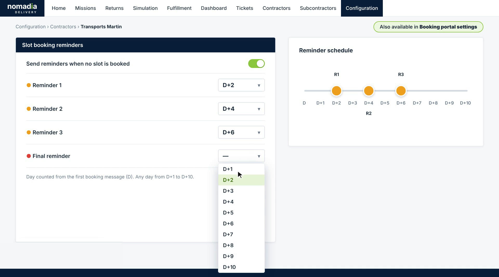
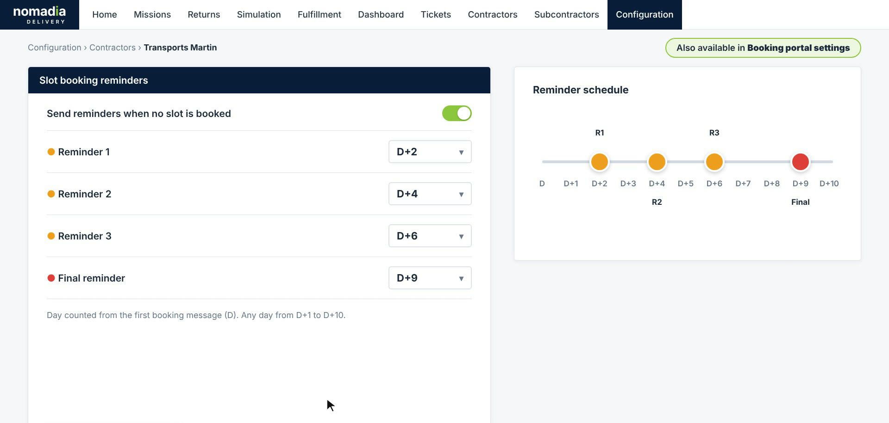
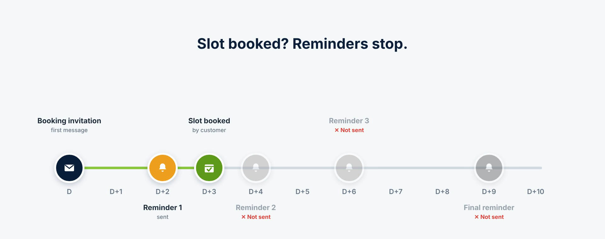
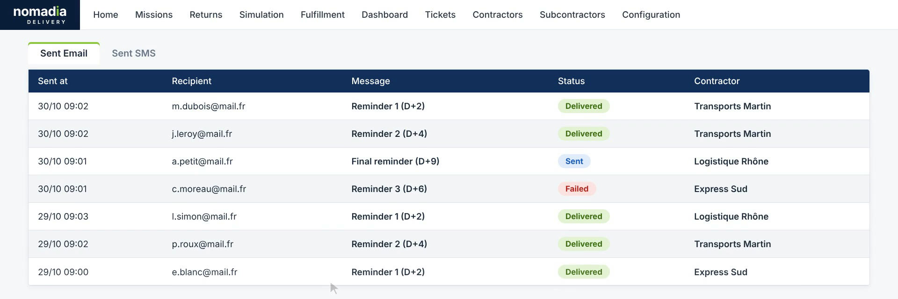
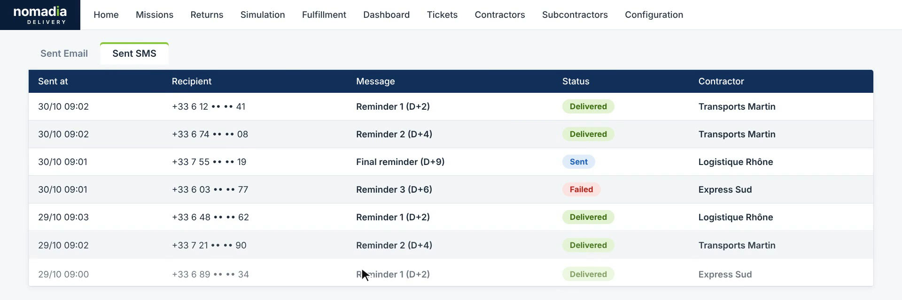

# Automated Slot Booking Reminders

Slot booking reminders follow up automatically with customers who have not booked a delivery slot yet. After the first booking message, Nomadia Delivery sends up to four reminders by email and SMS on the days you choose, with dedicated message templates. As soon as the customer books a slot, the remaining reminders stop. You get fewer unbooked slots without any manual follow-up.

## Before you begin

* Sign in to **Nomadia Delivery** with a user profile that has access to **Configuration**.
* Make sure the booking portal is set up for the contractor. See [Configure the Portal](booking-slots/configure-the-portal.md).

## Feature overview

* **Send reminders when no slot is booked**: The option, in the contractor's **Slot booking reminders** section, that turns the reminders on. The same settings are also available in the **Booking portal settings**.
* **Reminder days**: Up to four reminders: **Reminder 1**, **Reminder 2**, **Reminder 3** and **Final reminder**. Each one is sent on a day counted from the first booking message (**D**), any day from **D+1** to **D+10**.
* **Reminder schedule**: A timeline next to the settings that shows when each reminder is sent.
* **Slot booking reminder templates**: A dedicated email and SMS template for each reminder, under **Configuration** > **Customer experience** > **Message templates**.
* **Keywords**: Placeholders you insert in a template. Besides **Customer name** and **Booking link**, two new keywords are available: **Days since first message** and **Reminder number**.
* **Auto-stop on booking**: When the customer books a slot, the reminders that are still scheduled are not sent.
* **Full history**: Every reminder sent appears in the **Sent Email** and **Sent SMS** history, with its status and contractor.

## Set the reminder days

1. Go to **Configuration** > **Contractors**, and then open the contractor, for example **Transports Martin**.
2. In the **Slot booking reminders** section, turn on **Send reminders when no slot is booked**.

3. For each reminder you want to send, choose a day from **D+1** to **D+10** in the list next to it. Leave a reminder on **—** if you don't want to send it.

4. Check the **Reminder schedule**. Each reminder appears on the timeline on the day you chose.

### Result

The reminders are scheduled for the contractor's missions. For example, with **Reminder 1** on **D+2**, **Reminder 2** on **D+4**, **Reminder 3** on **D+6** and the **Final reminder** on **D+9**, a customer who never books a slot receives four reminders over nine days.

## Customize the reminder messages

1. Go to **Configuration** > **Customer experience** > **Message templates**.
2. In **Slot booking reminder templates**, select the tab of the reminder you want to edit, for example **Reminder 2**.
3. Select **Email** or **SMS**.
4. Write the message. To insert a value, click a keyword under **Keywords**: **Customer name**, **Booking link**, **Days since first message** or **Reminder number**.
5. Check the preview next to the template. It shows the message as the customer will receive it.

### Result

Each reminder uses its own template. For example, the message "Hello **Customer name**, it has been **Days since first message** days since your delivery was planned. Reminder **Reminder number**: book your slot here **Booking link**" is received as "Hello Marie Dubois, it has been 4 days since your delivery was planned. Reminder 2: book your slot here", followed by the booking link.

## How reminders stop once a slot is booked

You don't need to do anything. When the customer books a slot, the reminders that have not been sent yet are cancelled. In the example below, the customer booked on **D+3** after **Reminder 1**, so **Reminder 2**, **Reminder 3** and the **Final reminder** are not sent.

## Check the reminders that were sent

1. Open the history of sent messages, and then select the **Sent Email** tab. Each reminder is listed with the date it was sent, the recipient, the reminder and its day, the status (**Delivered**, **Sent** or **Failed**) and the contractor.

2. Select the **Sent SMS** tab to see the reminders sent by SMS.

## Tips


**Space out the reminders**: Leave at least one day between two reminders, and keep the **Final reminder** for the last days before the delivery, so customers are nudged without being flooded with messages.



**Use the new keywords**: **Days since first message** and **Reminder number** make each reminder clearly different from the previous one, which helps customers understand that action is still needed.


## Related topics

* [Booking Portal](README.md)
* [Configure the Portal](booking-slots/configure-the-portal.md)
* [Register a Contractor](../9-7-contractors/registration.md)
