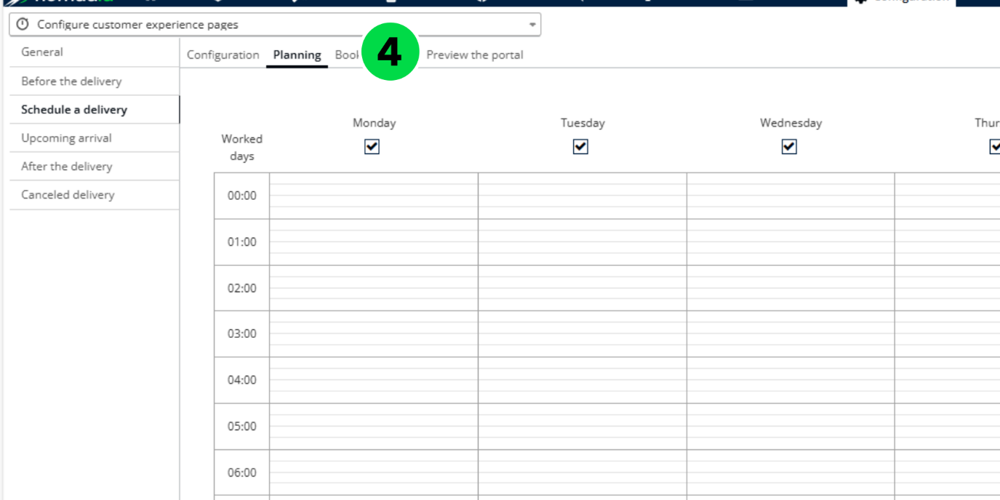

# Configure the Portal

The appointment booking portal in Nomadia Delivery enables you to schedule optimized slots for missions, ensuring alignment with the deliverers’ existing tour plans. Use this guide to improve scheduling efficiency.

## Feature overview

* **Planning tab**: Defines the time slots that are available for booking in the appointment portal.
* **Appointment Booking button**: Shows the available slot proposals when you edit a mission.
* **Star rating**: Categorizes proposed slots by distance from the existing tour plans in the back office.
  * **1-star**: The proposed slot is more than 30 minutes away from the existing tour plans in the back office.
  * **2-star**: The proposed slot is between 10 and 30 minutes away from the existing tour plans in the back office.
  * **3-star**: The proposed slot is less than 10 minutes away from the existing tour plans in the back office.

## Configure the appointment booking portal

1. Open the Nomadia Delivery application and go to the **Configuration** tab.

.png>)

2. From the drop-down menu, select **Configure customer experience pages.**

.png>)

3. Click the **Schedule a delivery option.**

.png>)

4. Open the Planning tab. This tab allows you to define the time slots that will be available for booking in the appointment portal.

5. Click within the grey area to set the availability of your deliverers.

.png>)

6. Choose the preferred days and times according to your delivery preferences, then save the planning.

You can either apply the same slots across all days of the week or configure different slots for each day. Once the setup is complete, the planning view displays the preferred slots, as shown in the example screenshot.

.png>)

7. Click **Save** to confirm the planning.

.png>)

## Update or delete an existing plan

1. Click the **blue area** to open the planning you want to modify.

.png>)

2. Adjust the date and time as needed.
3. Click **Update** to save the changes, or click **Delete** to remove the plan.

## Reserve a slot through the appointment booking portal

1. Launch the Nomadia Delivery application and go to the **Missions** tab.
2. Select any existing mission by clicking the **pencil** icon to edit it.

.png>)

3. Click the **Appointment Booking** button to view the available slot proposals.

.png>)

The **Appointment Booking** feature is available only for standard pickup or delivery missions. It is disabled for the following mission types:

* **Cross-docking**
* **Chained pickup & delivery**

For these missions, a tooltip message, as shown in the screenshot below, appears.

.png>)

The real-time optimization engine suggests slots by considering vehicle and user availability, as well as mission schedules, based on the pre-defined slots configured during setup.

.png>)

The proposed slots are categorized based on the star rating.

.png>)

4. Choose any of the proposed slots and click the **Choose** button to either create a new tour plan for the selected slot (if no existing tour is scheduled in the back office at that date and time) or add the mission to an existing tour plan.

.png>)

5. Check the notification that appears in the back office once the slot is successfully booked.

.png>)

6. Return to the **Missions** tab to confirm that the tour has been created or updated for the selected date and time.

.png>)

## Tips


**Slot definitions**: The delivery slots defined in the Planning tab are the ones proposed by the real-time optimization engine. Configure them carefully to avoid unwanted slot suggestions during breaks (e.g., lunch, briefing, or debriefing times).



**Slot proposal factors**: Slot proposals are influenced by multiple factors, such as user availability, vehicle availability, and mission opening times. Make sure your slot definitions take these factors into account.


## Related topics

* [Booking Portal](../README.md)
* [Booking slots](README.md)
* [Reschedule Configuration](../allow-customers-to-reschedule.md)
