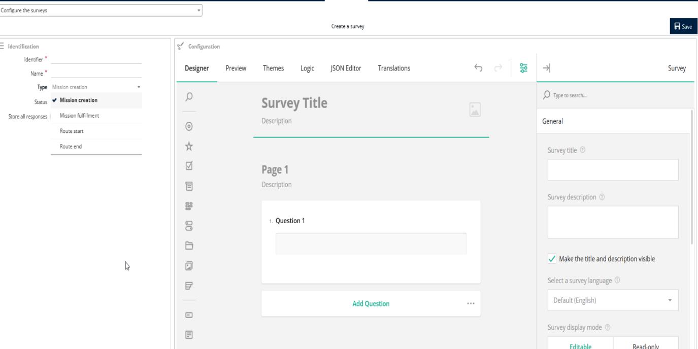
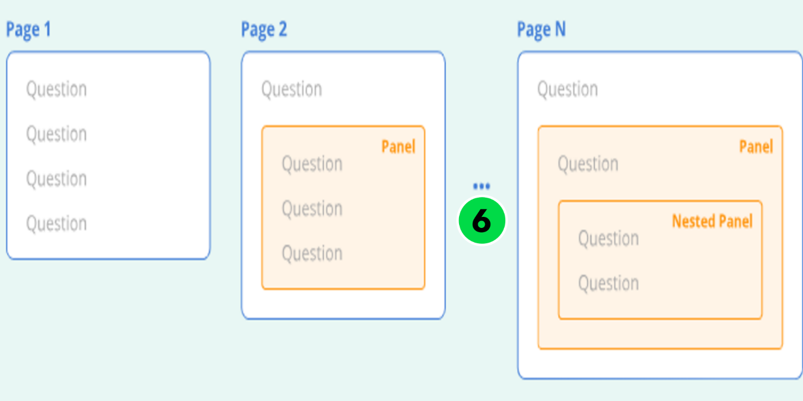
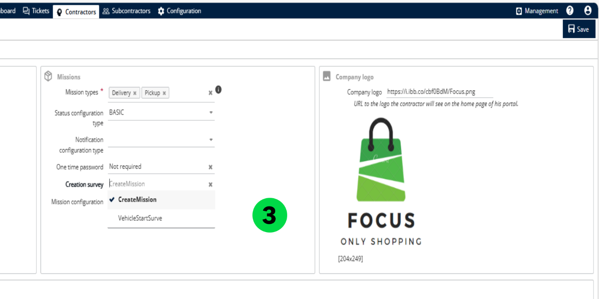
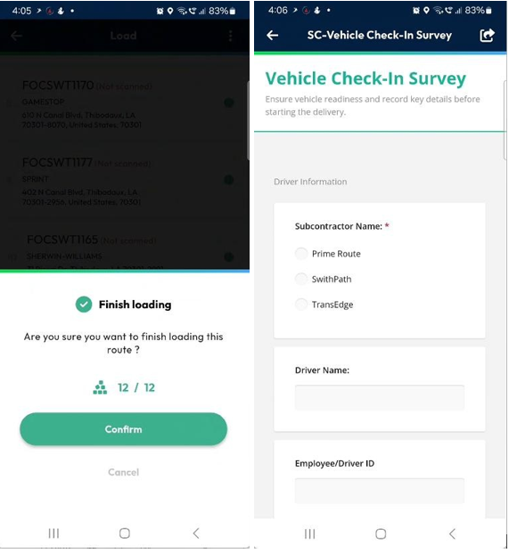
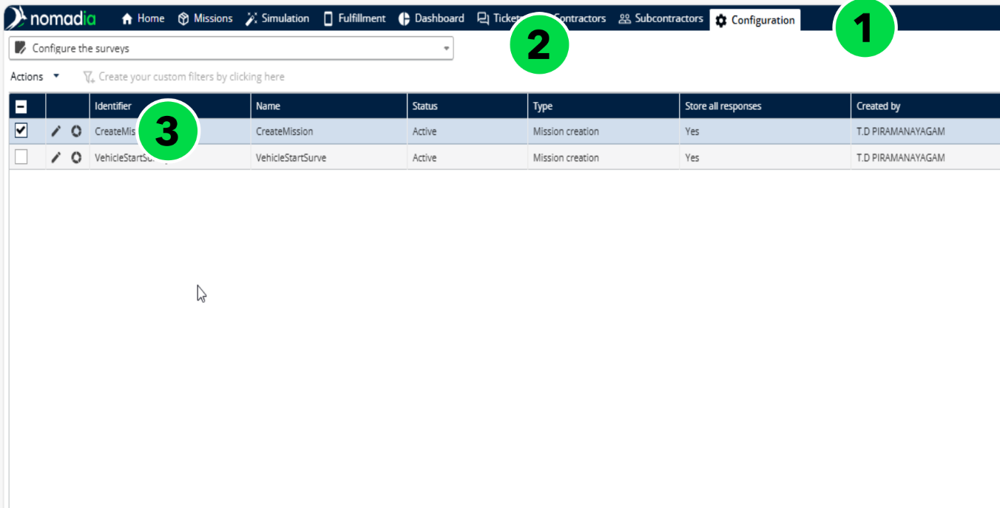
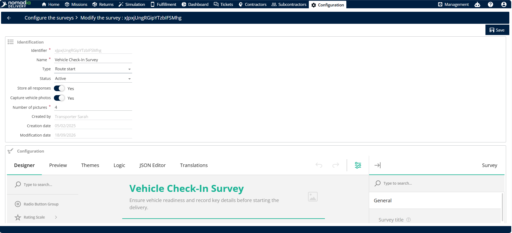

# Configuring Customized Surveys

As a transporter, you can use customized surveys to gather valuable feedback from deliverers and contractors at different stages of their operations. Surveys centralize all data on a single platform, which removes the complexity of managing scattered information and supports data-driven decisions.

## Steps

Follow these steps to set up customizable surveys in Nomadia Delivery:

1. Open the **Configuration** page.
2. From the drop-down, select **Configure the surveys**.
3. Click the **Actions** button and choose **Create** to set up a new survey.

Survey Creator / Form Builder is a visual design tool that allows you to create surveys and forms. Surveys can be conducted for four specific use cases:

* Mission Creation – Filled by the contractor before creating a mission in Nomadia Delivery (only for manual creation via the wizard). This helps to capture all necessary details upfront for successful deliveries.
* Route Start – Filled by the deliverer before leaving the agency for delivery/pickup. Collects vehicle condition data to ensure readiness before beginning the route.
* Mission Fulfillment – Filled by the deliverer during delivery or pickup. Tracks delivery milestones and monitors progress in real time.
* Route End – Filled by the deliverer after returning to the agency at the end of the day. Provides insights into vehicle condition post-route, useful for maintenance and operational planning.

4. Enter the Identifier and Name of the survey, select the survey type from the drop-down, set the Status to Active, and enable the Store all responses toggle to save survey results.

5. Surveys can contain one or more pages. Each page may include panels and questions. Panels group questions together and can also contain nested panels for structured organization.

6. For detailed guidance on creating a survey, refer to the documentation: [Create a simple survey](https://surveyjs.io/form-library/documentation/design-survey/create-a-simple-survey)
7. Once the survey is complete, click Save to create it.

8. The **Configure the surveys** page displays all surveys created in the system.

## Additional survey configurations

### Assign a survey to contractors

1. Open the Contractors tab in Nomadia Delivery.
2. Edit a contractor by clicking the Pencil icon.

3. In the Mission section, assign a survey for mission creation specific to that contractor, then click Save.

4. When logged in as a contractor, creating a mission via the wizard will prompt the mission creation survey, which must be completed before proceeding.

### Assign surveys to subcontractors

1. Open the Contractors tab.
2. Edit a subcontractor by clicking the Pencil icon.

3. In the Mission section, assign surveys for route start and route end specific to that subcontractor, then click Save.

<figure><figcaption></figcaption></figure>

4. When logged in as a subcontractor deliverer, completing the loading process will trigger the route start survey, which must be filled before starting the missions.

<figure><figcaption></figcaption></figure>

### Assign a survey to a sub-status

1. Open the **Configuration** page.
2. Select Sub status from the drop-down.
3. Edit a sub-status by clicking the Pencil icon.

4. Assign the appropriate Fulfillment survey from the drop-down and click Save.

5. When logged in as a transporter or subcontractor deliverer, attempting to fulfill a delivery/pickup will prompt the survey, which must be completed before proceeding.

## Analyzing survey responses

1. Open the **Configuration** page.
2. Select **Configure the surveys** from the drop-down.
3. Click the Circle icon next to the survey you wish to analyze.

4. Choose the analysis period and click Apply.
5. Click Load to view results for the selected timeframe.

6. Review and analyze survey responses in real time.

## Configure vehicle photos

1. Open the **Configuration** page and select **Configure the surveys**.
2. Click the **pencil icon** to modify the required survey.
3. Enable the **Capture vehicle photos** option.
4. Specify the **number of photos** to be displayed.

<figure><figcaption></figcaption></figure>

### Result

The configured photo fields are displayed on the **Survey** page of the route.

## Related topics

* [Route Editor](../routeeditor.md)
* [Manage Substatus](../manage-substatus/README.md)
* [Vehicle Condition Photos](vehicle-condition-photos.md)
