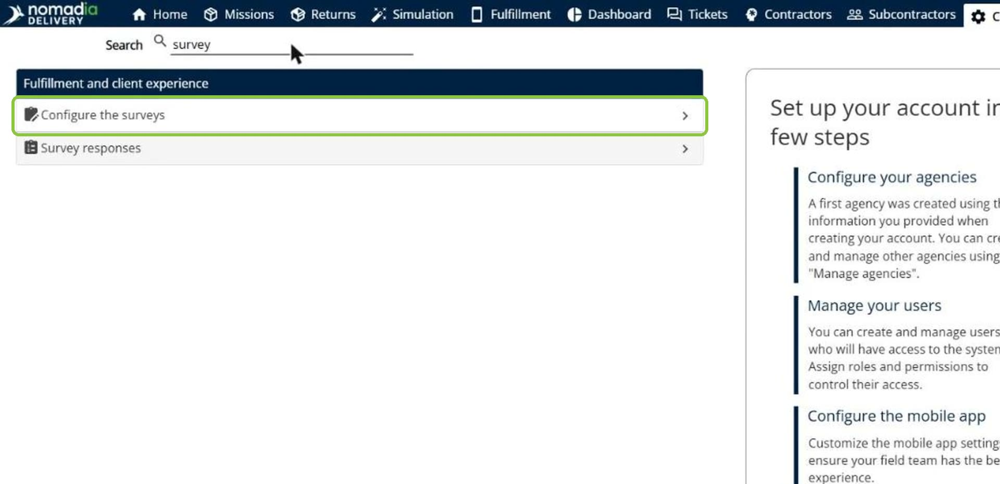
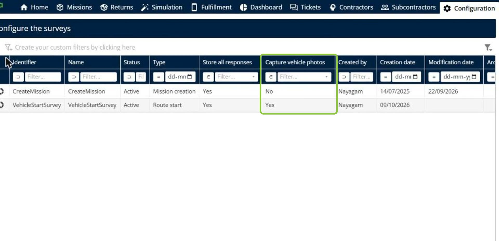
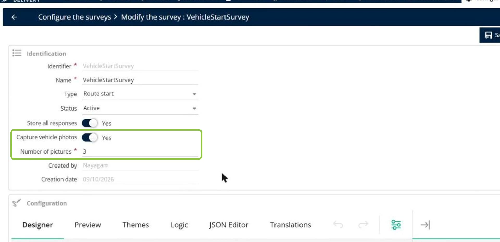
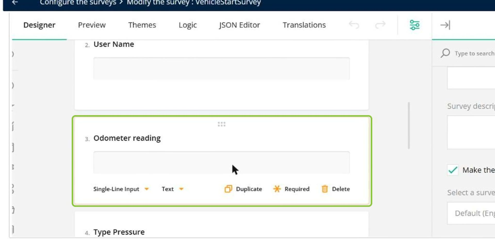
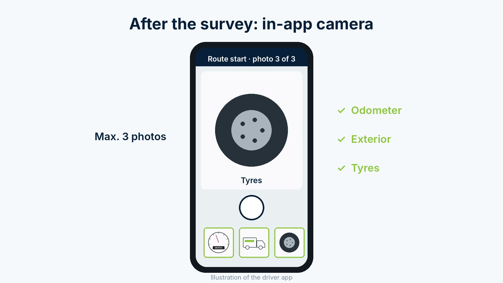
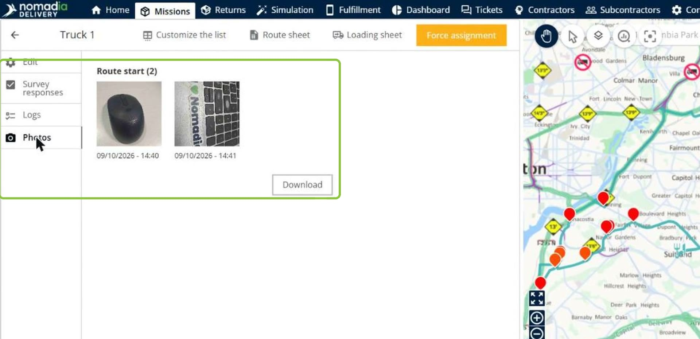
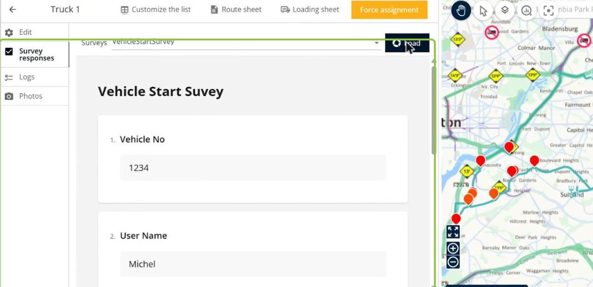

# Vehicle Condition Photos

Vehicle condition photos let drivers take photos of their vehicle at the start and end of the route with the in-app camera, right after the vehicle survey. The photos are saved to the route, so dispatchers can check the vehicle condition at a glance in the route's **Photos** tab, with no paper records or photos on personal phones.

## Before you begin

* Sign in to **Nomadia Delivery** with a user profile that has access to the **Configuration** page.
* Make sure a route start or route end survey exists. See [Configuring Customized Surveys](README.md).

## Feature overview

* **Configure the surveys**: The page under **Configuration** that lists your surveys. The **Capture vehicle photos** column shows which surveys ask for vehicle photos.
* **Capture vehicle photos**: The survey option that asks drivers to take vehicle photos after the survey.
* **Number of pictures**: The maximum number of photos the driver takes, for example **3**.
* **In-app camera**: The camera of the mobile app that opens after the survey, for example for the odometer, the exterior and the tyres.
* **Photos tab**: The tab of the route where the vehicle photos are saved, with their date and time.
* **Survey responses tab**: The tab of the route where the answers to the survey are saved.

## Enable vehicle photos in a survey

1. Go to **Configuration**, search for **survey**, and then click **Configure the surveys**.

2. In the list of surveys, check the **Capture vehicle photos** column, and then click the **pencil icon** next to the route start or route end survey.

3. Turn on **Capture vehicle photos**, and then enter the **Number of pictures**.

4. Under **Configuration**, design the survey questions that the driver answers before taking the photos, for example **Odometer reading**.

5. Save the survey.

### Result

At the start or end of the route, after the survey, the mobile app opens the in-app camera. The driver takes up to the configured number of photos, for example of the odometer, the exterior and the tyres.

## View the vehicle photos of a route

1. On the **Missions** page, open the route, for example **Truck 1**.
2. Click the **Photos** tab. The photos are grouped by survey, for example **Route start**, with their date and time.

3. To save the photos, click **Download**.
4. To see the driver's answers, click the **Survey responses** tab, choose the survey, and then click **Load**.

## Tips


**Keep the number of pictures short**: Choose only the photos you need, such as the odometer, the exterior and the tyres, so that drivers can start their route quickly.



**Survey already in use**: If the survey is used in an agency configuration, a message asks you to confirm before you edit it. Do not change the names or types of the questions, or the existing results may no longer be usable. Changes to labels or visuals have no impact.


## Related topics

* [Configuring Customized Surveys](README.md)
* [Route Editor](../routeeditor.md)
