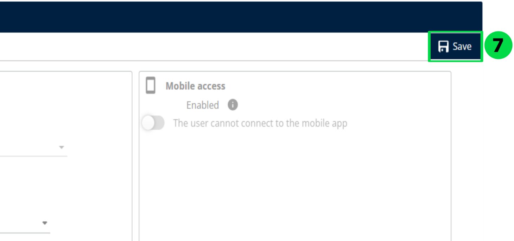

# Creating a User from an Existing User

Create a user from an existing user in Manage Users to start from the existing user's settings.

## Create a user from an existing user

1. In **Manage Users**, click the **Actions** drop-down and select **Add**.
2. Set **Create from existing user** to **Yes**.
3. Select the existing user from the list.
4. Choose **Yes** or **No** for **Import User's Preferences**, as required.
5. Click **Ok**.

6. Modify the user details if necessary.

7. Click **Save** to complete the process.

## Related topics

* [Manage Users](README.md)
* [Creating User from a Scratch](creating-user-from-a-scratch.md)
* [Enabling Web Access](enabling-web-access.md)
* [Enabling Mobile Access](enabling-mobile-access.md)
