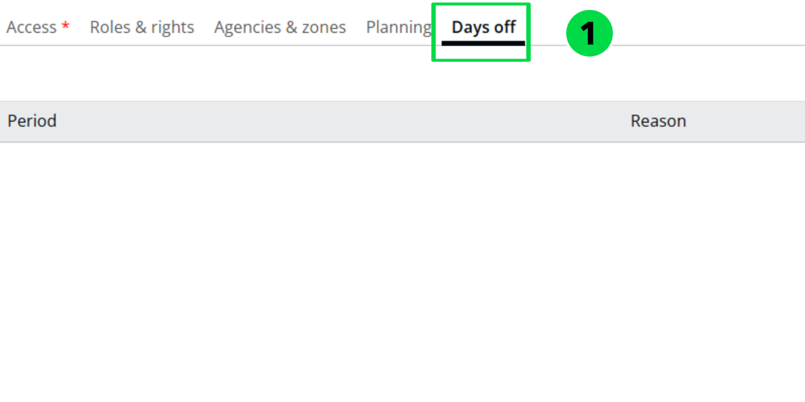
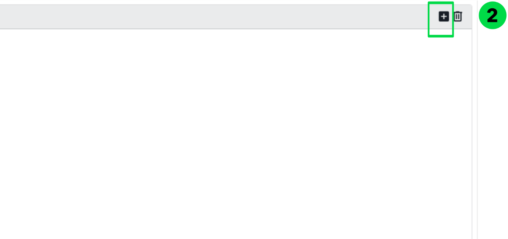
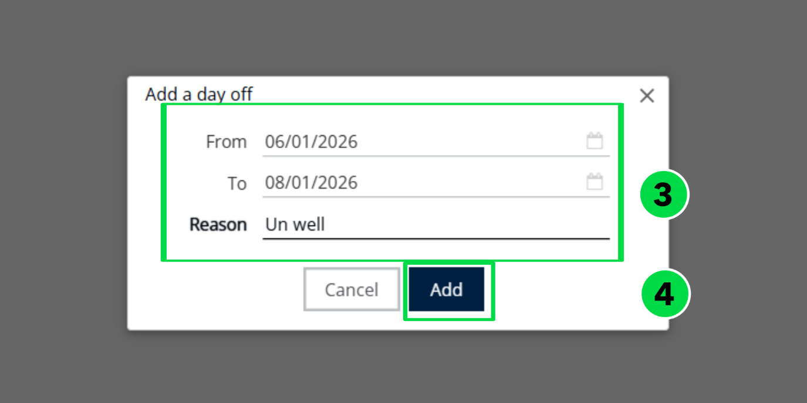

# Days off

If a user has planned leave or vacation, the Days Off section can be used to record the unavailable dates.

## Before you begin

* Sign in to **Nomadia Delivery** with a user profile that has access to **Manage Users**.
* Know the dates of the planned leave or vacation and the reason for it.

## Feature overview

* **Days Off**: Section where you record the dates on which a user is unavailable.
* **+ (Add)**: Icon that opens the entry for a new period of unavailability.
* **From Date** and **To Date**: Fields that define the unavailable dates.
* **Reason**: Field that specifies why the user is unavailable.

## Record days off

1. Navigate to **Days Off**.

2. Click the **+ (Add)** icon.

3. Enter the **From Date**, **To Date**, and specify the **Reason**.
4. Click **Add**.

5. Click **Save** to update the details.

## Tips


**Record planned leave**: If a user has planned leave or vacation, record the unavailable dates in the **Days Off** section.



**Save your changes**: After you click **Add**, click **Save** to update the details.


## Related topics

* [Manage Users](README.md)
* [Manage User Profile](6-manage-user-profile.md)
