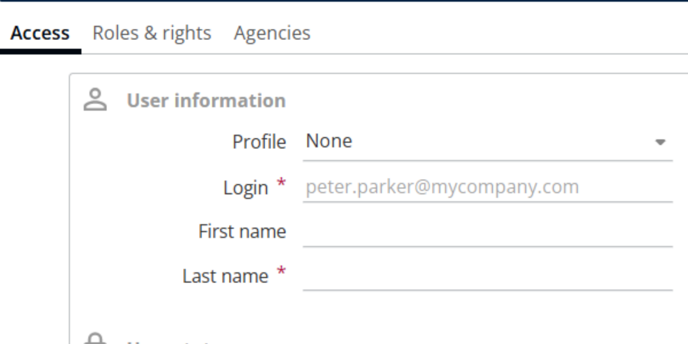
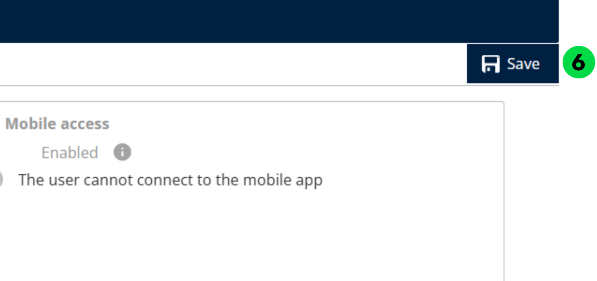
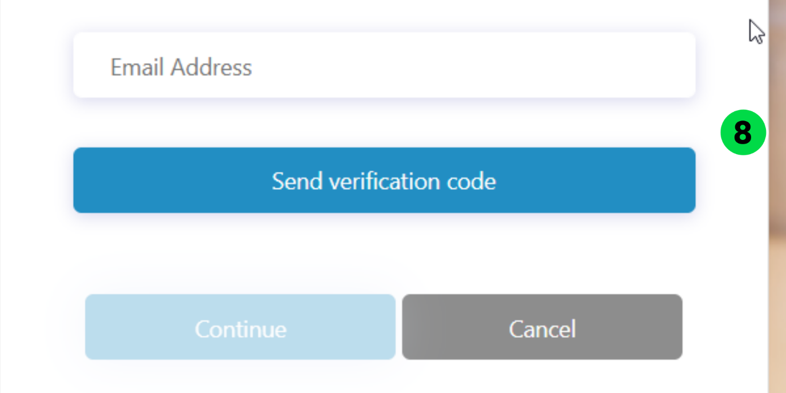
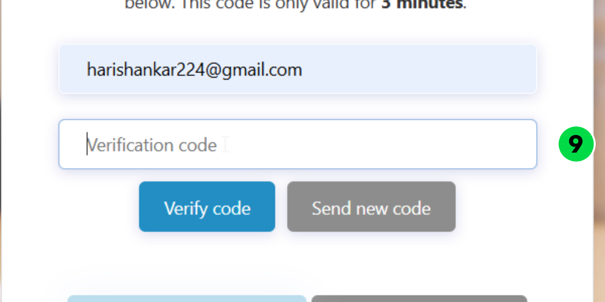
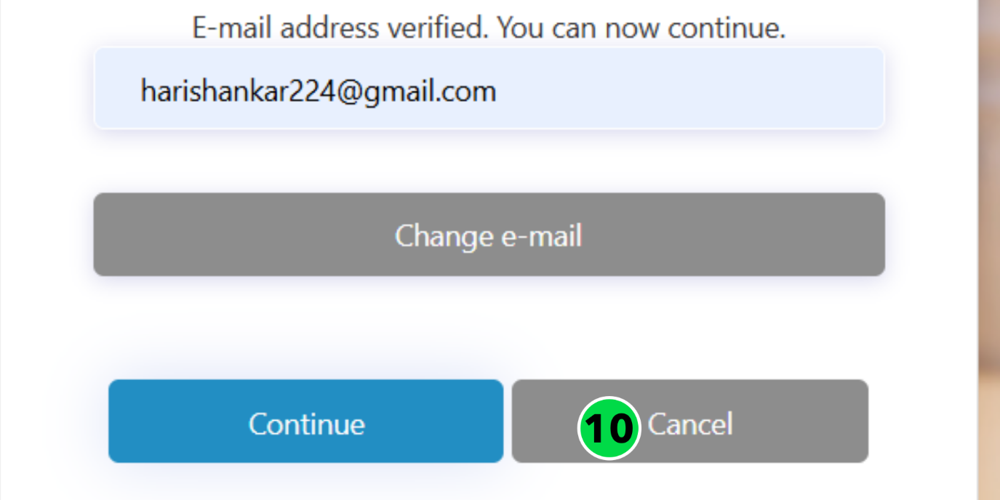
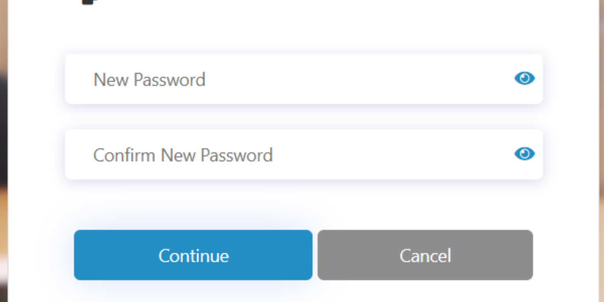

# Enabling Web Access

Enable web access when you create a user so that the user can sign in to the web application. The user receives a notification email and sets a password.

## Before you begin

* Decide which **Profile Name** applies to the user: **Planner (Standard)**, **Contractor**, or **Subcontractor**.

## Feature overview

* **Planner (Standard)**: Access can be granted to a **Transporter**.
* **Contractor**: Access can be granted to a **Contractor**.
* **Subcontractor**: Access can be granted to a **Subcontractor**.

## Enable web access for a user

1. Navigate to **Configuration**.
2. Select **Manage Users** from the list.
3. Click the **Actions** drop-down and select **Add**.
4. Set **Create from existing user** to **No**, then click **OK**.
5. Select the appropriate **Profile Name**: **Planner (Standard)**, **Contractor**, or **Subcontractor**.
6. Enter the following details:
   * **Login ID**
   * **First Name**
   * **Last Name**

7. Set the **User Status** to **Yes** or **No**, as required.
8. Enable or disable **Web Access** as required and select the **Subcontractor Name**, if applicable.

9. Click **Save**. A notification email is sent to the user.

## Set the password

1. Open the email and click the provided link to set the password.

2. Enter your **email address** and click **Send verification code**.

3. Enter the received verification code and click **Verify code**.

4. Click **Continue**.

5. Enter the **new password** and confirm it. For more information about the password policy, refer to [Password policy for Web Access](web-roles-and-rights.md#password-policy-for-web-access).
6. Click **Continue**.

### Result

The password has been changed successfully.

## Tips


**Login ID format**: For **Web Users**, the **Login ID** must be in a valid email format (for example, user@example.com).



**Inherited roles and rights**: When a profile is selected, all roles and access rights are inherited automatically. Roles and rights cannot be enabled or disabled manually at the user level. To change any roles or access rights, modifications must be made in the **profile configuration**.


## Related topics

* [Manage Users](README.md)
* [Web - Roles and Rights](web-roles-and-rights.md)
* [Enabling Mobile Access](enabling-mobile-access.md)
* [Creating a User from an Existing User](creating-a-user-from-an-existing-user.md)
* [Creating User from a Scratch](creating-user-from-a-scratch.md)
