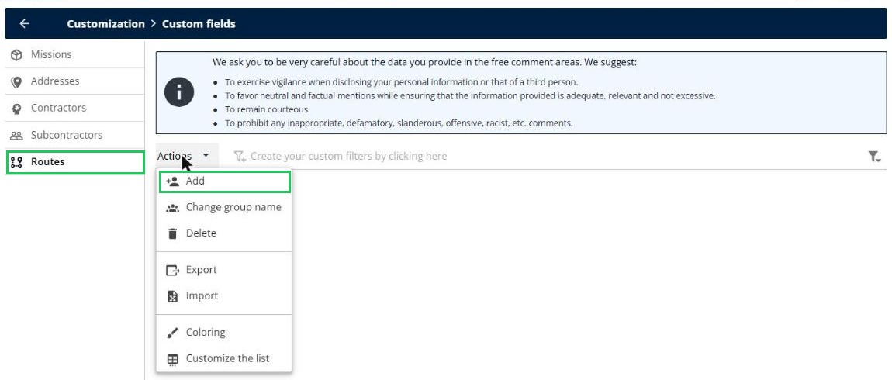
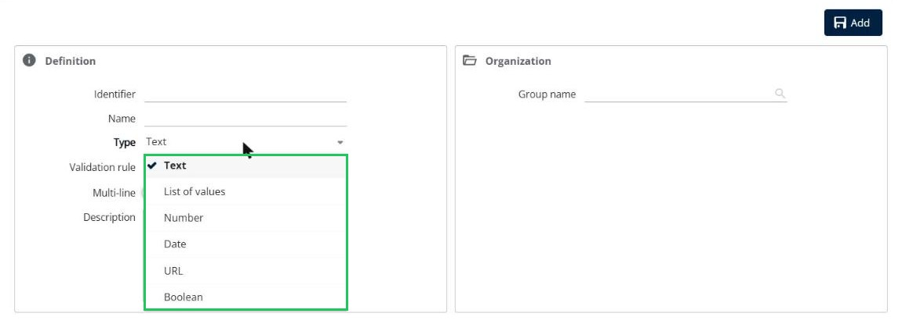
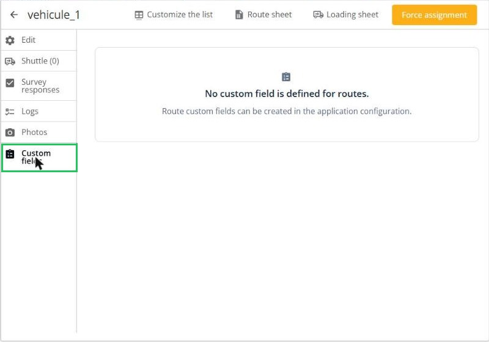

# Route Custom Fields

**Route custom fields** let administrators decide which route-level data to collect, such as the license plate or the odometer readings. Deliverers fill in the fields in the mobile app, and planners see the values in the back office screens, in documents and in integrations. Details that used to live on paper, or in workarounds that were hard to search and easy to lose, are now captured digitally on the route.

## Before you begin

* Sign in to **Nomadia Delivery** with a user profile that has access to the **Configuration** tab.
* Know which route data you want deliverers to enter, for example the license plate, the start odometer or the fuel level.

## Feature overview

* **Routes tab**: The **Custom fields** configuration page has a dedicated **Routes** tab. You add, rename the group of, delete, export and import route fields with the same **Actions** as for missions and contractors.
* **Field types**: **Text**, **List of values**, **Number**, **Date**, **URL** and **Boolean**.
* **Group name**: Each field can belong to a group, for example **Route start** or **Route end**, so that related fields are shown together.
* **Mobile surveys**: Deliverers fill in route fields in the route start and route end surveys of the mobile app, including the license plate of the route. The answers are stored on the route automatically.
* **Custom fields tab of the route editor**: Shows every value that the deliverer entered, grouped by group name. Planners can still edit the values after the route has started.
* **License plate**: Shown as read-only in the **Edit** tab of the route editor, and shown as a default column in the route table.
* **Route table columns**: Every route custom field is available as an optional column of the route table, with the same sorting, filtering and number coloring conditions as the other columns.
* **API, webhooks and documents**: Route custom fields can be read and written through the public API, are included in the route webhook payloads, and can be used as template variables in route sheets and eCMR documents.

## Create a route custom field

1. Go to the **Configuration** tab. Under **Customization**, click **Custom fields**.
2. Click the **Routes** tab, and then click **Actions** > **Add**.

3. Enter an **Identifier** and a **Name**, for example **License plate**.
4. Select the **Type** of the field.

5. If needed, enter a **Group name**, for example **Route start**.
6. Click **Add**.

### Result

The field appears in the **Routes** tab. Deliverers can fill it in from the route surveys of the mobile app.

## View and edit route custom fields

1. On the **Missions** page, click the **Pencil** icon of a route to open the route editor.
2. Click the **Custom fields** tab.

3. Check the values entered by the deliverer, and edit them if needed.

### Result

The values are saved on the route. They appear in the route table columns, in the route sheets and eCMR documents that use them, and in the API and webhooks.


If no route custom field is defined, the tab shows **No custom field is defined for routes**. Create the fields first in the **Routes** tab of the **Custom fields** page.


## Tips


**Group by moment**: Use group names such as **Route start** and **Route end**, so that deliverers and planners find the fields in the order of the day.



**Use typed fields**: Choose **Number** for odometer readings and **List of values** for levels such as the fuel level, so that you can sort, filter and color the route table on these fields.



**Deleting a field removes its data**: Before you delete a route custom field, check that it isn't used in a route sheet, an eCMR template or an integration.


## Related topics

* [Custom Fields](../8-6-missions/custom-fields.md)
* [Route Editor](../routeeditor.md)
* [Table view](../tableview.md)
* [Configuring Customized Surveys](../15-13-configuring-customized-surveys/README.md)
* [Accessing eCMR](../manage-document-templates/accessing-ecmr.md)
