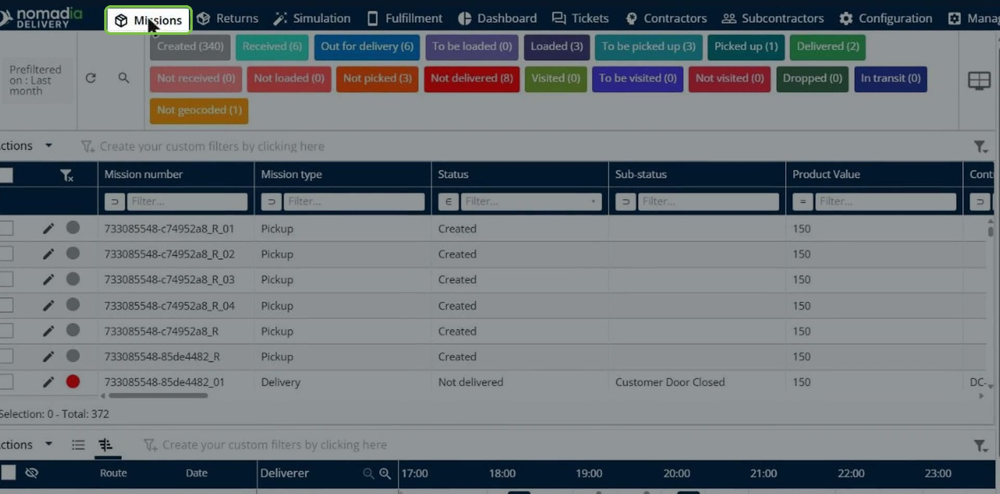
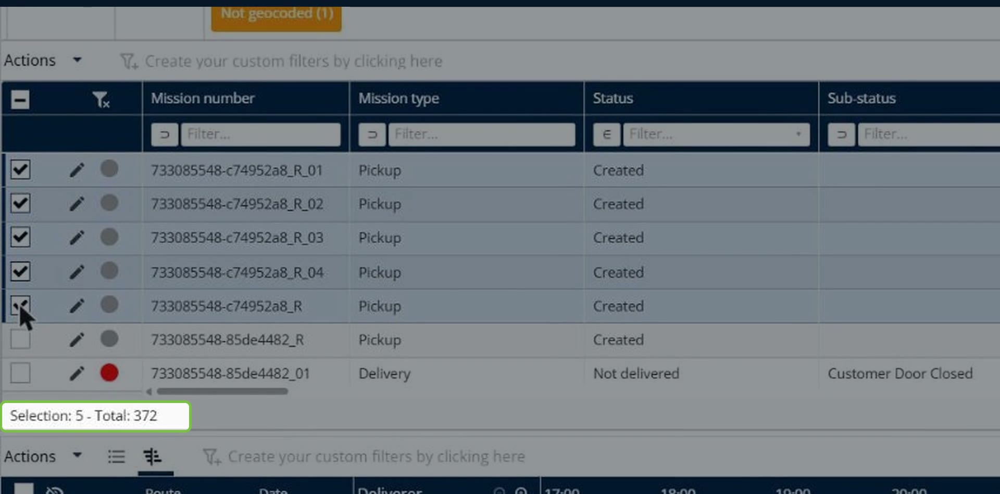
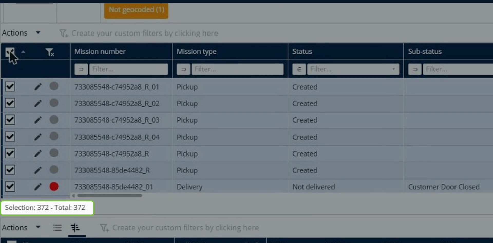
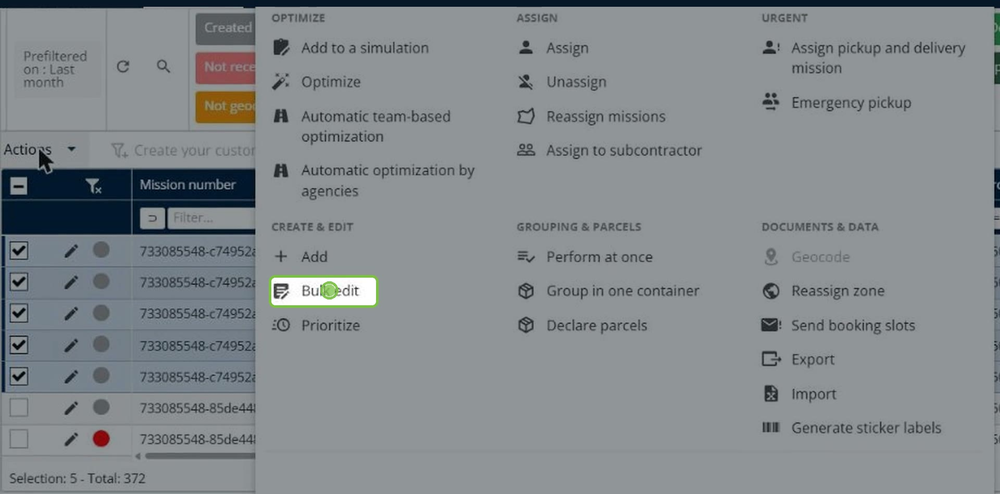
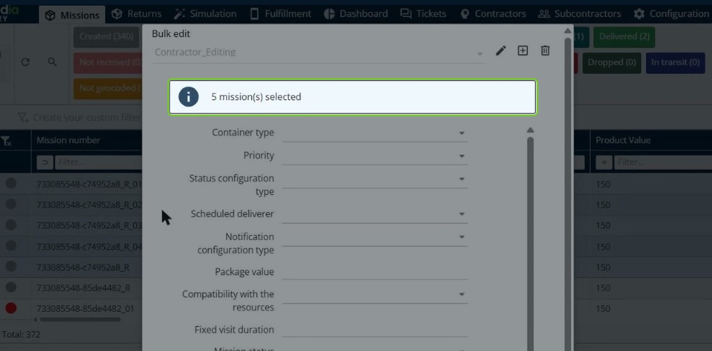
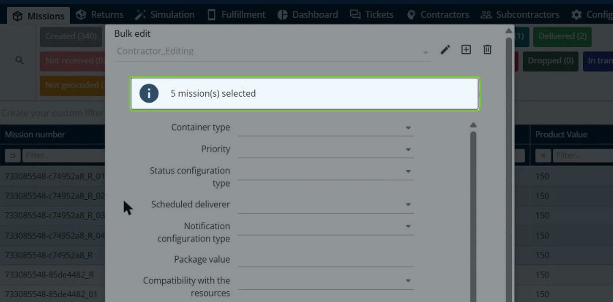
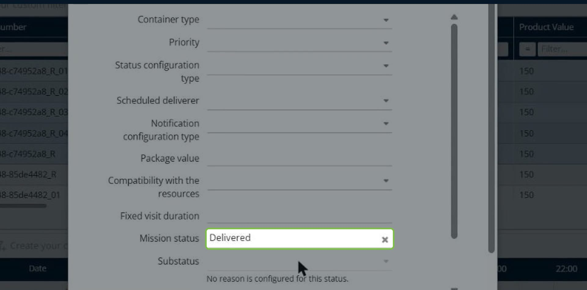
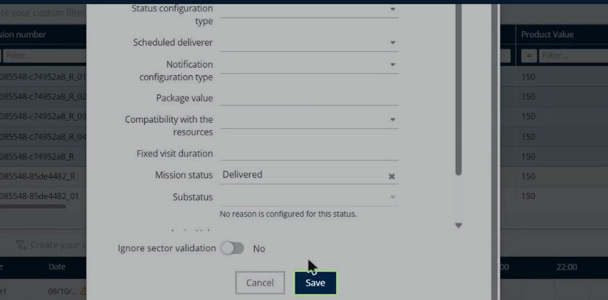
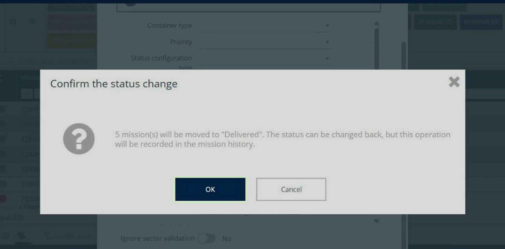
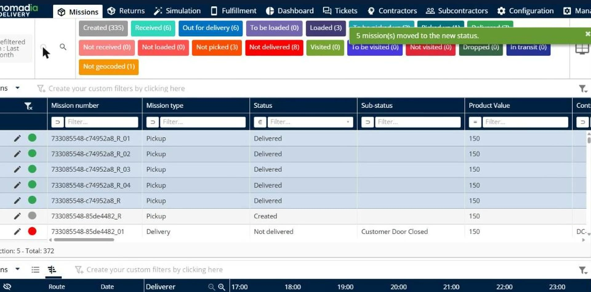

# Bulk Update Mission Status

Bulk update mission status lets you change the status of several missions in a single action instead of updating each mission one by one. It is useful for grouped deliveries, error corrections, and incident handling.

## Before you begin

* Sign in to **Nomadia Delivery** with a user profile that has the **Modify missions** permission. If you do not see **Bulk edit** in the **Actions** menu, contact your administrator.
* Make sure the missions you want to update exist in the mission table.
* Decide which status you want to apply to the missions.

## Feature overview

* **Missions page**: The page in the main header where you select the missions to update.
* **Select all check box**: The check box in the table header that selects all the missions in the table.
* **Selection counter**: The counter below the table that shows how many missions are selected, for example **Selection: 5 - Total: 372**.
* **Actions menu**: The menu that contains **Bulk edit**, under **Create & Edit**.
* **Bulk edit pop-up**: The pop-up that shows the number of selected missions and the fields you can change.
* **Mission status**: The field where you choose the new status for the selected missions.
* **Substatus**: The optional field where you choose a reason for the new status. It is available only when a substatus is configured for the chosen status.
* **Confirm the status change**: The pop-up that asks you to confirm before the status is applied.

## Update the status of several missions

1. From the main header, click the **Missions** page.

2. Select the check boxes of the missions you want to update. The selection counter below the table shows the number of selected missions.

3. To select every mission in the table, click the check box in the table header instead.

4. Click **Actions**, and then click **Bulk edit**.

The **Bulk edit** pop-up opens and shows the number of missions selected.

5. In the **Mission status** field, open the drop-down list and choose the new status.

6. Optional: In the **Substatus** field, choose a substatus for the new status. If no substatus is configured, the field shows **No reason is configured for this status.**

7. Click **Save**.

8. In the **Confirm the status change** pop-up, read the message and click **OK**. Click **Cancel** to leave the statuses unchanged.

### Result

A notification confirms that the missions were moved to the new status, and the **Status** column of the mission table shows the new status for all the selected missions.

## Tips


**Status changes are recorded**: You can change the status back afterwards, but each change is recorded in the mission history. See [Mission Logs](mission-logs.md).


## Related topics

* [Missions](README.md)
* [Bulk Edit Mission Data](bulk-edit-mission-data.md)
* [Mission Logs](mission-logs.md)
* [Manage Substatus](../manage-substatus/README.md)
