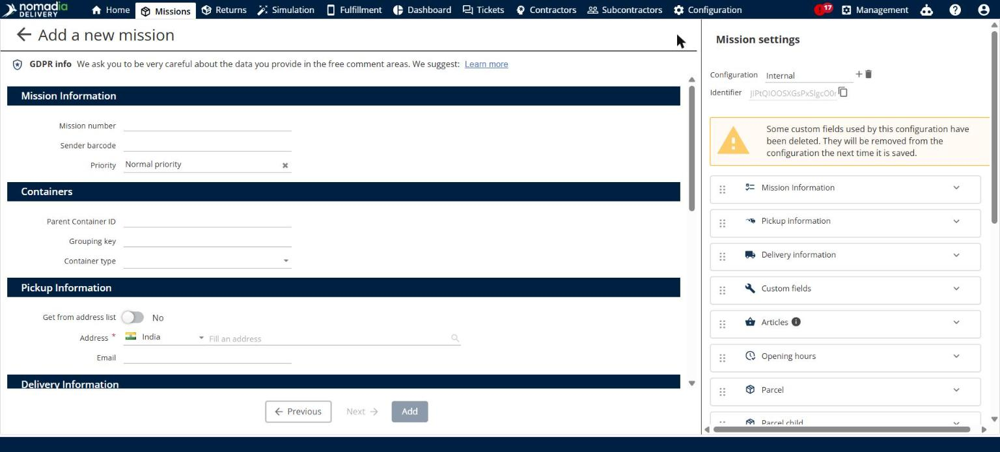
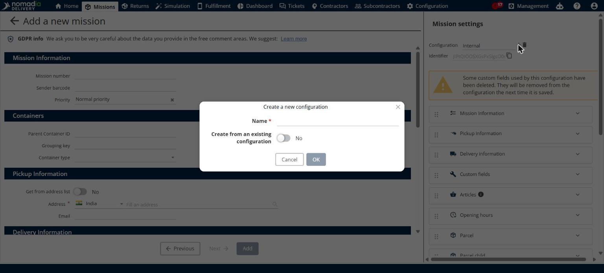
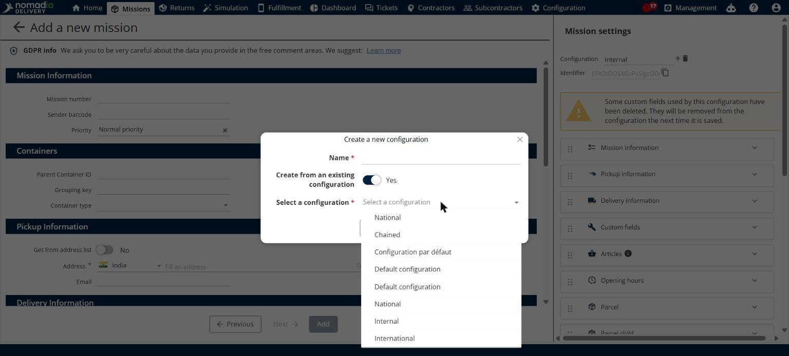
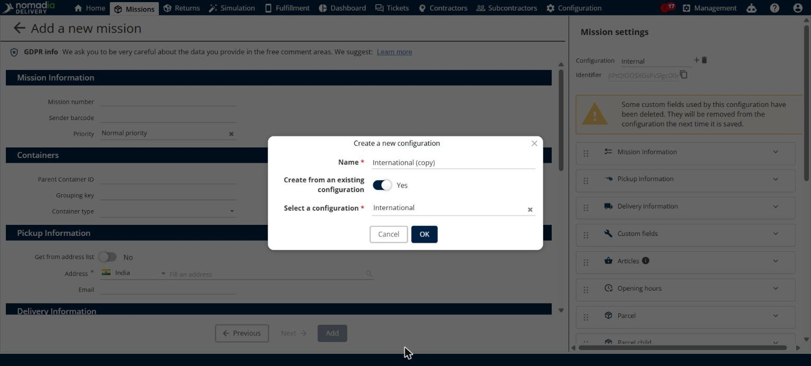

# Clone a Mission Configuration

**Clone a mission configuration** lets you create a new mission creator or mission editor configuration from an existing one. Setting up a new configuration used to mean starting from a blank page and switching more than a hundred fields on or off, one by one. Now you copy a configuration that is close to what you need, and change only what is different.

## Before you begin

* Sign in to **Nomadia Delivery** with a user profile that is allowed to create, modify, and delete the mission creation, edition, and bulk edit configurations.
* Know how mission configurations work. For more information, see [Mission Creation Configuration](mission-creation-configuration.md).

## Feature overview

* **Configuration types**: You can clone the four types of mission configurations: web creation, mobile creation, edition, and bulk edit.
* **Create a new configuration**: When you click **+** next to **Configuration**, a dialog opens with a **Name** field and a **Create from an existing configuration** toggle.
  * **Yes**: The new configuration is a copy of an existing one.
  * **No**: The new configuration starts blank, as before.
* **Select a configuration**: A searchable list shows every configuration of the same type in your account. **OK** stays disabled until you select a source. If no configuration of this type exists, the list shows **No existing configuration of this type is available.**
* **Automatic name**: When you select a source, the **Name** field is filled with the name of the source followed by **(copy)**. You can change the name before you save. Each configuration name must be unique.
* **What is copied**: The new configuration inherits everything from its source: field activation states, sections, ordering, options, mission type, standard fields, custom fields, and display settings.
* **What is not copied**: Assignments stay with the source. The links to user profiles, contractors, and subcontractors are not copied, so the new configuration starts unassigned.
* **Independent copies**: After creation, the copy and the source are fully independent. A change to one never affects the other.

## Clone a mission configuration

1. Go to **Missions**, click **Actions** > **Add**, enter the **Mission type** and the **Agency**, and then click **Next**.
2. Click the **pencil** icon in the top right corner. The **Mission settings** panel opens with the current **Configuration**.

3. Click **+** next to **Configuration**. The **Create a new configuration** dialog opens.

4. Turn on **Create from an existing configuration**.
5. In **Select a configuration**, search for and select the configuration to copy, for example **International**.

6. Check the name that is filled in automatically, for example **International (copy)**, and change it if needed.

7. Click **OK**.
8. Change only the fields, sections, and options that must differ from the source.
9. Click **Save**.

### Result

The new configuration is created with all the settings of its source and the changes you made. It starts unassigned: assign it to the user profiles, contractors, or subcontractors that must use it.

## Create a blank configuration

1. In the **Mission settings** panel, click **+** next to **Configuration**.
2. Enter a **Name**.
3. Leave **Create from an existing configuration** set to **No**.
4. Click **OK**.

### Result

The new configuration starts blank, and you set each field yourself.

## Tips


**Start from the closest configuration**: Choose the source that needs the fewest changes, for example the configuration of the same mission type, so that you only adjust the differences.



**Rename the copy**: Replace **(copy)** with a meaningful name, for example the team or the shift that uses the configuration, so that users can find it easily.



**Assign the new configuration**: Assignments are not copied. Until you link the new configuration to user profiles, contractors, or subcontractors, nobody uses it.


## Related topics

* [Missions](README.md)
* [Mission Creation Configuration](mission-creation-configuration.md)
* [Customize Mission Block Labels](../customizemissionblocklabels.md)
* [Bulk Edit Mission Data](bulk-edit-mission-data.md)
