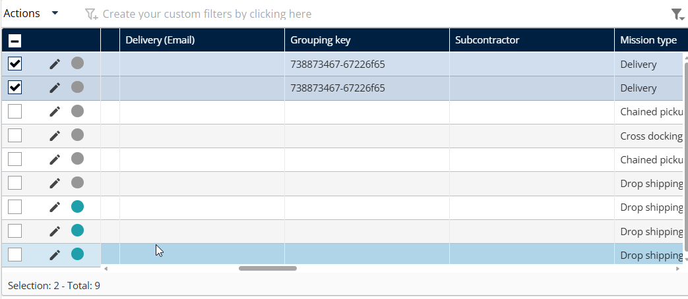

# Create a 'perform at once' mission

'Perform at once' links multiple individual missions destined for the same customer/address. Unlike container grouping, this relies on a "Grouping Key" to tell the mobile app that these items should be fulfilled together, allowing for a single validation step (one signature or one photo) for all linked items.

## Before you begin

* Sign in to **Nomadia Delivery** with a user profile that has access to missions.
* Make sure the individual missions you want to link already exist.
* Confirm that the missions share the exact same delivery address.

## Feature overview

* **Perform at once**: Links multiple individual missions destined for the same customer or address.
* **Grouping Key**: Tells the mobile app that the linked items should be fulfilled together.
* **Actions menu**: The menu where you select **Perform at once** for the selected missions.
* **Single validation step**: One signature or one photo covers all linked items.

## Create a 'perform at once' mission

1. Select multiple missions that share the exact same delivery address.

<figure><figcaption></figcaption></figure>

2. Click the **Actions** menu.
3. Select **Perform at once**.

<figure><figcaption></figcaption></figure>

### Result

The system generates a Grouping Key for the selected missions.

<figure><figcaption></figcaption></figure>

## Related topics

* [Missions](README.md)
* [Create an Urgent Pickup Mission](create-an-urgent-pickup-mission.md)
