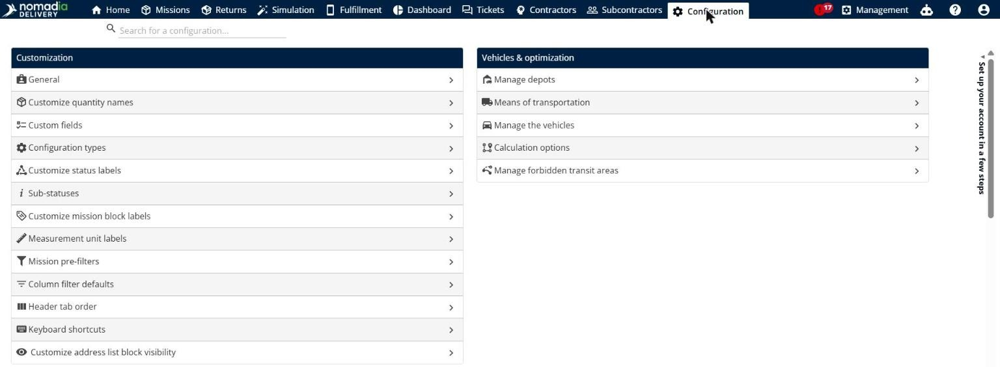
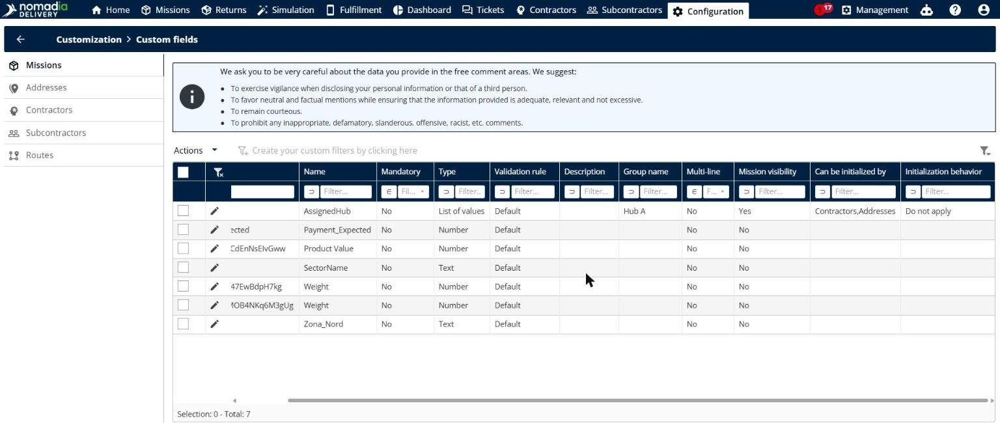
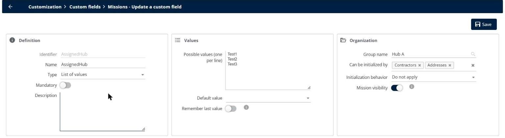
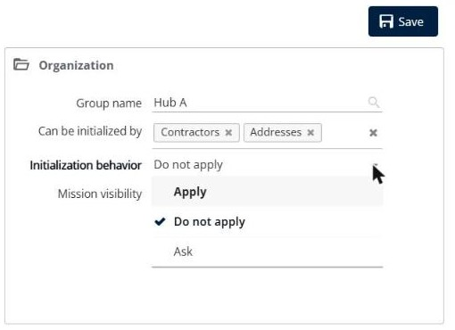

# Custom Field Overwrite Behavior

**Initialization behavior** decides what happens to a mission custom field that already has a value when you select an address or a contractor. Until now, the value from the address or the contractor always replaced the value that you had typed. For example, if you entered an access code first and then picked the address, the access code from the address replaced yours without warning. You now choose, for each custom field, whether to replace the value, keep it, or ask the user first.

## Before you begin

* Sign in to **Nomadia Delivery** with a user profile that has access to the **Configuration** tab.
* Make sure the mission custom field is initialized from a contractor or an address. For more information, see [Inherit mission data from contractor & address list](inherit-mission-data-from-contractor-and-address-list.md).

## Feature overview

* **Initialization behavior**: The setting of a mission custom field that controls what happens when the field already has a value and an address or a contractor is selected. It appears only when **Can be initialized by** has at least one source, such as **Contractors** or **Addresses**.
* **Apply**: The value from the address or the contractor replaces the value of the field, with no prompt. This is the behavior you had before, and the default for every existing and new custom field.
* **Do not apply**: The field keeps its value. Empty fields are still filled in automatically.
* **Ask**: Before anything changes, a single popup lists every field that is about to be replaced. One answer applies to all the listed fields.
* **Empty fields**: An empty field is always filled from the address or the contractor, whatever the behavior.
* **Mission editor**: Selecting a contractor in the mission editor now also initializes the mission custom fields, with the same per-field behavior as the mission creation wizard.

## Set the initialization behavior of a custom field

1. Go to the **Configuration** tab, and then click **Custom fields**.

2. Select the **Missions** tab. The **Initialization behavior** column shows the current behavior of each field.

3. Click the **Pencil** icon of the custom field, for example **AssignedHub**.
4. In the **Organization** section, check that **Can be initialized by** lists at least one source, for example **Contractors** and **Addresses**.

5. In **Initialization behavior**, select **Apply**, **Do not apply**, or **Ask**.

6. Click **Save**.

### Result

The next time a user selects an address or a contractor in a mission, the field follows the behavior that you selected.

## What happens when you select an address or a contractor

Take a mission where the user has already typed an access code and delivery instructions, and the unloading dock is still empty. The user then selects an address that has its own access code, delivery instructions and unloading dock.

* **Apply**: The access code and the delivery instructions are replaced by the values of the address, with no prompt. The unloading dock is filled.
* **Do not apply**: The access code and the delivery instructions keep the values that the user typed. The unloading dock is filled.
* **Ask**: A popup named **Replace custom field values?** lists the access code and the delivery instructions, with the current value and the new value of each one.
  * Click **Yes** to replace all the listed values.
  * Click **No** or close the popup to keep all the listed values. The rest of the address is still applied, and the unloading dock is still filled.

When no **Ask** field would change, for example because all the fields are empty, no popup appears.

## Initialize custom fields from the contractor in the mission editor

1. Open an existing mission in the mission editor.
2. Select a **Contractor**.

### Result

The mission custom fields that are initialized by **Contractors** are filled from the contractor, following the **Initialization behavior** of each field, exactly as in the mission creation wizard.

## Tips


**Nothing changes until you decide**: Every existing and new custom field starts on **Apply**, which is the behavior you had before. Change only the fields where users often type the value themselves.



**Fill forms in any order**: Set **Do not apply** on fields that users fill in by hand, such as an access code, so that selecting the address afterwards never erases their entry.



**Use Ask for sensitive fields**: With **Ask**, the user sees the current and the new values side by side before deciding. One answer applies to all the listed fields.


## Related topics

* [Custom Fields](../custom-fields.md)
* [Inherit mission data from contractor & address list](inherit-mission-data-from-contractor-and-address-list.md)
* [Grouping Custom Field](grouping-custom-field.md)
