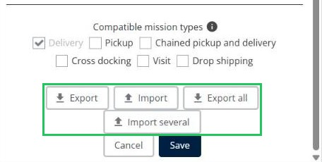
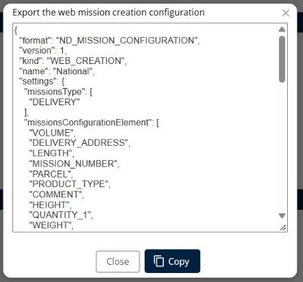
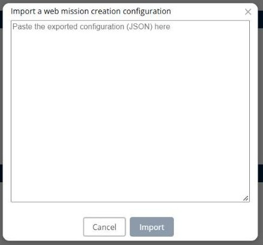
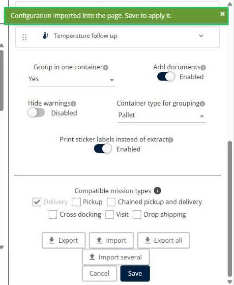
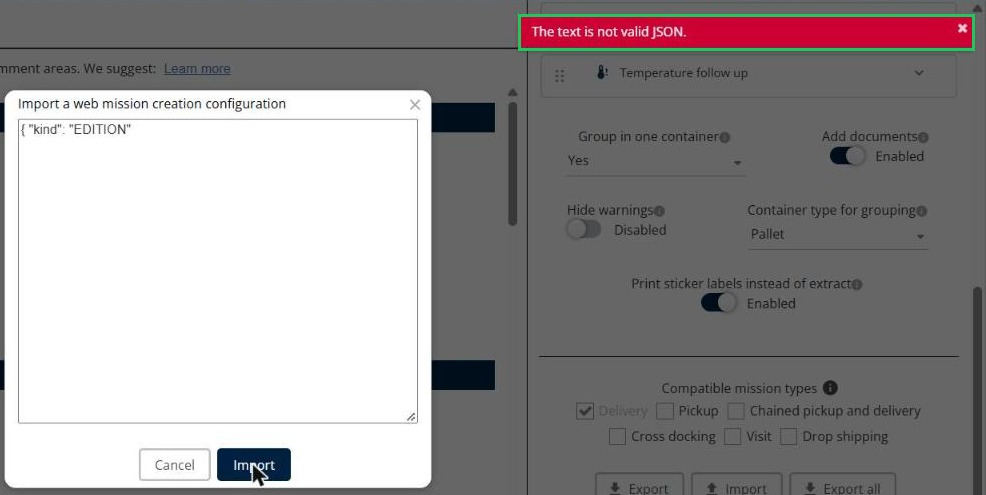

# Import and Export Mission Configurations as JSON

**Import and export mission configurations as JSON** lets you move mission creator and editor configurations between accounts, for example from a test environment to production. A configuration has more than a hundred settings, and rebuilding it field by field is slow and easy to get wrong. Now you export the configuration as JSON on one account, paste it on the other, and save.

## Before you begin

* Sign in to **Nomadia Delivery** with a user profile that has beta tester rights on the account. Users without these rights don't see the import and export buttons.
* Save the configuration that you want to export. Only a saved configuration can be exported.
* Open the mission creator or the mission editor, and then click the **pencil** icon at the top right to open **Mission settings**. For more information, see [Mission Creation Configuration](mission-creation-configuration.md).

## Feature overview

* **Export**: Shows the current configuration as JSON, with a **Copy** button to copy it to the clipboard.
* **Import**: Opens a window where you paste an exported configuration. The configuration replaces every setting on the page, but nothing is saved until you click **Save**.
* **Export all**: Downloads every configuration of the same type in one JSON file.
* **Import several**: Imports several configurations at once from an exported file. A summary lists the configurations that will be replaced or created, and you click **Confirm the import** to apply it. Nothing is saved until you confirm, and configurations missing from the file are left as they are.
* **Configuration type**: The JSON records its type, such as web mission creation, mobile mission creation, mission edition or bulk edit. A configuration can only be imported into the same type.
* **Missing references**: If the JSON refers to custom fields or container types that don't exist on the account, they are left out, and a warning lists them so that you can fix them by hand.
* **Validation**: If the text isn't valid JSON, isn't an exported mission configuration, or is of another type, the import is rejected with a message, and the page stays unchanged.

## Export a mission configuration

1. On the source account, open the saved configuration in **Mission settings**, and then scroll to the bottom of the panel.

2. Click **Export**. The configuration appears as JSON.

3. Click **Copy** to copy the configuration to the clipboard, and then click **Close**.

### Result

The configuration is in your clipboard, ready to paste on the other account.

## Import a mission configuration

1. On the target account, open the configuration that you want to update in **Mission settings**.
2. Click **Import**.
3. Paste the exported configuration in **Paste the exported configuration (JSON) here**, and then click **Import**.

4. Review the imported settings on the page. If a warning lists custom fields or container types that don't exist on this account, create them, and then set them by hand.
5. Click **Save** to apply the configuration.

### Result

A message confirms "Configuration imported into the page. Save to apply it." After you click **Save**, the configuration is applied on this account.

If the pasted text can't be imported, a message explains why, for example "The text is not valid JSON.", and nothing changes on the page.

## Tips


**Export, paste, review and save**: The import only fills the page. Check the result before you click **Save**, or click **Cancel** to keep the current configuration.



**Move all configurations at once**: Use **Export all** and **Import several** to move every configuration of a type in one step, for example during a project rollout.



**Import into the same type**: An editor configuration can't be imported into a creator configuration, and the other way round. The import is rejected, and the page stays unchanged.


## Related topics

* [Missions](README.md)
* [Mission Creation Configuration](mission-creation-configuration.md)
* [Clone a Mission Configuration](clone-a-mission-configuration.md)
