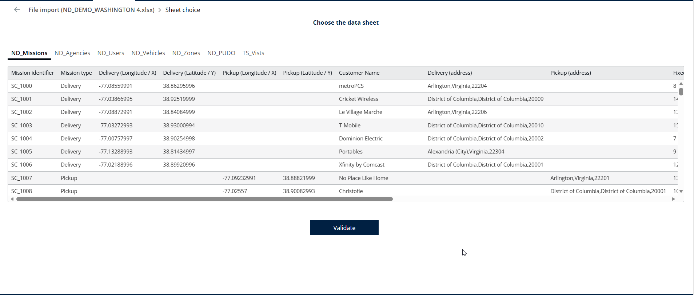
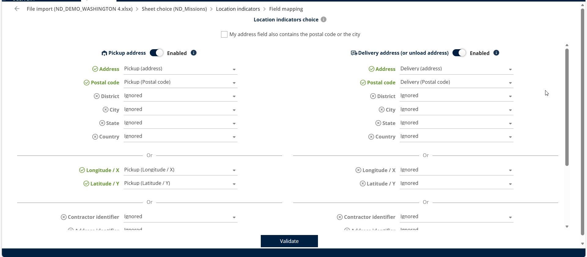

# Import Missions

Import missions from an Excel file on the Missions page to create many missions at once.

## Before you begin

* Sign in to **Nomadia Delivery** with a user profile that has access to the **Missions** page.
* Have an Excel file on your local system that contains the missions to import.
* Know whether your sheet provides the address field or the latitude and longitude fields for the mission locations, because you map one of them during the import.

## Feature overview

* **Actions**: Opens the dropdown menu on the Missions page that contains **Import**.
* **Browse (Excel)**: Lets you choose the **Desired Excel file** from your local system.
* **Validate**: Processes the selected Excel sheet and dataset so you can review the preview.
* **Table view and map view**: Show the preview of the data before the import.
* **Location mapping**: Maps either the address field or the latitude and longitude fields for the mission locations.
* **Import**: Creates the missions from the validated data.

## Import missions from an Excel file

1. From the Missions page, click **Actions**.
2. Select **Import** from the dropdown menu.

<figure><figcaption></figcaption></figure>

3. Click **Browse (Excel)**.

<figure><figcaption></figcaption></figure>

4. Choose the **Desired Excel file** from your local system to upload and import it.

<figure><figcaption></figcaption></figure>

5. Review the preview of the available Excel sheets, select the required dataset, and click **Validate**.

<figure><figcaption></figcaption></figure>

6. Review the preview of the data, which is displayed in both the table view and the map view.

<figure><figcaption></figcaption></figure>

7. Map either the address field or the latitude and longitude fields for the mission locations.

<figure><figcaption></figcaption></figure>

8. Click **Import**.

<figure><figcaption></figcaption></figure>

### Result

Missions are imported successfully.

<figure><figcaption></figcaption></figure>

## Tips


**Preview before importing**: Review the preview of the data in both the table view and the map view before you click **Import**.



**Choose one location method**: Map either the address field or the latitude and longitude fields for the mission locations. To improve address geocoding, see Improve the Missions addresses geocoding.


## Related topics

* [Improve the Missions addresses geocoding](improve-the-missions-addresses-geocoding.md)
* [Creating Custom Fields while Importing](../custom-fields/creating-custom-fields-while-importing.md)
* [Missions](../README.md)
