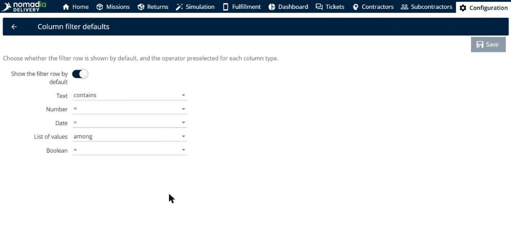
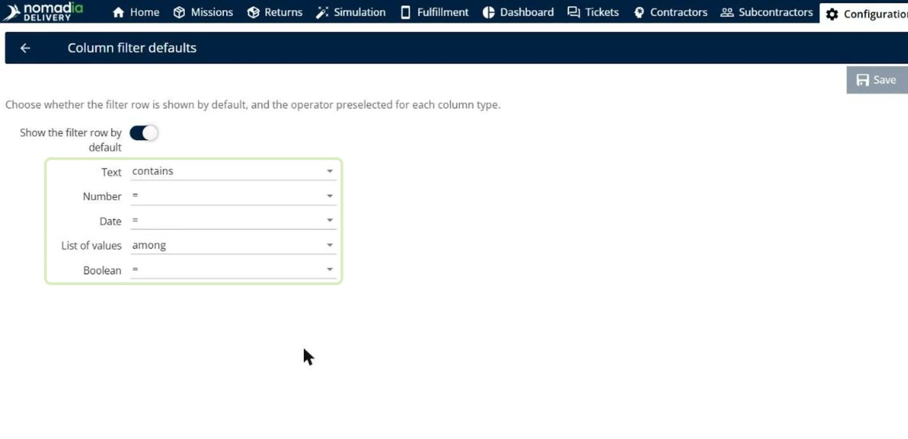
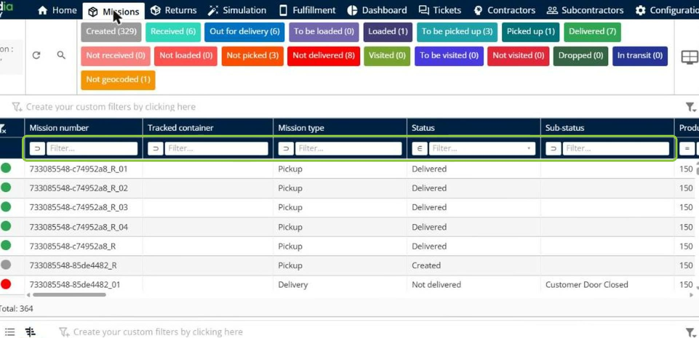
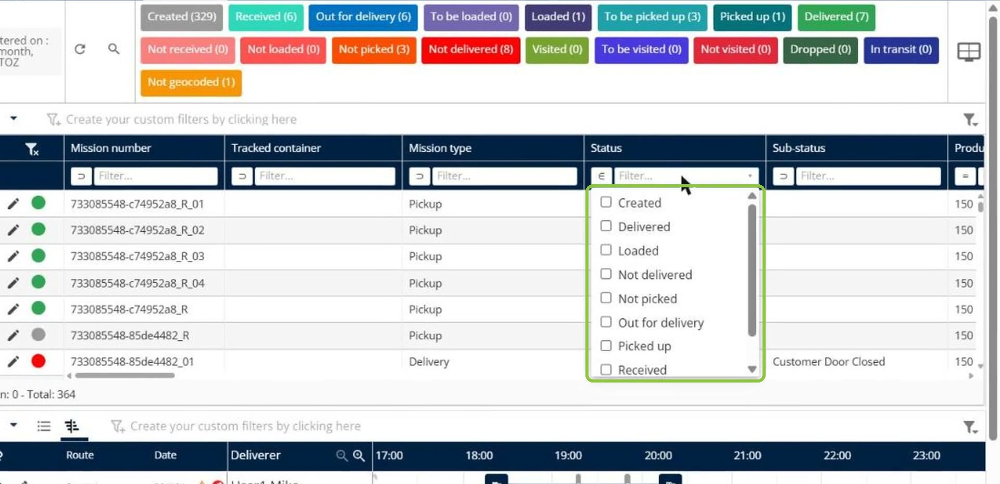
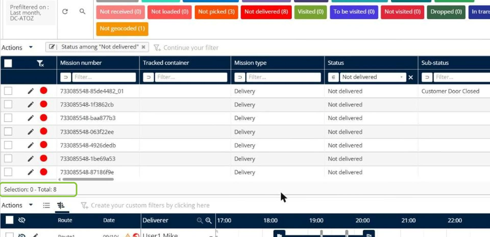
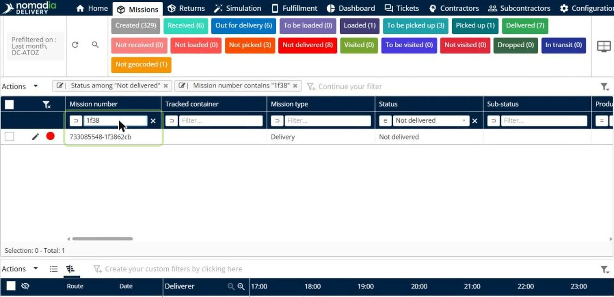
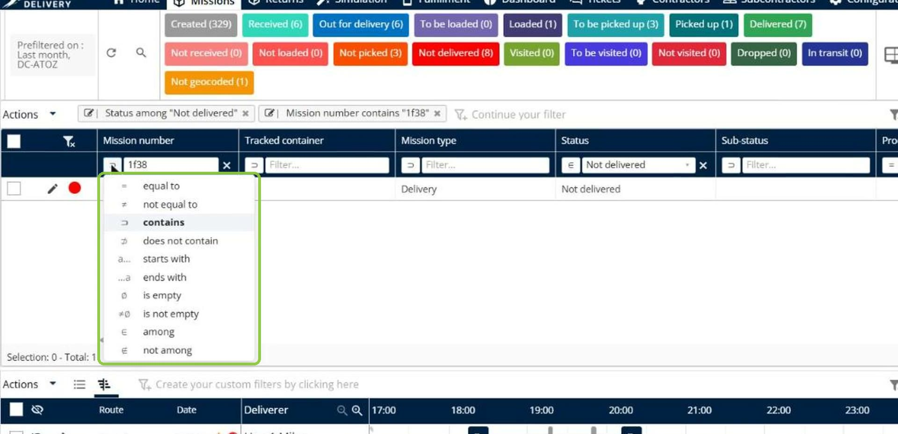
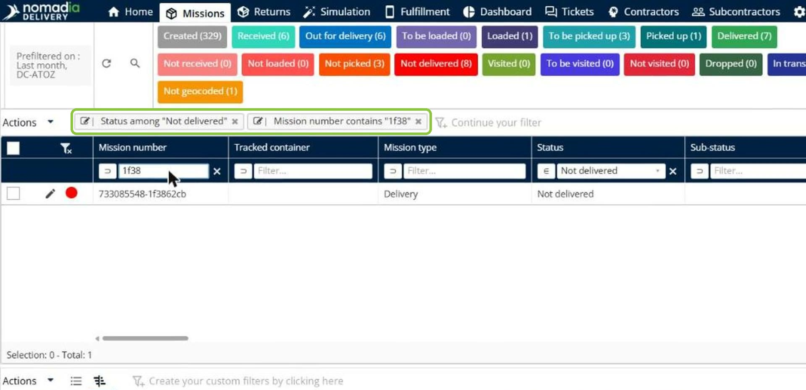
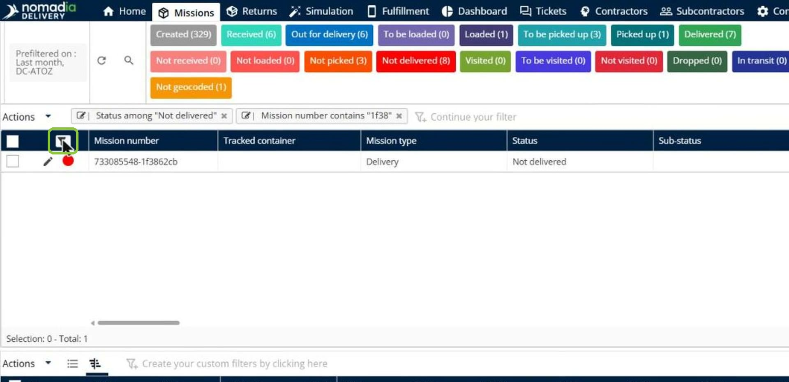
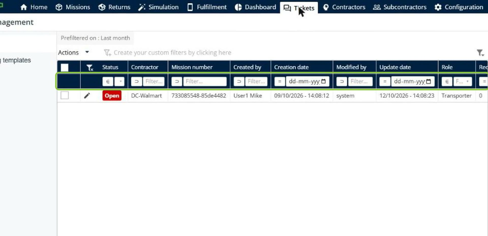

# Excel-Style Column Filters

Excel-style column filters let you filter any table straight from its column headers, as in a spreadsheet. A filter row under the headers gives each column a drop-down list for set values or a text box for free text, and you can change the comparison in one click. Administrators choose whether the filter row is shown by default and which comparison is preselected for each column type.

## Before you begin

* Sign in to **Nomadia Delivery** with a user profile that has access to the tables you want to filter, such as the **Missions** page.
* To set the defaults, you need access to the **Configuration** page.

## Feature overview

* **Column filter defaults**: The page under **Configuration** where you choose whether the filter row is shown by default and the comparison preselected for each column type.
* **Show the filter row by default**: The switch that shows the filter row under the column headers of every table by default.
* **Default comparison per column type**: The comparison preselected for **Text** (for example **contains**), **Number** (**=**), **Date** (**=**), **List of values** (**among**) and **Boolean** (**=**) columns.
* **Filter row**: The row under the column headers. Columns with set values show a drop-down list, and other columns show a text box for free text.
* **Comparison**: The operator of a column filter, such as **equal to**, **not equal to**, **contains**, **does not contain**, **starts with**, **ends with**, **is empty**, **is not empty**, **among** and **not among**.
* **Per-table switch**: The icon at the top left of a table that shows or hides its filter row.

## Set the column filter defaults

1. Go to **Configuration** > **Column filter defaults**.

2. Turn on **Show the filter row by default** to show the filter row in every table.
3. For each column type, choose the comparison to preselect: **Text**, **Number**, **Date**, **List of values** and **Boolean**.

4. Click **Save**.

## Filter a table from its column headers

1. Open a table, for example the missions table on the **Missions** page. The filter row is shown under the column headers.

2. For a column with set values, such as **Status**, open the drop-down list in the filter row and select the values to keep.

The table is filtered in one click, and the filter is added to the filter bar above the table.

3. For a column with free text, such as **Mission number**, type the text in the text box of the filter row.

4. To change the comparison, click the operator icon on the left of the filter, and then choose the comparison, for example **starts with** or **is not empty**.

### Result

The table shows only the rows that match all the column filters. The filters stay in sync with the filter bar above the table, so you can also edit or remove them there.

## Show or hide the filter row of a table

1. Click the filter row icon at the top left of the table to show or hide its filter row.

### Result

The filter row is shown or hidden for this table only. The other tables, such as the tickets table, keep the same filter row behavior.

## Tips


**Combine filters**: You can filter several columns at the same time. The table shows only the rows that match every filter, and each filter appears in the filter bar.


## Related topics

* [Understanding the Missions Page](README.md)
* [Filter the Table using Criteria](filter-the-table-using-criteria.md)
* [Search for a Mission](search-for-a-mission.md)
