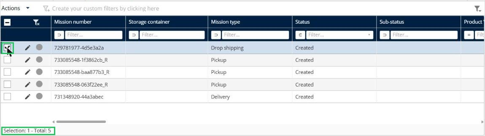
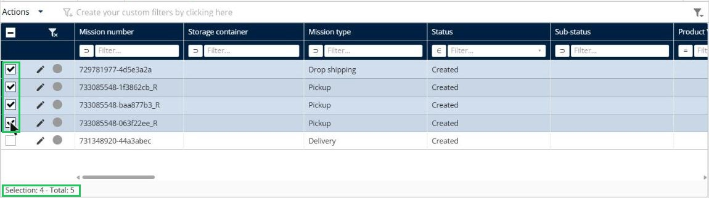

# Shift-Click Range Selection

**Shift-click range selection** lets you select a block of consecutive rows in a table with two clicks, instead of clicking each checkbox one by one. You click the first row, hold **Shift** and click the last row: every row in between is selected. It works the same way as in a spreadsheet or a file explorer.

## Before you begin

* Sign in to **Nomadia Delivery** with a user profile that has access to the table you want to work with, for example the **Missions** tab.
* Sort or filter the table first if needed, so that the rows you want to select are next to each other.

## Feature overview

* **Anchor row**: The last row that you selected or cleared with a normal click. The range always starts from this row.
* **Shift-click**: Holding **Shift** while you click a row checkbox selects every row between the anchor row and the clicked row, both included.
* **Display order**: The range follows the rows as they are shown on the screen, with the current sort and filters, not the order in which the missions were created.
* **Both directions**: You can select a range downward, from a row to a row below it, or upward, from a row to a row above it.
* **New range from the same anchor**: Each new Shift-click redraws the range from the same anchor row, so you can extend or reduce the selection without starting over.
* **Earlier selections are kept**: Rows that you selected individually before you set the anchor stay selected.
* **Unchanged behavior**: A normal click still selects or clears one row, and the header checkbox still selects or clears all rows.
* **All tables**: The feature is built into the shared table component, so it works in the tables of missions, routes, subcontractors, users and other lists of the back office.

## Select a range of rows

1. Go to the table, for example the **Missions** tab.
2. Click the checkbox of the first row of the range. This row becomes the anchor row.

3. Hold **Shift** and click the checkbox of the last row of the range.

### Result

Every row between the anchor row and the clicked row is selected. The counter under the table, for example **Selection: 4 - Total: 5**, shows how many rows are selected. You can now use the **Actions** menu on the whole selection.

## Change the range

1. Keep the same anchor row.
2. Hold **Shift** and click another row, above or below the anchor.

### Result

The range is drawn again from the anchor row to the new row. To start a range from a different row, click that row without **Shift** first.

## Tips


**Sort first, then select**: Sort or filter the table so that the missions you need, for example all the missions of one postal code, are grouped together. Then select them with a single Shift-click.



**Combine with single clicks**: Shift-click to select a block, then click individual rows to add or remove them from the selection.



**Check the counter before you act**: Before you run a bulk action, check the **Selection** counter under the table to make sure that only the rows you want are selected.


## Related topics

* [Understanding the Missions Page](README.md)
* [Excel-Style Column Filters](excel-style-column-filters.md)
* [Manage Missions Table](../manage-missions-table.md)
* [Bulk Edit Mission Data](../bulk-edit-mission-data.md)
