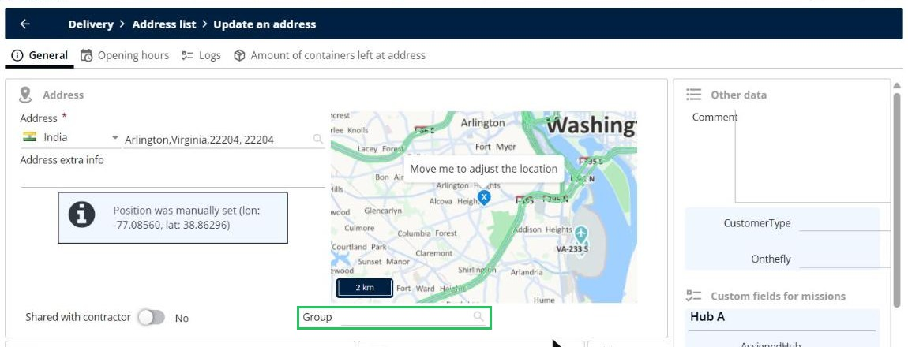
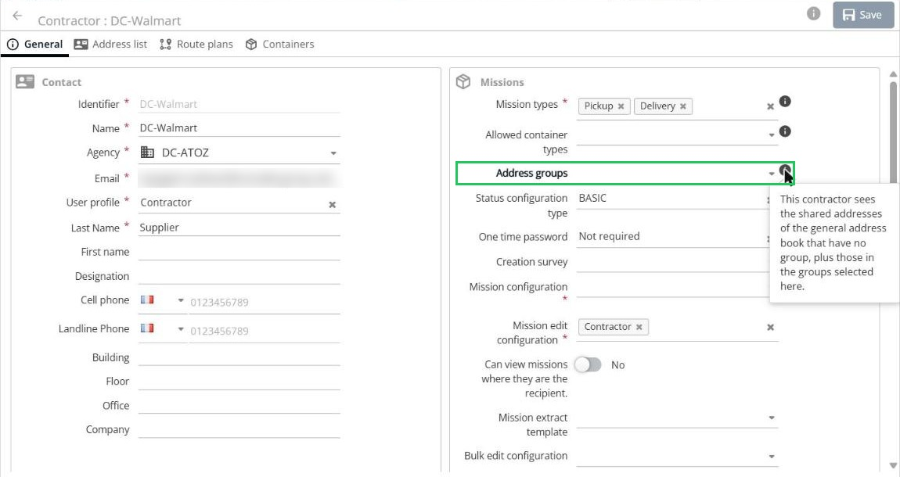

# Address List Groups for Contractors

**Address list groups for contractors** give each contractor instant access to the addresses they need, without configuring addresses one by one. You put addresses of the address list into named groups, such as **Lyon Retail**, and then assign one or more groups to a contractor. The contractor finds the addresses of their groups when they create a mission.

## Before you begin

* Sign in to **Nomadia Delivery** with a user profile that has access to the **Configuration** tab and to the **Contractors** tab.
* Decide how to group your addresses, for example by city, by customer or by type of site.

## Feature overview

* **Group**: The field in the address editor where you enter the name of the group that the address belongs to. An address belongs to one group.
* **Group column in imports**: When you import addresses, add a group column to your file to group hundreds of addresses in one go.
* **Address groups**: The field in the **General** tab of a contractor, under **Missions**, where you select one or more groups for the contractor. You can add or remove groups at any time.
* **Address groups column in contractor imports**: When you import contractors, add an address groups column to your file so that every contractor is created with their groups already assigned.
* **What the contractor sees**: The shared addresses of the general address list that have no group, plus the addresses of the groups selected for the contractor.
* **Mission address picker**: When the contractor creates a mission, their assigned groups appear in the address picker. They open a group and choose an address.
* **Read-only address list**: Contractors get a read-only list of every address in their assigned groups, which they can filter by group or search by name.

## Put an address in a group

1. Go to the **Configuration** tab. Under **Delivery**, click **Address list**.
2. Click the **Pencil** icon of the address.
3. In the **Group** field, enter the name of the group, for example **Lyon Retail**.

4. Click **Save**.

### Result

The address belongs to the group. Every contractor to whom you assign this group can use the address.

## Assign groups to a contractor

1. Go to the **Contractors** tab.
2. Click the **Pencil** icon of the contractor, or create a new contractor.
3. In the **General** tab, under **Missions**, click the **Address groups** field and select one or more groups.

4. Click **Save**.

### Result

The contractor sees the shared addresses that have no group, plus the addresses of the selected groups. When the contractor creates a mission, the groups appear in the address picker, ready to use without any setup.

## Tips


**Group in bulk**: To group many addresses or set up many contractors, add a group column to your address import file and an address groups column to your contractor import file.



**Name groups clearly**: Use names that contractors recognize, such as a city and a type of site, for example **Marseille Port** or **Paris Hypermarkets**.



**Addresses without a group stay visible**: A contractor always sees the shared addresses that have no group. To limit what a contractor sees, put the addresses in groups.


## Related topics

* [Manage Global Address List](../manage-global-address-list.md)
* [Control Address Sharing with Contractors](../control-address-sharing-with-contractors.md)
* [Manage Address List](manage-address-list.md)
* [Register a Contractor](registration.md)
