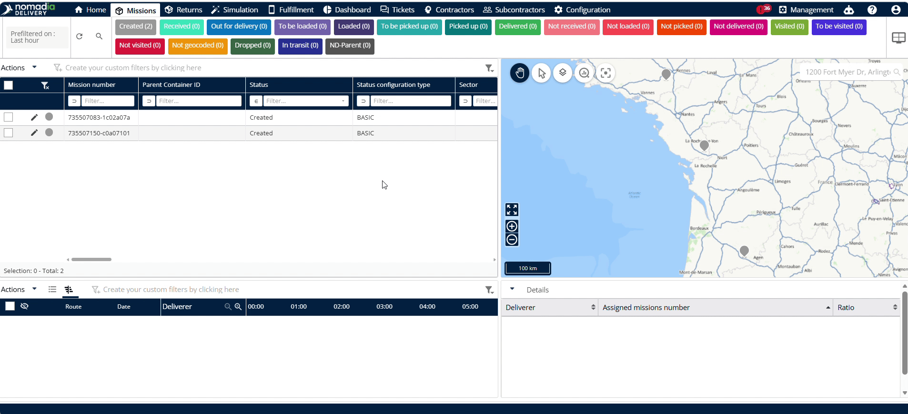
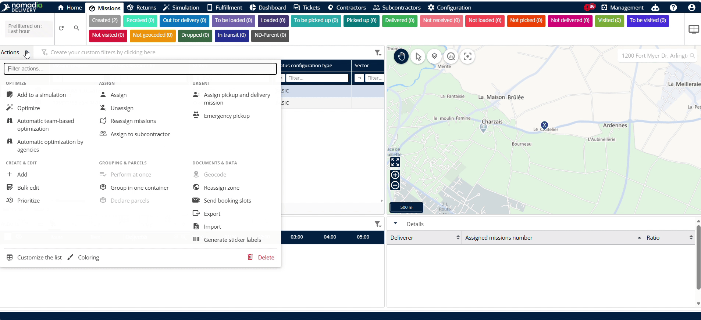
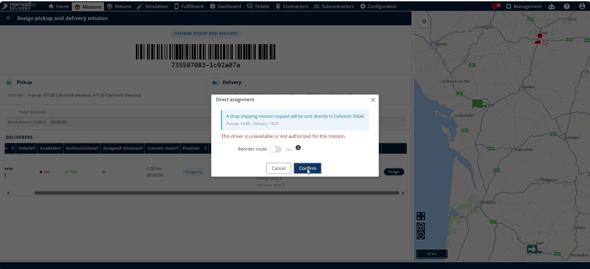

# Assign Pick up and Delivery Missions

The **Assign Pickup and Delivery Missions** feature lets dispatchers assign pickup and delivery routes to drivers and vehicles. You need it to optimize route placement and manage driver assignments in real time. By using this feature, you will achieve faster deliveries and manage driver acceptance timeouts.

## Before you begin

Prerequisites:

* Assigned driver and vehicle details.
* Driver authorizations for required skills.
* Mobile app accept timeout (in minutes) configured.

Initial setup steps:

1. Navigate to **Configuration**.
2. Click **Configure Mobile App**.
3. Enter minutes in **Accept Timeout Minutes**.
4. Click **Save**.

## Feature overview

* **Driver Name and Vehicle Name**: Displays driver and vehicle details to track active units.
* **Available Missions**: Lists unassigned missions ready for route assignments.
* **Authorizations**: Indicates driver skills and permissions to ensure task compatibility.
* **Assigned Missions**: Lists missions currently linked to the selected driver.
* **Current Route Kilometer**: Tracks the total mileage of the driver's active route.
* **Position**: Shows the driver's location relative to the agency.
* **Assign Optimal**: Adjusts existing unstarted routes to deliver current assignments faster.
* **Assign After Current State**: Inserts the task directly after the driver's current task.
* **Assign at the End**: Appends the task to the end of the driver's scheduled route.
* **Acceptance Status**: Displays whether the driver has accepted or rejected the assigned route.
* **Accept Timeout Minutes**: Sets how many minutes the driver has to accept or reject the route.

## Assign pickup & delivery mission

1. Go to **Missions**.
2. Select **Pickup & delivery missions**.

3. Click **Actions**.
4. Click **Assign pickup and delivery mission**.

5. Review the assignment page:
   * The assignment page displays all routes planned for the day. You can choose any of these routes to insert the pickup & delivery mission request.
   * You can also display the routes and their mission stops on the map, to make an informed decision about where to insert the new pickup & delivery mission.
6. Click **Assign** and choose one of the assignment options:
   * **Assign optimal**: Use this to insert both the pickup and delivery steps at the optimal positions within an existing route.
   * **Assign after**: Use this when the mission is an emergency and must be performed immediately after the current mission.
   * **Assign at the end**: Use this when the mission is not an immediate priority and can be completed any time before the end of the route.
7. Click **Confirm**.

### Result

Once the back-office user confirms the assignment, the request is sent to the deliverer's mobile app for acceptance.

* The deliverer can accept the mission until the acceptance timeout expires.
* The acceptance status can be tracked in two places, with the values **Pending** / **Accepted** / **Not Accepted**:
  * **Mission table**: the **Acceptance status** column.
  * **Mission log**: expand the log entry to view the acceptance status.
* A mission with the status **Not Accepted** can be reassigned from the **Acceptance status** column.
* If the mission is not accepted before the timeout, it is automatically removed from the route. It can then be reassigned to the same deliverer or to a different deliverer.

## Tips


**Optimal Route Sequencing**: Select **Assign Optimal** to re-sequence unstarted routes and accelerate delivery schedules.



**Driver Response Limits**: Set **Accept Timeout Minutes** to enforce response deadlines for driver route acceptance.



**Reorder Option**: The Reorder option is deactivated for routes that contain dynamic pickup & delivery locations, as this feature is not compatible with this mode.


## Related topics

* [Drop Shipping Missions](8-6-missions/drop-shipping-missions.md)
* [Manual Route Creation](8-6-missions-1/manualroutecreation.md)
* [Route Editor](routeeditor.md)
