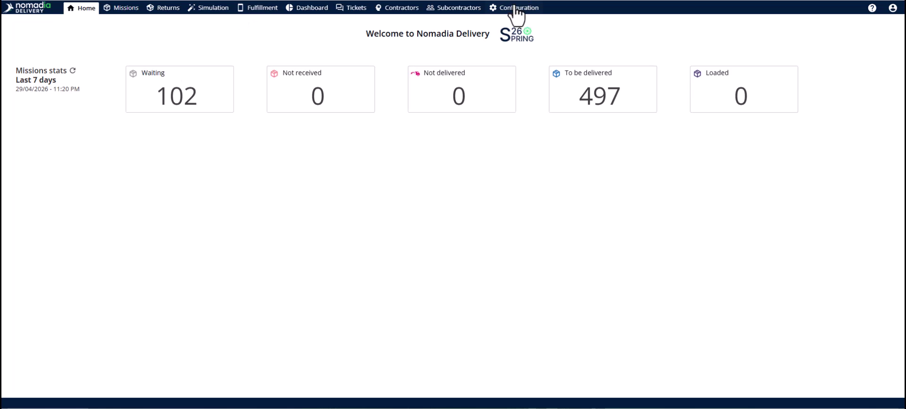
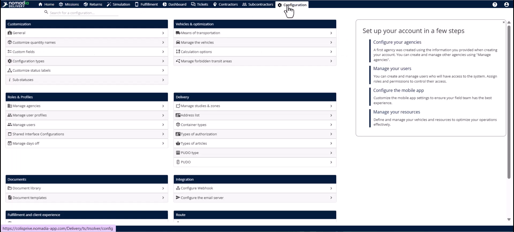
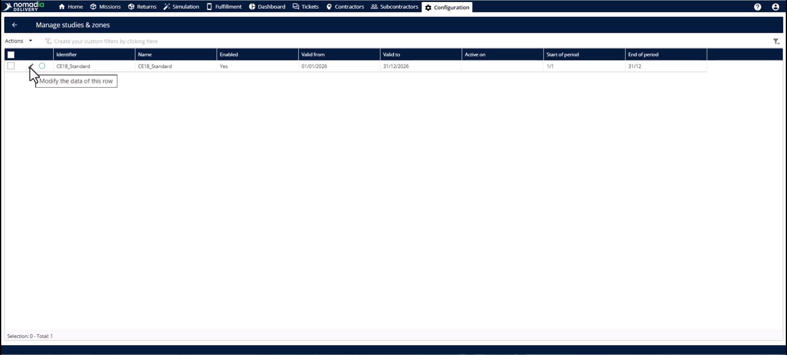
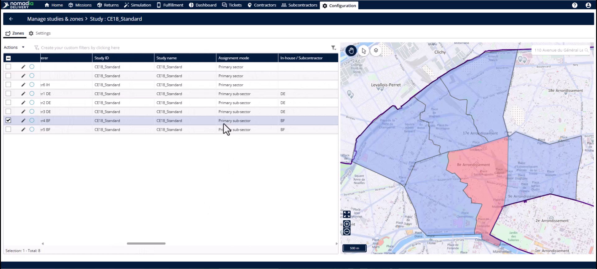
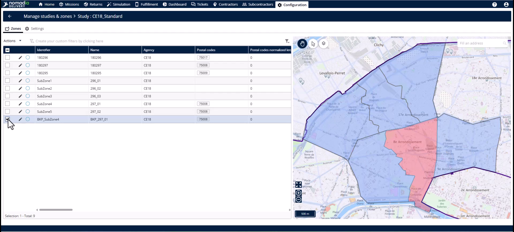
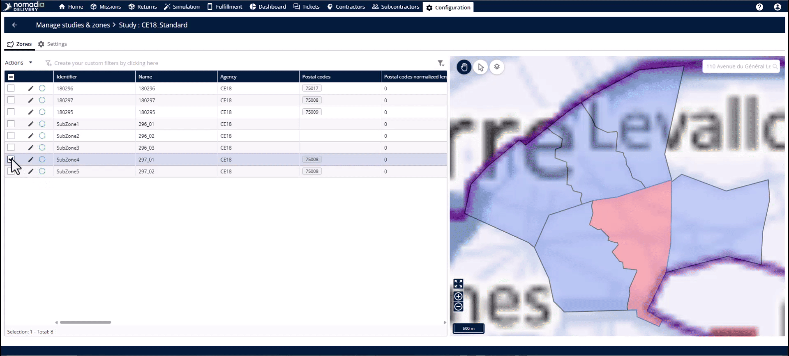
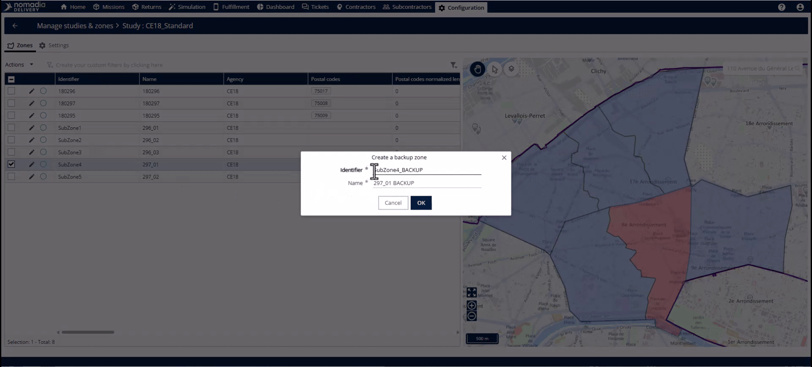
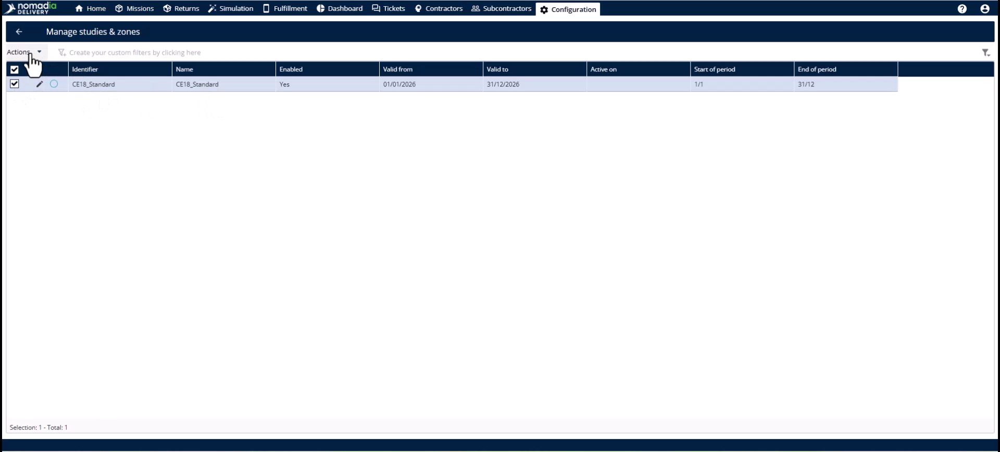
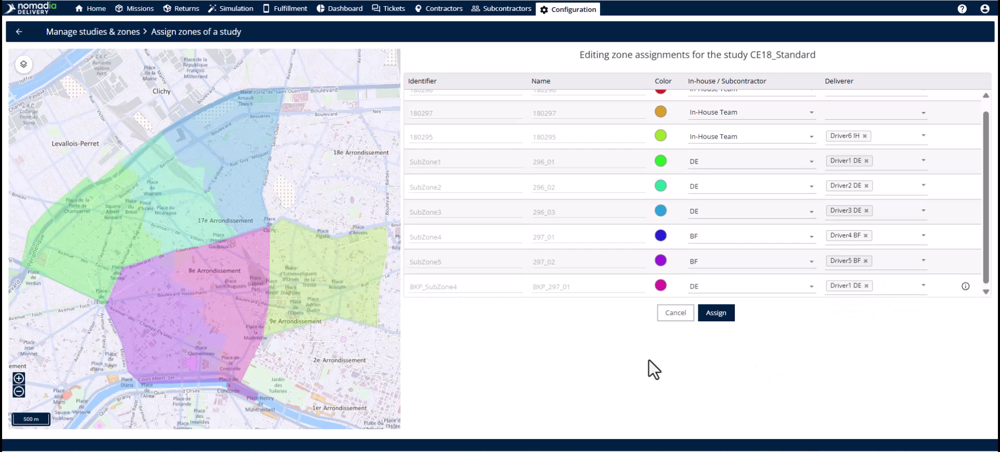
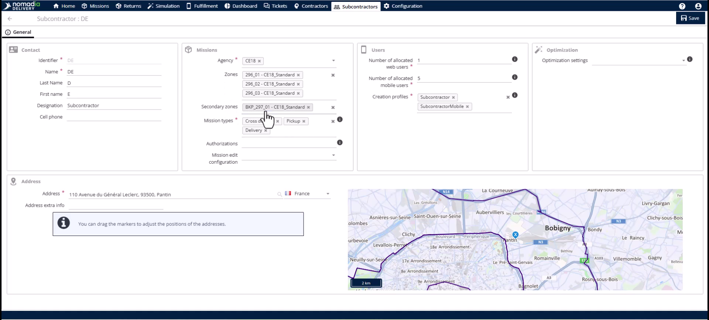

# Creating Backup Zone

The Backup Zone feature allows you to handle emergency subcontractor no-shows by creating temporary secondary sectors. It enables quick hand-offs of existing missions to available teams without changing your primary infrastructure. This ensures your SLAs are met and deliveries arrive on time despite overnight changes.

## Before you begin

* Access to the **configuration module**.
* An existing primary subzone requiring backup.
* A replacement subcontractor available for assignment.

1. Navigate to the **configuration module**.

2. Click **manage studies and zones**.

3. Select the **pencil icon** next to the relevant study.

## Feature overview

* **Primary sub-sector**: The original delivery territory assigned to the first subcontractor.

* **Secondary sub-sector**: The newly created backup zone assignment mode distinguishing it from the original.

* **Identifier**: A unique code field for the backup zone.

* **Zone table**: The list within the study displaying both primary and backup zones.

## Create a backup zone

1. Click the **primary subzone** you want to back up.

2. Open the **actions menu**.

<figure><figcaption></figcaption></figure>

3. Select **create a backup zone**.
4. Enter a new **identifier** and **name**.

5. Click **OK** to create the zone.

## Assign a backup subcontractor

1. Choose the relevant study.

2. Click **actions** and select **assign** again.

3. Click **assign** to link the territory.

## Verify the assignment

1. Navigate to the **subcontractors module**.

2. Click **edit** on the replacement subcontractor.

3. Check the **secondary zones** drop-down.

## Tips


**Automatic Synchronization**: System updates happen immediately without manual refreshes after clicking assign.



**Existing Missions Update**: Replacement subcontractors cannot see current missions until you update the sector and deliverer info.



**Preserve Infrastructure**: Backup zones are temporary and do not change your primary subzone configurations.


## Related topics

* [Case Studies](README.md)
* [Subcontractor Swap to Backup Zone](subcontractor-swap-to-backup-zone.md)
* [Subcontractor Swap to Primary Zone](subcontractor-swap-to-primary-zone.md)
