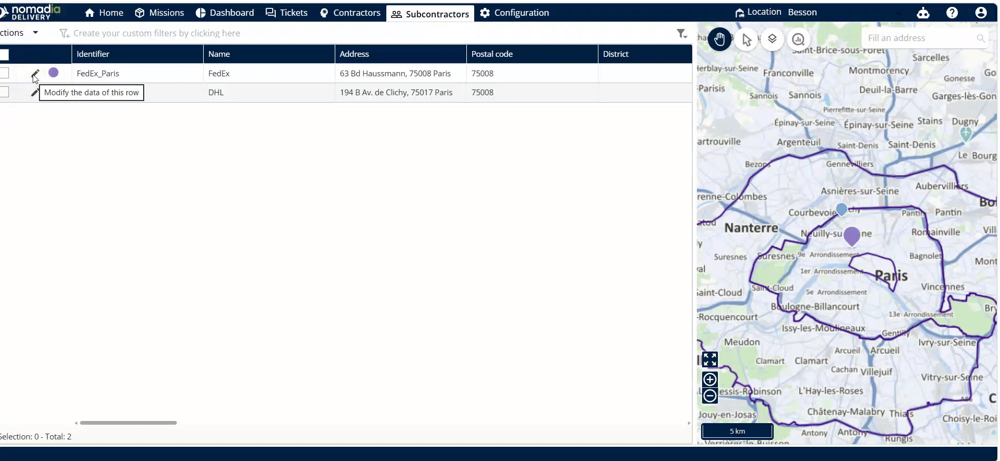
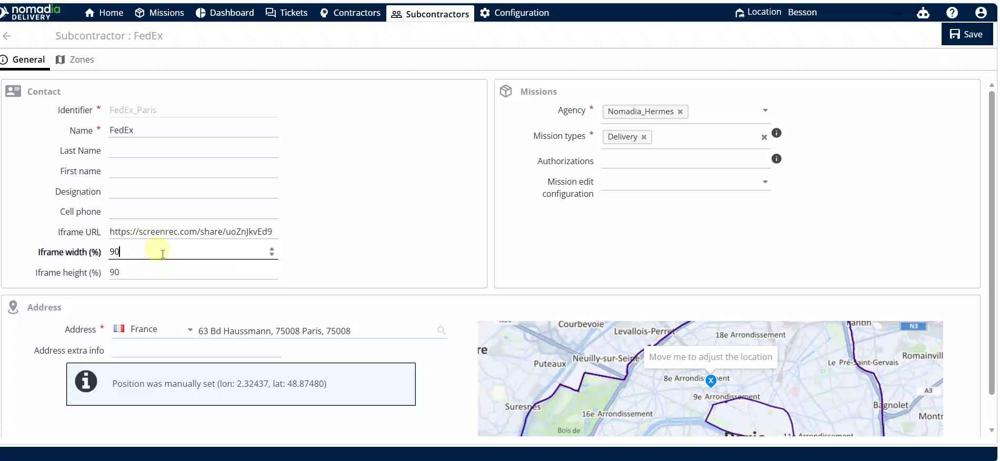

# Iframe Configuration

Configure iFrame settings for subcontractors within Nomadia Delivery to embed external mission data. This feature allows you to customize the display of external URLs for specific users. You will achieve a personalized viewing experience for each subcontractor profile.

## Before you begin

* Access to the Nomadia Delivery dashboard.
* A valid URL or mission ID.

1. Navigate to the **Subcontractors** menu.
2. Locate the list of users on the screen.

<figure><figcaption></figcaption></figure>

## Feature overview

* **Pencil icon**: Opens the editing interface for a selected subcontractor.
* **iFrame URL**: Field used to input the URL or mission ID.
* **iFrame width**: Sets the horizontal dimension of the embedded frame.
* **iFrame height**: Sets the vertical dimension of the embedded frame.

## Configure a subcontractor iFrame

1. Click the **pencil icon** next to the user.

2. Replace the existing URL with your URL or mission ID.

3. Set the **iFrame width** value.
4. Set the **iFrame height** value.
5. Click **save** to save the modifications.

## Tips


**Modification Confirmation**: Verify the configuration by waiting for the "existing subcontractor has been modified" pop-up.


## Related topics

* [Assign to Subcontractors](README.md)
* [Interacting with Iframe](intracting-with-iframe.md)
* [Register a Subcontractor](../../../10-8-subcontractor-management/register-a-subcontractor.md)
