# Child to Parent Inheritance

Child-to-parent inheritance automatically syncs data from child containers to parent containers. This feature saves dispatchers time by eliminating manual data entry. You will achieve real-time visibility of consolidated package statuses and aggregate cargo dimensions.

## Before you begin

Before using this feature, ensure you meet the following requirements:

* An active user account for **Nomadia Delivery** with administrative privileges.
* Pre-configured parent and child container profiles.

## Feature overview

* **Fetch status from child missions**: This setting enables parent containers to inherit progress status from child containers. It ensures automatic updates.
* **Scan all the items in the container**: This toggle forces operators to scan every child item before executing delivery. It guarantees delivery accuracy.
* **Mission status**: This field defines the current operational status of each individual child mission. It updates inherited status values.
* **Partial status attainment**: The parent mission shows the percentage of child missions/parcels that have reached the status.
* **Aggregate dimensions**: This configuration defines which physical dimensions sum up from child to parent containers. It aggregates size details.
* **Aggregate quantities**: This configuration defines which quantitative measurements sum up to the parent container. It aggregates weight and volume.

## Configure child to parent inheritance

Set up child-to-parent inheritance using these steps:

1. Go to **Configuration**.

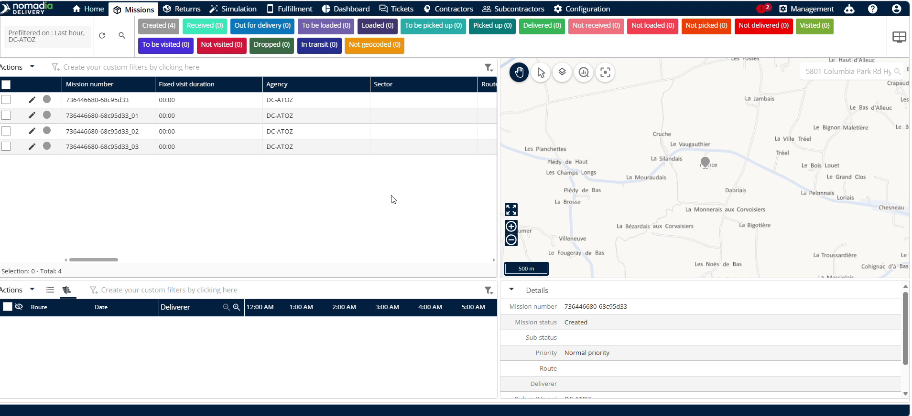

2. Click **Container Types**.

3. Scroll down to find the correct identifier.

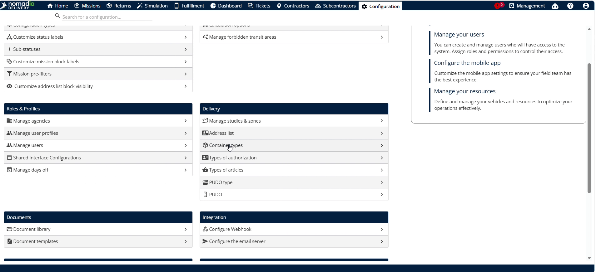

4. Click the correct identifier.

5. Locate the **Fetch status from child missions** toggle.
6. Toggle the setting to **Yes** if it is disabled.
7. Click **Save**.

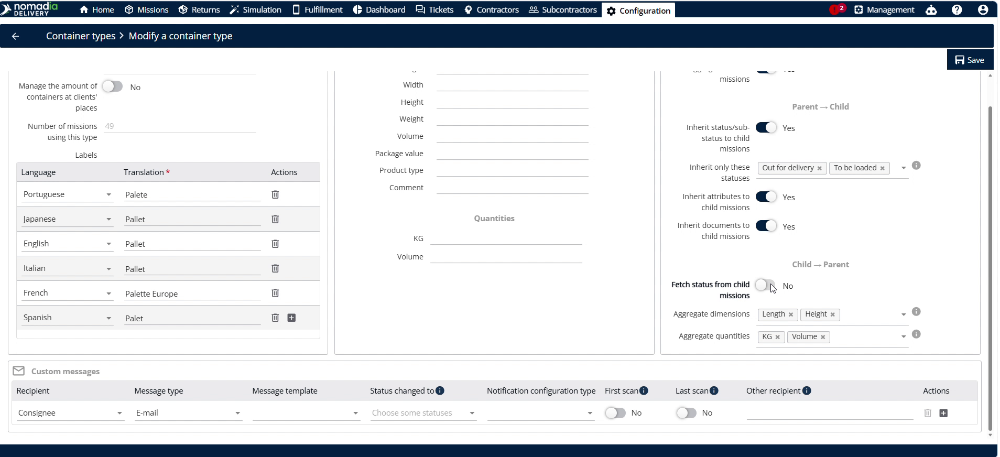

## Enable scanning of all items in the container for a specific sub-status

1. Click **Sub status**.

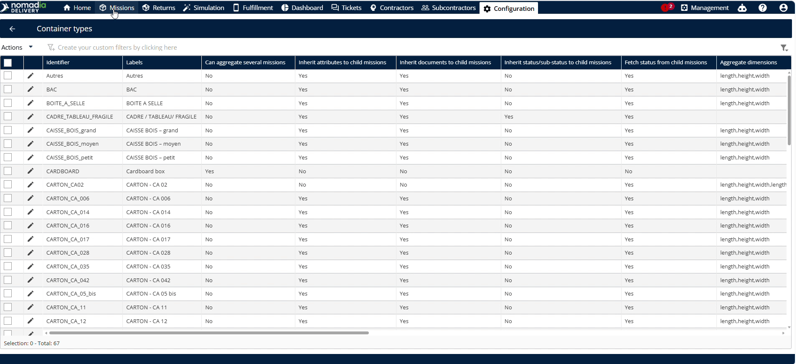

2. Edit the sub-status for which you want to allow the mobile user to scan all the items in the container.

3. Check if **Scan all the items in the container** is enabled.
4. Toggle the option to **Yes** if it is disabled.

5. Click **Save**.

## Update child container delivery status

1. Click **Missions** on the main navigation panel.

2. Click on the **child container**.

3. Change the **Mission status** to **Delivered**.

4. Click **Save**.

5. Updating the status of a child mission also updates the status of its parent mission.

## Customize the list to view parcel status attainment

1. Click **Customize the list** from the **Actions** menu.

2. Verify **Parcel status attainment** is in the display fields list.
3. Click **Save**.

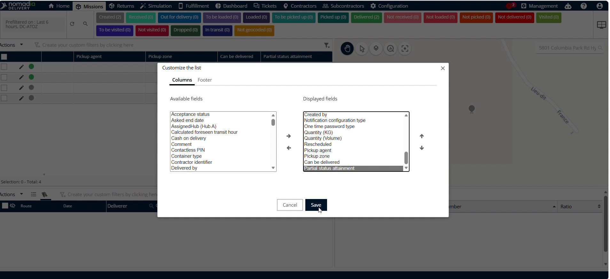

4. Click the **Pencil icon** to edit another child mission.

5. Change the status to **Delivered**.

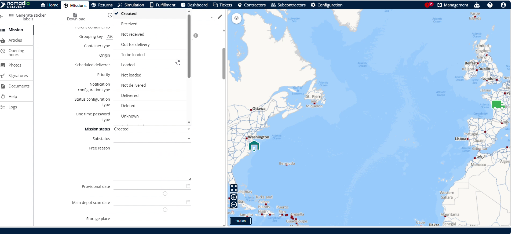

6. Click **Save**.

7. The percentage of parcel attainment shown on the parent mission changes to reflect the update.

## Track damaged items and not-delivered reasons

1. Click the **Pencil icon** of the damaged child container to edit it.

2. Change the status to **Not Delivered**.

3. Enter the specific reason in the **Reason** field.

4. Click **Save**.

### Result

The status will be reflected in the parent container. Please note that only positive statuses will be updated in the parent container.

The partial status attainment is updated based on the number of child missions that have a positive status.

<figure><figcaption></figcaption></figure>

## Configure and view aggregated dimensions and quantities

1. Click **Configuration** on the top menu.

2. Edit any container type from the list.
3. Choose your desired size metrics in **Aggregate dimensions**, such as length or height.

4. Choose your desired quantity metrics in **Aggregate quantities**, such as kg or volume.

5. Click **Save**.

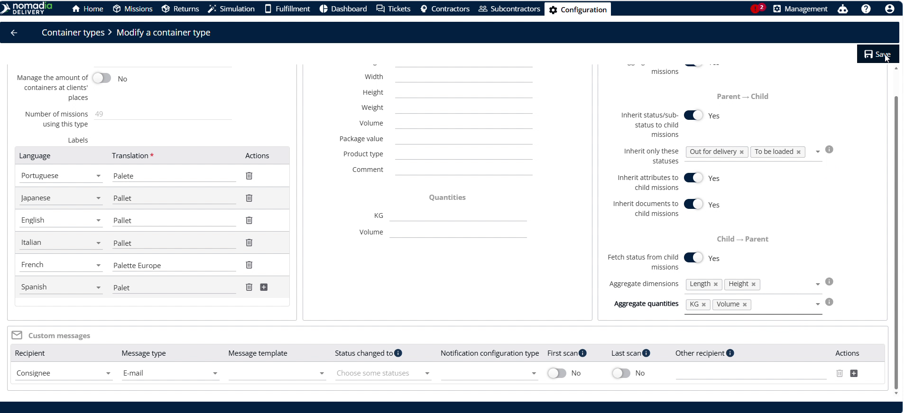

6. Click **Missions**.

<figure>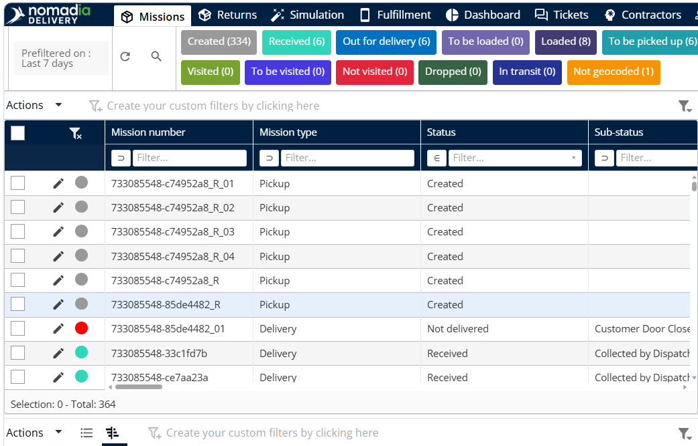<figcaption></figcaption></figure>

7. Enter the **length, height, quantity, weight (kg)**, and **volume values** for the first child container.

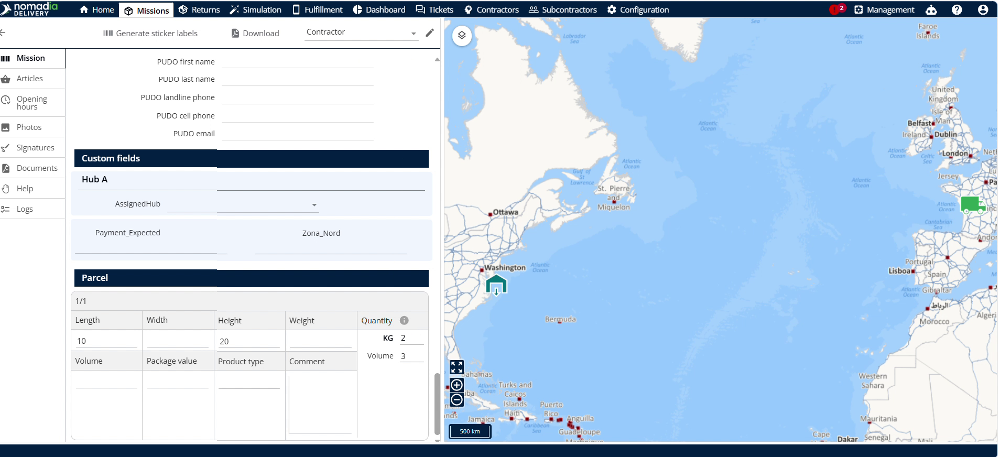

8. Click **Save**.

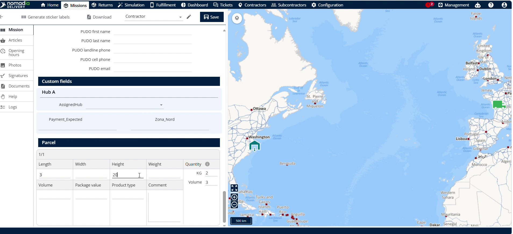

9. Select the second child container and enter its metrics.

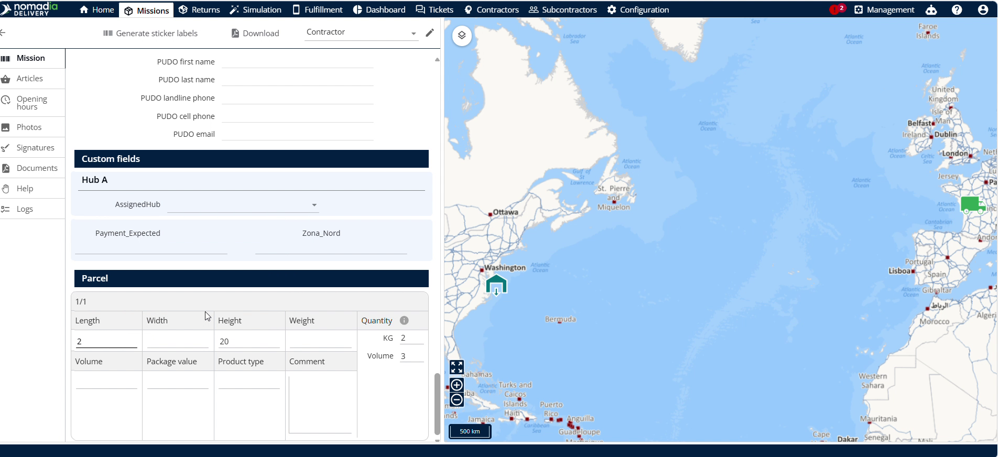

10. Click **Save**.

11. Open the parent container to view the calculated totals.

<figure><figcaption></figcaption></figure>

## Tips


**Mobile Synchronization**: Use the mobile application to experience the same automatic child-to-parent data inheritance on the go.



**Detailed Tracking**: Enter specific reasons when marking containers as not delivered to ensure accurate fleet reporting.



**Parent Display Only**: The overall mission status is updated only on the parent mission. Sub-statuses are not passed from child missions to the parent, because each child mission can have a different sub-status.


## Related topics

* [Parent to Child Inheritance](../parenttochildinheritance/parenttochildinheritance.md)
* [Edit a Container Type](../manage-container-types/edit-a-container-type.md)
