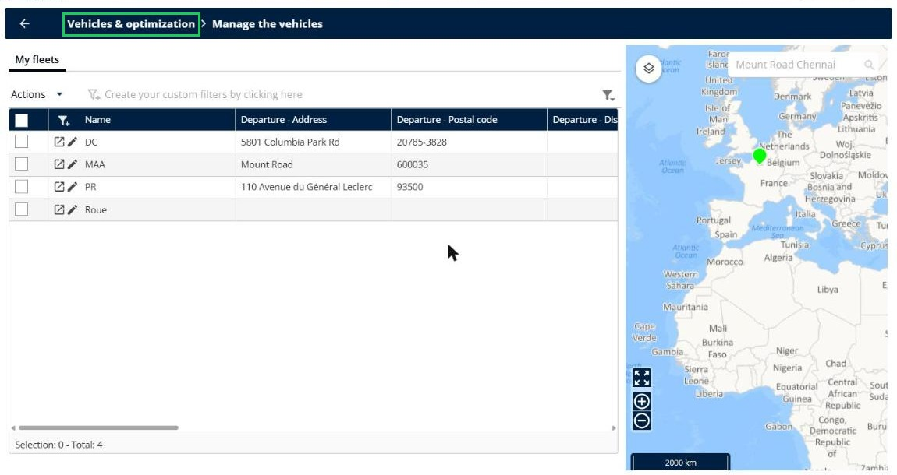
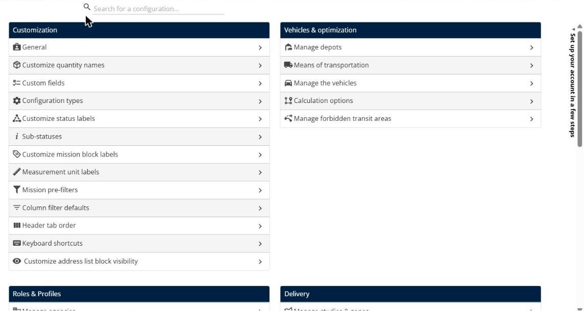
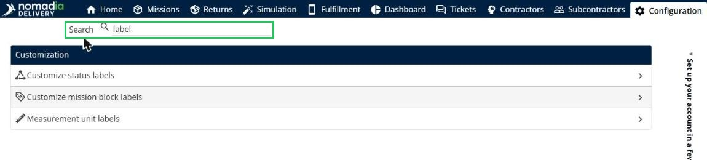

# Configuration Breadcrumb Navigation

**Configuration breadcrumb navigation** lets planners and dispatchers move through the **Configuration** tab with fewer clicks. Each level above the current page in the breadcrumb trail is a link, so you can jump to any level with one click instead of going back step by step. The configuration menu also remembers your search and your scroll position, and your unsaved changes are protected when you leave a page.

## Before you begin

* Sign in to **Nomadia Delivery** with a user profile that has access to the **Configuration** tab.

## Feature overview

* **Clickable breadcrumb trail**: The bar at the top of each configuration page shows the path to the page, for example **Vehicles & optimization** > **Manage the vehicles**. Each level above the current page is a link. The current page is shown in bold.
* **Remembered menu state**: When you come back to the configuration menu with the breadcrumb or the **Back** arrow, the menu keeps the text that you typed in the search field and the scroll position.
* **Configuration tab reset**: Clicking the **Configuration** tab in the header, from any level, opens the menu in a blank state, with an empty search field and the list scrolled to the top.
* **Browser history**: The **Back** and **Forward** buttons of the browser go through the configuration levels in order. For example, **Back** from the vehicle editor returns to the fleet list, then to the menu.
* **Unsaved changes confirmation**: If you change a value and then click a breadcrumb link, a header tab or the browser **Back** button, a confirmation dialog asks before you leave the page. If you cancel, your input stays exactly as you typed it.

## Go to a higher configuration level

1. Go to the **Configuration** tab, and open a configuration page, for example **Vehicles & optimization** > **Manage the vehicles**.
2. In the breadcrumb trail, click the level that you want to go to, for example **Vehicles & optimization**.

### Result

The configuration menu opens directly, without going back page by page.

## Come back to your search

1. In the configuration menu, enter a word in the **Search for a configuration** field, for example **label**.
2. Open one of the results, for example **Customize status labels**.
3. Click **Customization** in the breadcrumb trail, or click the **Back** arrow.

### Result

The menu still shows your search text and the filtered results, at the same scroll position, so you can carry on without filtering again.

## Start from a blank menu

1. From any configuration page, click the **Configuration** tab in the header.

### Result

The menu opens with an empty search field, scrolled to the top.

## Tips


**Use the browser buttons**: The browser **Back** and **Forward** buttons step through the configuration levels in order, so you don't leave the **Configuration** section by accident.



**Save before you leave**: If you change a value, save it before you leave the page. When the confirmation dialog appears, click **Cancel** to stay on the page and keep your input.


## Related topics

* [Customize Navigation Tabs](customize-navigation-tabs.md)
* [Keyboard Shortcuts Configuration](keyboard-shortcuts-configuration.md)
* [Manage Vehicle Fleets](manage-vehicle-fleets/README.md)
* [Customizing Status Labels](8-6-missions/customizing-status-labels.md)
