# Control Address Sharing with Contractors

Control address sharing with contractors lets you choose which entries of the general address list your contractors can see. You can keep a sensitive address private, check the sharing status of every entry at a glance, and share or stop sharing several addresses in one step.

## Before you begin

* Sign in to **Nomadia Delivery** as an administrator or back-office user with access to the **Configuration** tab.
* Make sure the addresses you want to manage exist in the general address list. See [Manage Global Address List](manage-global-address-list.md).

## Feature overview

* **Address list**: The general address list used across your whole organization, found in **Configuration**.
* **Shared with contractor column**: The column that shows, for each address, whether contractors can see it (**Yes** or **No**). You can filter this column.
* **Shared with contractor toggle**: The toggle in each address that turns sharing with contractors on or off. It is on by default.
* **Actions menu**: The menu that contains **Share with contractors** and **Stop sharing with contractors** for the selected addresses.
* **Modify**: The button that saves the changes to an address.

## Open the address list

1. As an administrator or back-office user, open the **Configuration** tab.

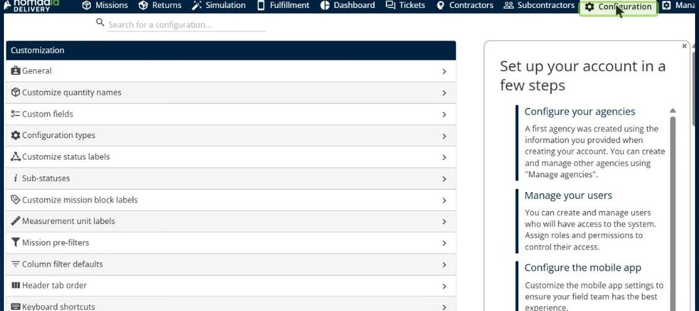

2. In the search box, type **Address**, and then open **Address list**.

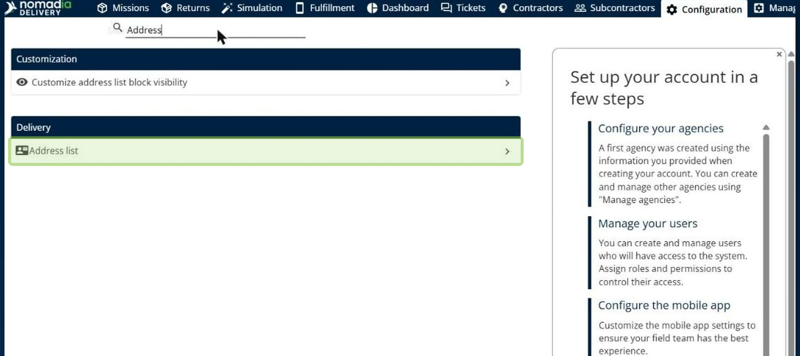

The **Address list** page opens. It is your general address list, used across your whole organization.

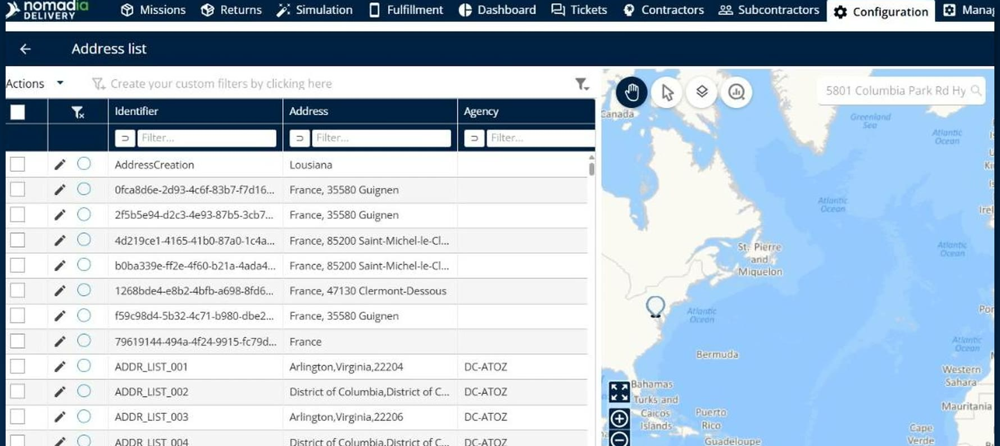

## Check the sharing status of addresses

1. In the **Address list**, look at the **Shared with contractor** column. It shows the sharing status of every address.

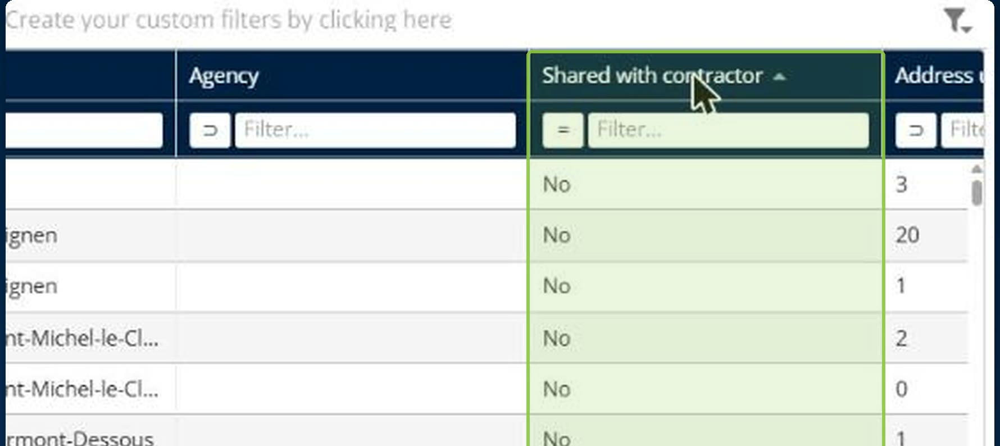

2. To list only the addresses your contractors can currently see, enter **Yes** in the filter of the **Shared with contractor** column.

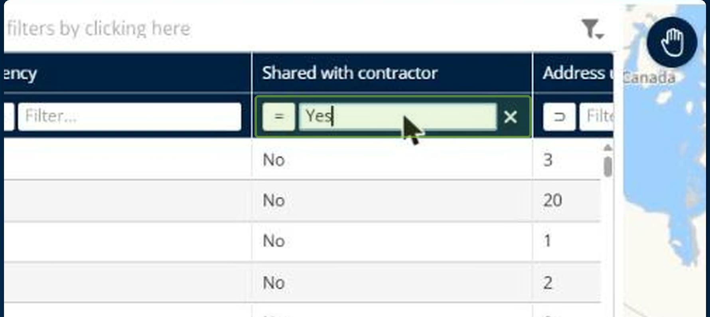

### Result

The list shows only the addresses shared with contractors.

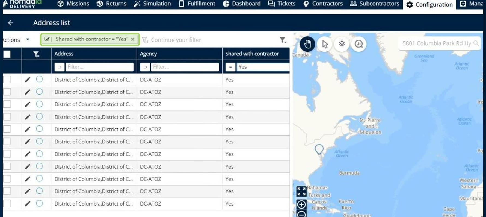

## Stop sharing an address with contractors

1. In the **Address list**, click the **pencil icon** next to the address to open it.
2. Find the **Shared with contractor** toggle. It is on by default, so nothing changes until you turn it off.

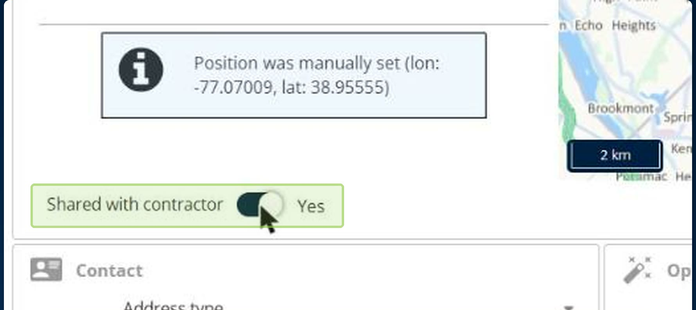

3. Switch the toggle off so that it shows **No**.

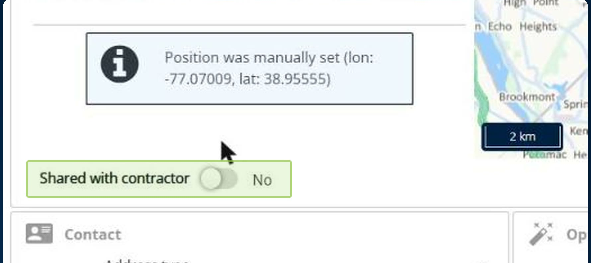

4. Click **Modify** to save.

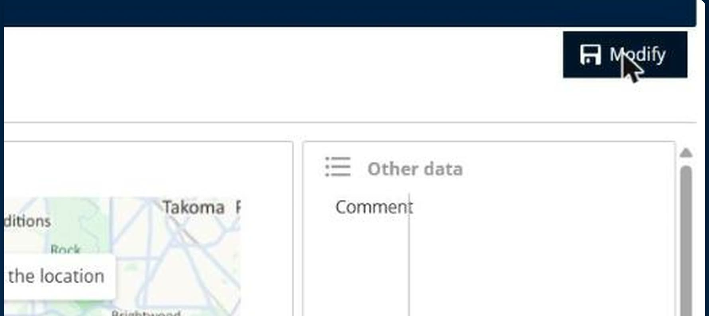

### Result

A notification confirms that the address was updated. If the list is filtered on **Yes**, the address is no longer shared, so it drops out of the list.

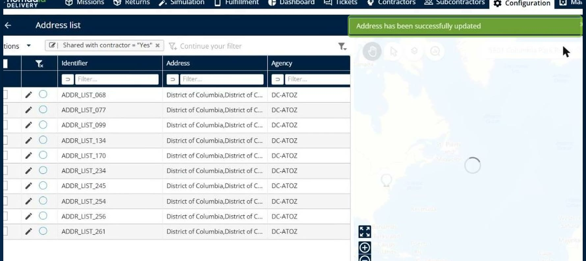

## Share or stop sharing several addresses

1. In the **Address list**, select the check boxes of the addresses you want to update.

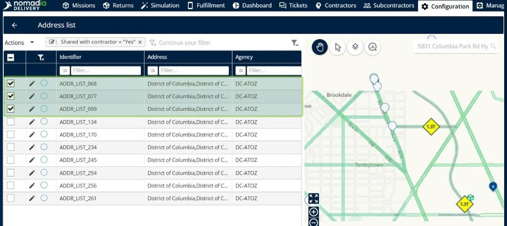

2. Click **Actions**, and then click **Share with contractors** or **Stop sharing with contractors**.

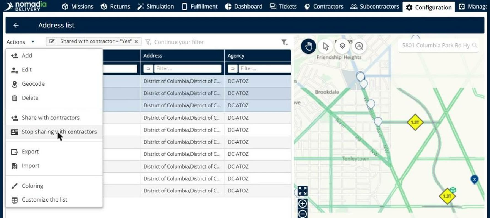

### Result

All the selected addresses are updated in a single step, and a notification confirms the update.

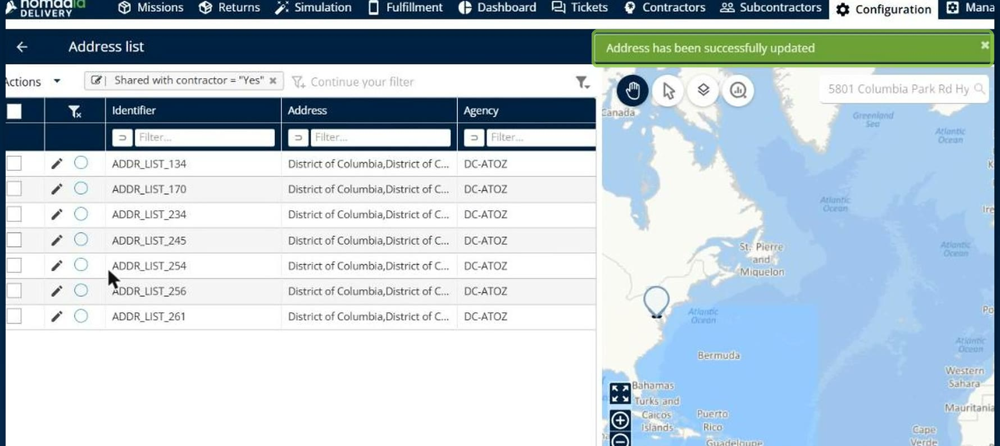

## Tips


**What contractors see**: Addresses that are not shared no longer appear in contractors' address searches and address pickers, both in the interface and through the API. Missions already assigned to those addresses are not affected.


## Related topics

* [Manage Global Address List](manage-global-address-list.md)
* [Manage Address List](9-7-contractors/manage-address-list.md)
* [Customize the Address Visibility](customizetheaddresslistvisibility/customizetheaddresslistvisibility.md)
