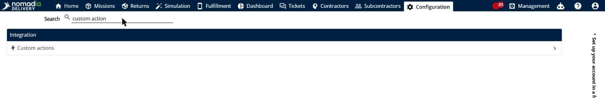
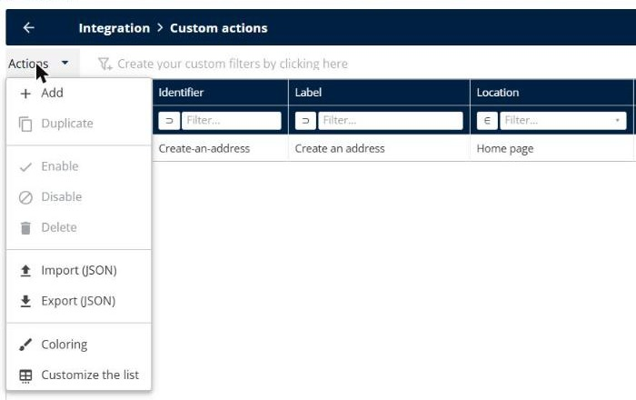
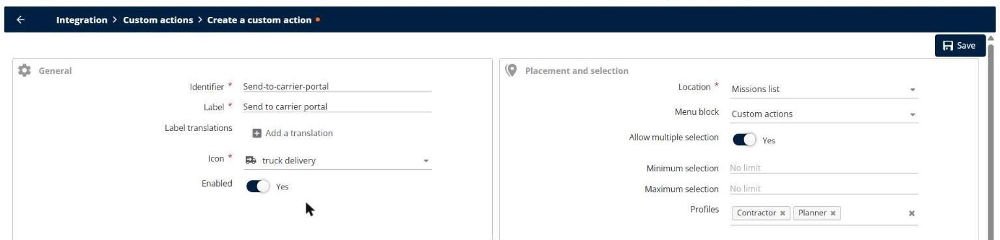
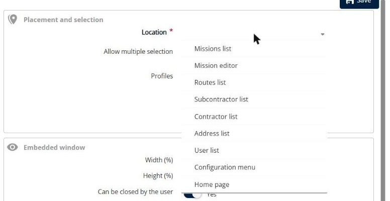
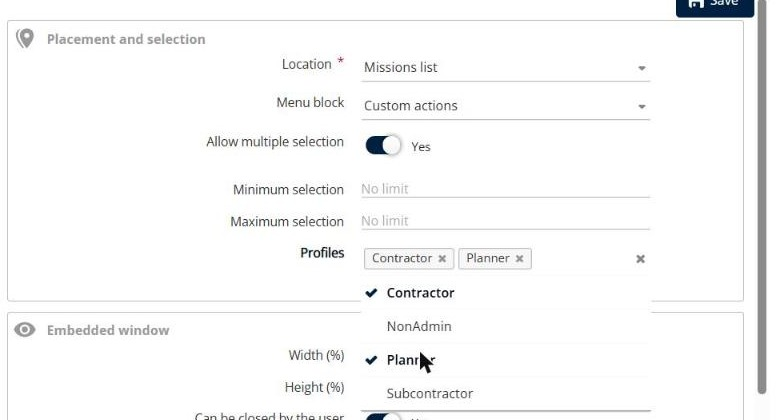
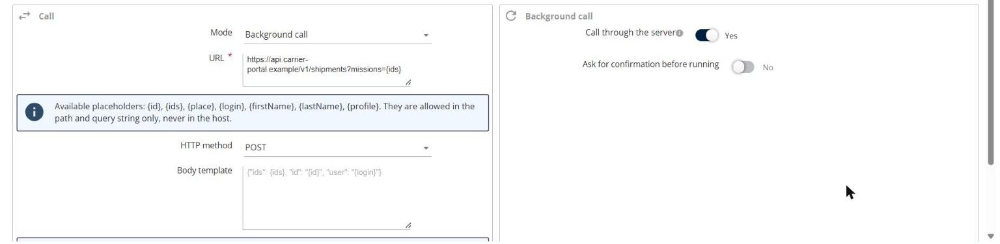
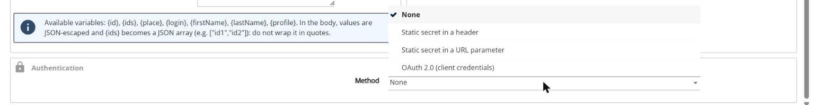
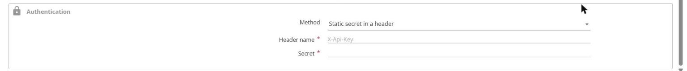
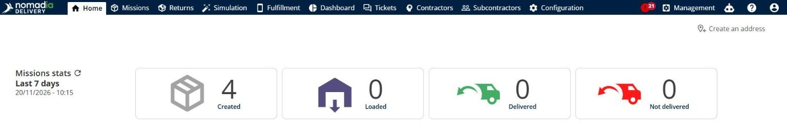

# Custom Actions

**Custom actions** let integrators plug external tools and workflows into the Nomadia Delivery back office, with no custom development. A custom action adds a button to a screen of your choice, such as the missions list or the mission editor. When a user clicks it, Nomadia Delivery calls the URL of your external system, for example a carrier portal, an ERP or a CRM, and passes the selected records.

## Before you begin

* Sign in to **Nomadia Delivery** with a user profile that has access to the **Configuration** tab.
* Have the URL of the external system to call and, if it requires one, its API secret.
* Know which user profiles must be able to run the action.

## Feature overview

* **General**: The **Identifier**, the **Label** that users see, optional **Label translations**, the **Icon**, and the **Enabled** switch.
* **Placement and selection**: Where the action appears and which records it runs on:
  * **Location**: **Missions list**, **Mission editor**, **Routes list**, **Subcontractor list**, **Contractor list**, **Address list**, **User list**, **Configuration menu** or **Home page**.
  * **Menu block**: The block of the **Actions** menu where the action appears on a list, for example **Custom actions**.
  * **Allow multiple selection**: On list locations, runs the action on several items at once. You can set a **Minimum selection** and a **Maximum selection**.
  * **Profiles**: Restricts the action to the selected user profiles. By default, the action is available to all profiles.
* **Call**: How the external system is called:
  * **Mode**: **Embedded window** opens the URL in a window inside Nomadia Delivery. **Background call** sends the request without leaving the screen.
  * **URL**: The endpoint to call. Placeholders such as **{id}** and **{ids}** pass the selected records. The available placeholders are {id}, {ids}, {place}, {login}, {firstName}, {lastName} and {profile}. They are allowed in the path and query string only, never in the host.
  * **HTTP method**: **GET**, **POST**, **PUT**, **PATCH** or **DELETE**. With **POST**, **PUT** and **PATCH**, you can also enter a **Body template**.
* **Background call**: **Call through the server** sends the request from the Nomadia Delivery server, which keeps the secret out of the browser. **Ask for confirmation before running** asks the user to confirm before the call.
* **Authentication**: How the credentials are passed: **None**, **Static secret in a header**, **Static secret in a URL parameter** or **OAuth 2.0 (client credentials)**.

## Create a custom action

1. Go to the **Configuration** tab, search for **custom action**, and then click **Custom actions** under **Integration**.

2. Click **Actions** > **Add**.

3. In **General**, enter the **Identifier** and the **Label**, for example **Send to carrier portal**, and then choose an **Icon** so that users spot the action instantly. Keep **Enabled** set to **Yes**.

4. In **Placement and selection**, choose the **Location** where the action appears, for example **Missions list**.

5. On a list location, turn on **Allow multiple selection** to run the action on several items at once. Optionally, select the **Profiles** that can run the action.

6. In **Call**, choose the **Mode**, enter the **URL** of the endpoint with the placeholders you need, for example **{ids}**, and then choose the **HTTP method**. For a **Background call**, turn on **Call through the server** to keep the secret out of the browser.

7. In **Authentication**, choose the **Method** that your external system expects.

8. For a static secret, enter the **Header name** or the parameter name, and the **Secret**.

9. Click **Save**.

### Result

The custom action appears exactly where you placed it, for the selected profiles. In the example below, a custom action placed on the **Home page** appears at the top right of the screen.

## Run a custom action

1. Go to the screen where the action is placed, for example the **Missions** tab.
2. Select the records, for example several missions.
3. Click **Actions**, and then click the custom action.

### Result

Nomadia Delivery calls the external system with the selected records, and the external system takes it from there.

## Tips


**Use clear labels and icons**: Give each action a short label and a recognizable icon, and add **Label translations** so that users see the label in their language.



**Restrict sensitive actions**: Select the **Profiles** that can run an action, so that only the right teams can trigger it.



**Keep secrets out of the browser**: For a background call with a secret, turn on **Call through the server**. The URL must use https, and placeholders are never allowed in the host.


## Related topics

* [Secure API Key Management](secure-api-key-management.md)
* [Customize Navigation Tabs](customize-navigation-tabs.md)
* [Fall Release 2026](fall-release-2026/fall-release-2026.md)
