# Custom Fields in Mission Pre-filters

Custom fields in mission pre-filters let you filter the mission list by the attributes that matter to your operations. Every custom mission field is available in the pre-filter criteria as soon as it is created, with comparisons that match its type. You can combine standard and custom fields in one pre-filter, and choose which pre-filters each user can see.

## Before you begin

* Sign in to **Nomadia Delivery** with a user profile that has access to the **Configuration** page.
* Make sure the custom mission fields you want to filter on exist. See [Custom Fields](8-6-missions/custom-fields.md).

## Feature overview

* **Mission pre-filters**: The page under **Configuration** > **Customization** that lists your mission pre-filters and the fields they use.
* **Custom tag**: The **Custom** tag shown next to each custom field in the criteria field list, so that you can tell custom fields from standard fields.
* **Automatic inclusion**: New custom fields appear in the criteria field list instantly, without any extra setup.
* **Field-type comparisons**: The comparisons offered for each field type, for example **is one of** and **is none of** for lists, **contains**, **equals**, **is empty** and **is not empty** for text, and **equals**, **greater than** and **less than** for numbers. Dates and yes/no fields are also supported.
* **Mission pre-filters of a user**: The field of a user's **Access** tab that sets which pre-filters the user can see.

## Add a custom field to a mission pre-filter

1. Check your custom mission fields and their types, for example **List of values**, **Number** or **Text**.

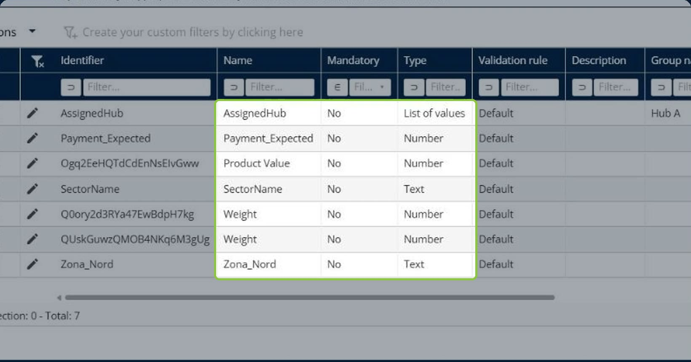

2. Go to **Configuration** > **Mission pre-filters**, and then click the **pencil icon** next to a pre-filter, or click **Actions** > **Add** to create one. See [Configure Mission Pre-filters](configuremissionprefilters.md).

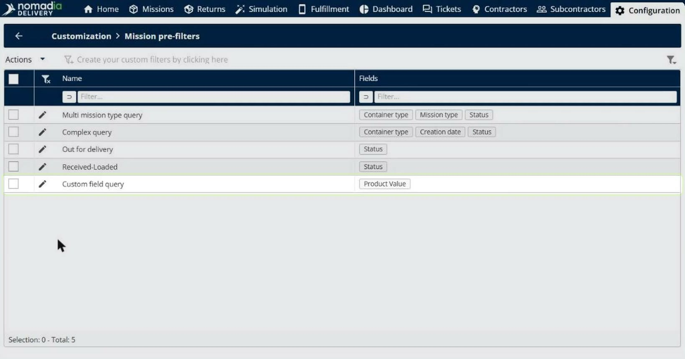

3. Under **Criteria**, open the field list of a condition. Custom fields appear with a **Custom** tag. Select a custom field.

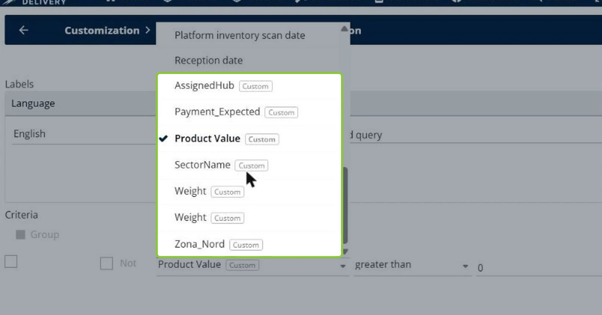

4. Choose the comparison. The comparisons depend on the field type:

   * For a list of values, choose **is one of** or **is none of**, and then pick the values straight from the list.

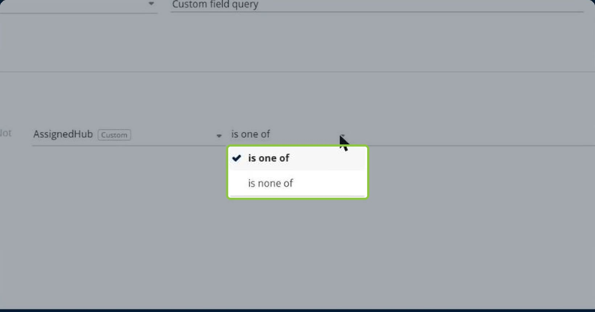

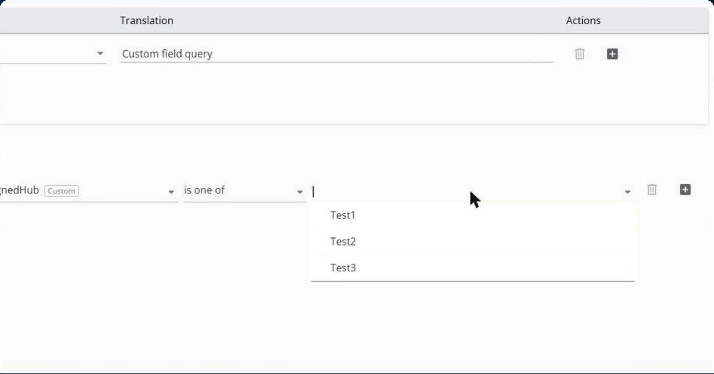

   * For text, choose **contains**, **equals**, **is empty** or **is not empty**, and then type the text.

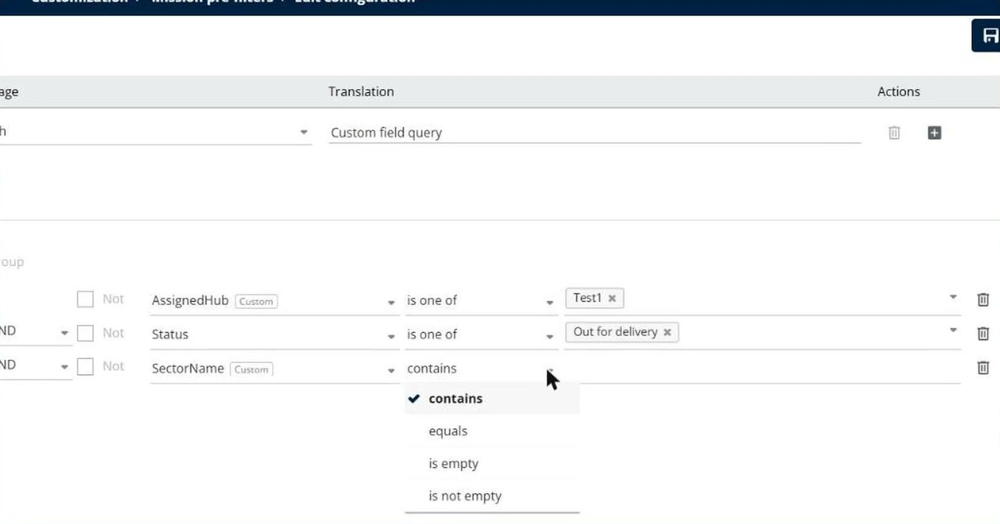

   * For a number, choose **equals**, **greater than** or **less than**, and then enter the number.

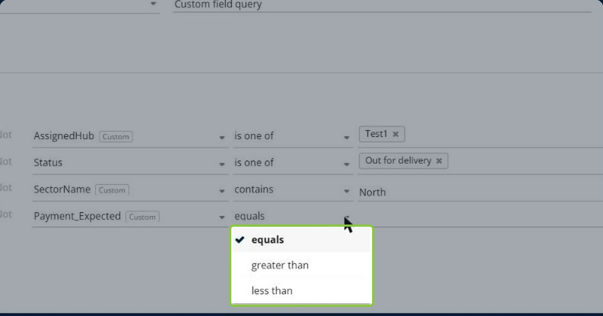

5. Add other conditions as needed, with standard fields such as **Status** and custom fields, and connect them with **AND** or **OR**.

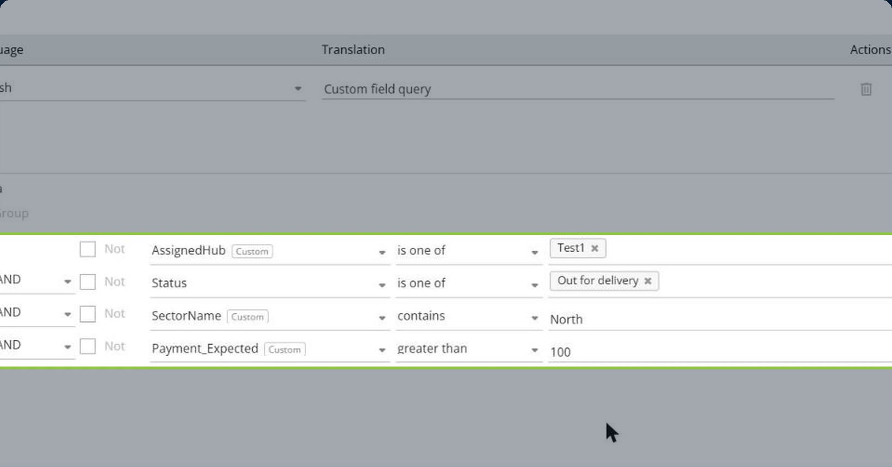

6. Save the pre-filter.

## Choose which pre-filters a user can see

1. Go to **Configuration** > **Manage users**, and then click the **pencil icon** next to the user. The **Access** tab opens.

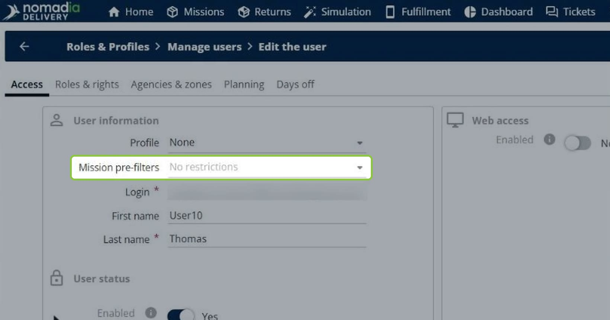

2. In **Mission pre-filters**, select the pre-filters the user can see.

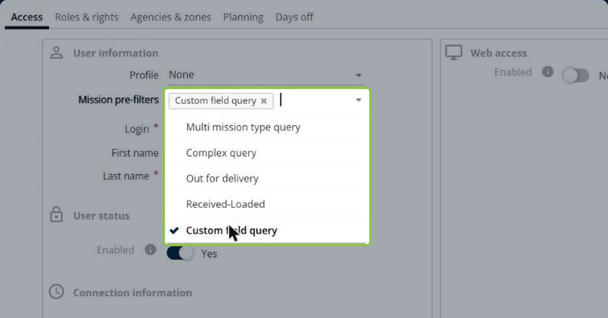

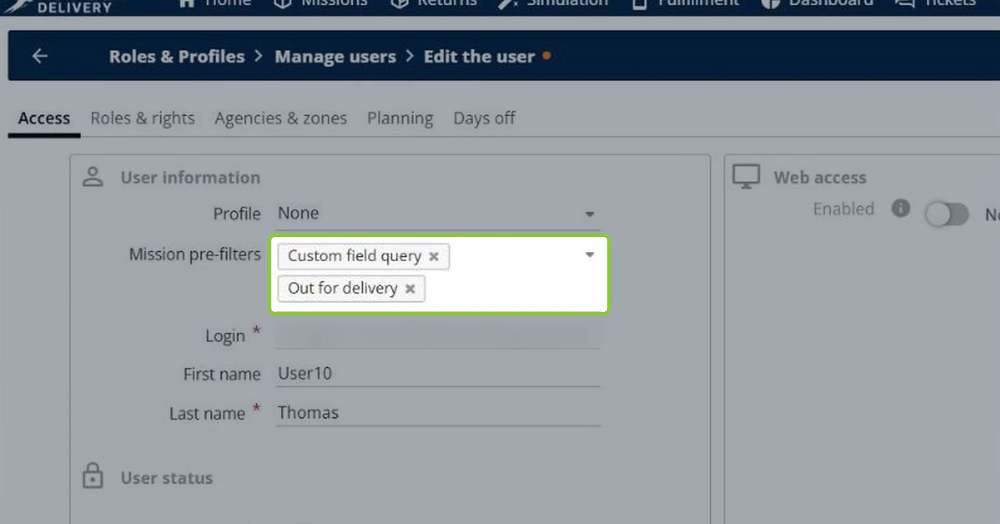

3. Save the user.

### Result

The user sees only the pre-filters that are relevant to them. If no pre-filter is selected, the field shows **No restrictions**.

## Apply a pre-filter in the mission list

1. On the **Missions** page, click the pre-filter box at the top left of the page to open the pre-filter panel.
2. In **Mission pre-filter configuration**, choose the pre-filter. The panel shows the number of matching missions.

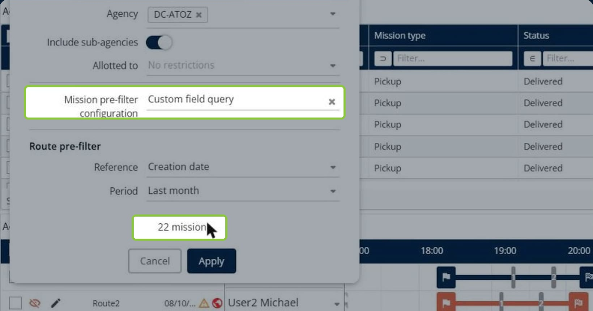

3. Click **Apply**.

### Result

The mission list shows only the missions that match the pre-filter, for example 22 missions out of 364.

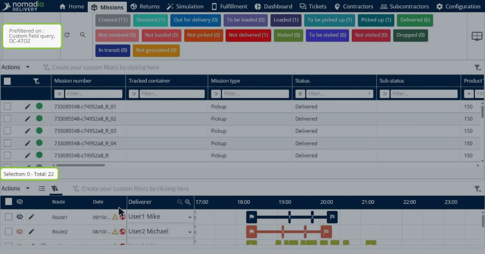

## Tips


**One pre-filter, all your criteria**: Combine standard fields and custom fields in a single pre-filter instead of creating several pre-filters.


## Related topics

* [Configure Mission Pre-filters](configuremissionprefilters.md)
* [Set missions display (prefilter)](8-6-missions/understanding-the-missions-page/pre-filters/set-missions-display-prefilter.md)
* [Custom Fields](8-6-missions/custom-fields.md)
