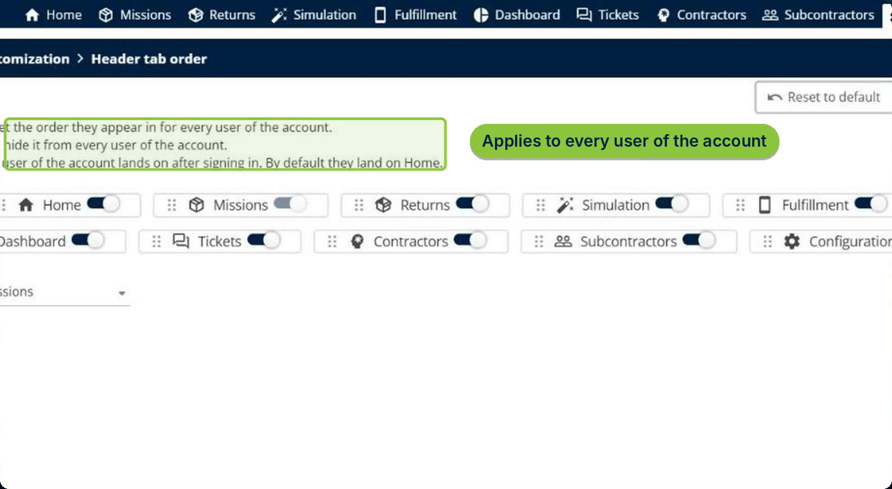
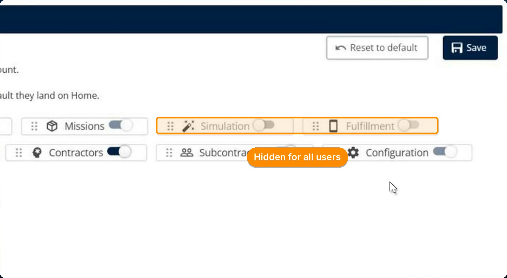
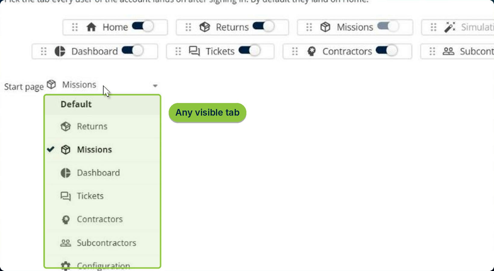
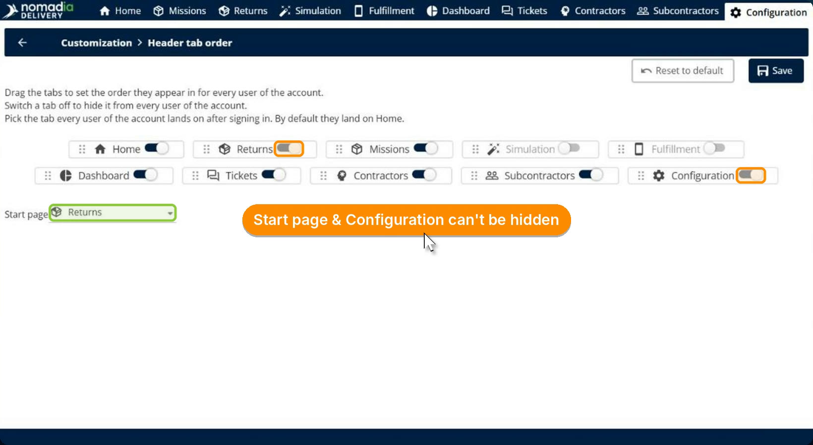
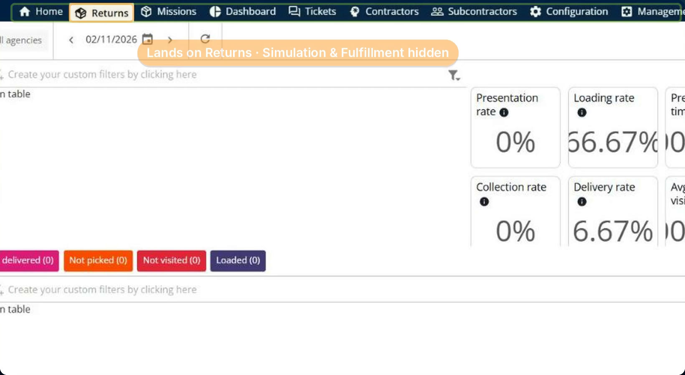
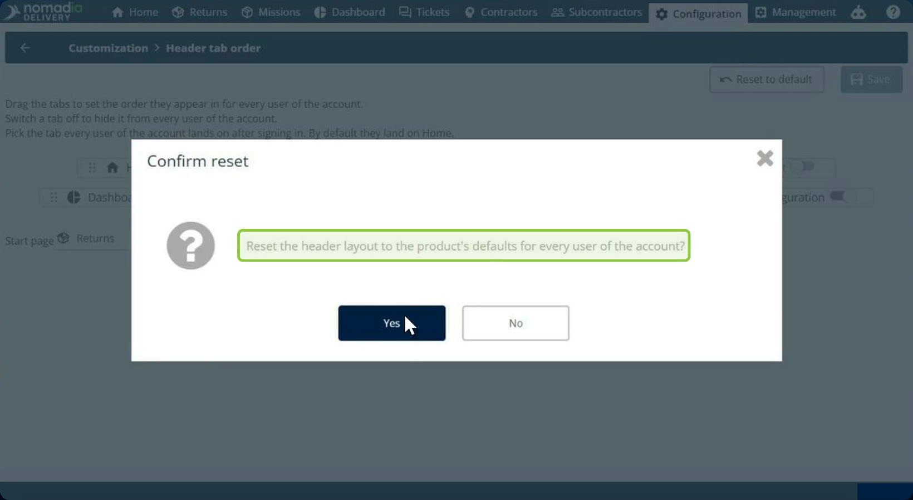
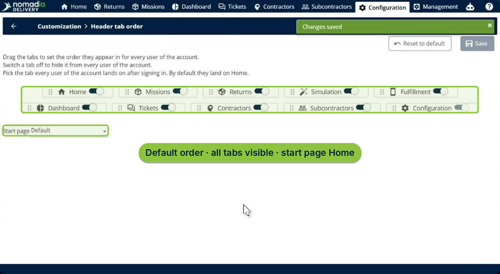

# Customize Navigation Tabs

The **Header tab order** page lets an administrator choose how the tabs of the main header appear for every user of the account. You can drag the tabs into the order your team works in, hide the tabs it doesn't use, and choose the page every user lands on after signing in. A single click restores the default layout.

## Before you begin

* Sign in to **Nomadia Delivery** as an administrator with access to **Configuration**.
* Keep in mind that the layout applies to every user of the account.

## Feature overview

* **Header tab order**: The page under **Configuration** > **Customization** that lists every tab of the main header, such as **Home**, **Missions**, **Returns**, **Simulation**, **Fulfillment**, **Dashboard**, **Tickets**, **Contractors**, **Subcontractors** and **Configuration**.
* **Drag handle**: The dotted handle on the left of each tab. Drag a tab to change its position in the header.
* **Visibility switch**: The switch on the right of each tab. Switch a tab off to hide it from every user of the account.
* **Start page**: The tab every user lands on after signing in. By default, users land on **Home**. You can choose any visible tab.
* **Always shown**: The tab chosen as the start page and the **Configuration** tab can't be hidden.
* **Reset to default**: Restores the default order, shows every tab again and sets the start page back to **Home**.
* **New tabs**: Tabs added by future releases appear at the end of the header automatically.

## Open the Header tab order page

1. Go to **Configuration**. In the **Customization** section, click **Header tab order**.

The page shows every tab of the main header, in its current order, with its visibility switch.

## Reorder the tabs

1. Drag a tab by its handle and drop it at its new position. For example, drag **Returns** next to **Home**.

The other tabs move to make room, and **Returns** now follows **Home**.

## Hide tabs

1. Switch off the tabs your team doesn't use. For example, switch off **Simulation** and **Fulfillment**.

The hidden tabs are greyed out. They will be hidden for every user of the account.

## Choose the start page

1. Open the **Start page** list, and then choose the tab every user lands on after signing in, for example **Returns**. You can choose any visible tab, or **Default** to land on **Home**.

The tab chosen as the start page and the **Configuration** tab can't be switched off.

2. Click **Save**.

### Result

The new layout applies to every user of the account. After signing in, users land on the start page you chose, and the hidden tabs no longer appear in the header. In this example, users land on **Returns**, and **Simulation** and **Fulfillment** are hidden.

## Restore the default layout

1. On the **Header tab order** page, click **Reset to default**.
2. In the **Confirm reset** window, click **Yes**.

### Result

The default order is restored, every tab is visible again and the start page is set back to **Default**, so users land on **Home**.

## Tips


**Match the header to your daily work**: Put the tabs your team uses most at the start of the header, and choose the page they open first as the start page.



**New tabs are never lost**: Tabs added by future releases are added at the end of the header automatically, even if you have customized the order.


## Related topics

* [Keyboard Shortcuts Configuration](keyboard-shortcuts-configuration.md)
* [Manage Users](7-5-manage-users/README.md)
* [Home Page](readme-1/README.md)
