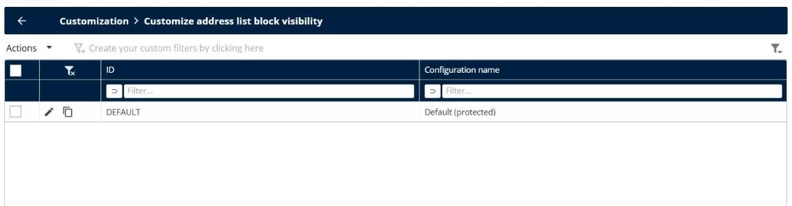
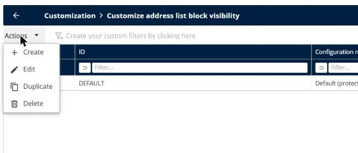
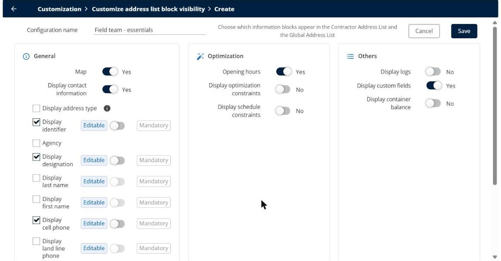
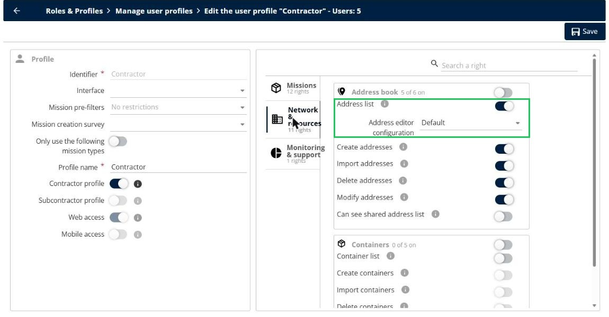

# Address List Block Visibility per User Profile

**Address list block visibility per user profile** lets administrators decide which blocks of the address list each role sees. Not every user needs every part of an address. You create named visibility configurations, choose the blocks that each one shows, such as the map, the contact information or the optimization constraints, and then assign a configuration to a user profile.

## Before you begin

* Sign in to **Nomadia Delivery** with a user profile that has access to the **Configuration** tab and to **Manage user profiles**.
* Know which blocks of the address list each role needs to see.

## Feature overview

* **Customize address list block visibility**: The table under **Configuration** > **Customization** that lists every visibility configuration of the account, with its **ID** and its **Configuration name**.
* **Default (protected)**: The default configuration, always listed first. It can't be deleted.
* **Create**, **Edit**, **Duplicate** and **Delete**: The actions to manage the configurations. **Duplicate** creates an unassigned copy with the same settings and a proposed name, so that you don't start from scratch.
* **Blocks**: The parts of the address list that a configuration shows or hides:
  * **General**: **Map** and **Display contact information**. When contact information is shown, you choose each field, such as the identifier, the designation or the cell phone, and whether it is editable or mandatory.
  * **Optimization**: **Opening hours**, **Display optimization constraints** and **Display schedule constraints**.
  * **Others**: **Display logs**, **Display custom fields** and **Display container balance**.
* **Address editor configuration**: The drop-down in a user profile, under **Network & resources** > **Address book** > **Address list**, where you choose the configuration for the profile. It appears only when the **Address list** right is enabled.
* **Scope**: The configuration applies to the global address list and to contractor address lists opened from the back office.
* **No regression**: Users whose profile has no assigned configuration keep seeing every block, as before.

## Create a visibility configuration

1. Go to the **Configuration** tab. Under **Customization**, click **Customize address list block visibility**.

2. Click **Actions** > **Create**.

3. Enter a **Configuration name**, for example **Field team – essentials**.
4. Turn on the blocks that users must see, and turn off the others. Under **Display contact information**, select the fields to show, and set them as **Editable** or **Mandatory** if needed.

5. Click **Save**.

### Result

The configuration appears in the table, ready to edit, duplicate or delete at any time.

## Assign a configuration to a user profile

1. Go to the **Configuration** tab, and then click **Manage user profiles**.
2. Click the **Pencil** icon of the profile, for example **Contractor**.
3. Click **Network & resources**.
4. Under **Address book**, make sure that **Address list** is turned on.
5. In **Address editor configuration**, select the configuration.

6. Click **Save**.

### Result

Users with this profile see only the blocks allowed by the configuration whenever they open an address list, including the contractor address lists opened from the back office. If you turn off **Address list**, the drop-down is hidden.

## Tips


**Start from a copy**: Use **Duplicate** to create a variant of an existing configuration, then change only the blocks that differ.



**Name configurations after roles**: Use names such as **Planners – full detail** or **Field team – essentials**, so that the right configuration is easy to pick in each profile.



**Nothing changes until you assign**: Profiles without an assigned configuration keep seeing every block of the address list.


## Related topics

* [Customize the Address Visibility](customizetheaddresslistvisibility.md)
* [Manage Global Address List](../manage-global-address-list.md)
* [Manage Address List](../9-7-contractors/manage-address-list.md)
* [Manage User Profile](../7-5-manage-users/6-manage-user-profile.md)
