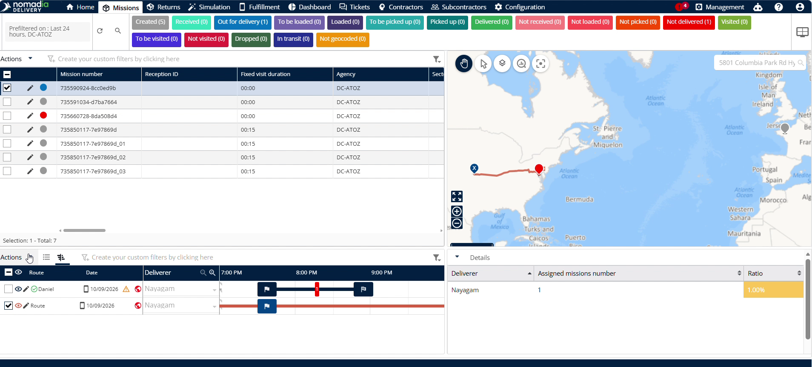
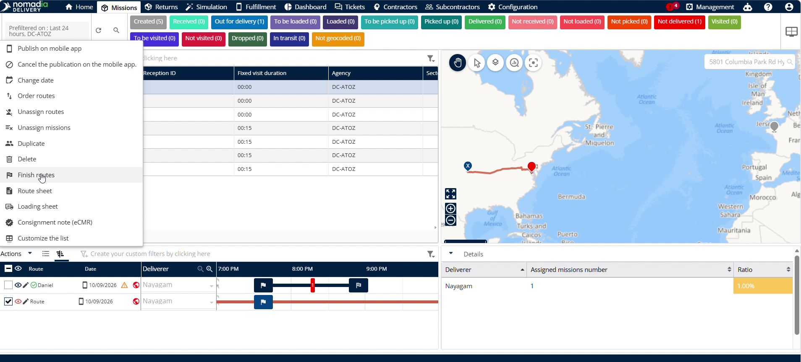
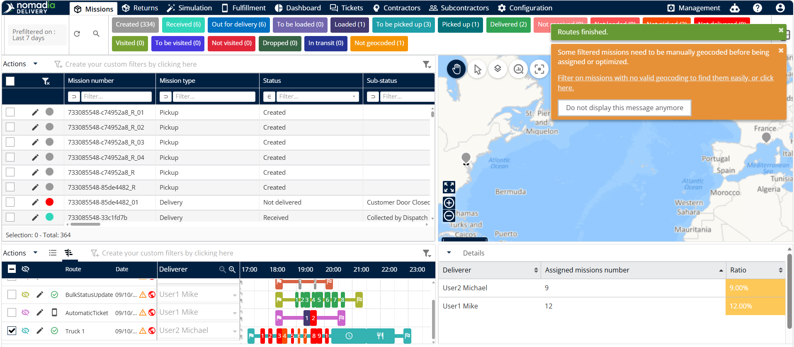

# Finish the Route

The **Finish the Route** feature lets dispatchers' complete delivery routes from the back office. Use this feature when a deliverer forgets to finish their route after loading. You will achieve accurate real-time route statuses across your fleet.

## Before you begin

* **Back Office Access**: Active account in the Nomadia Delivery back office.
* **Assigned Route**: A route assigned and published to a deliverer.

1. Log into the **Back Office** system.

2. Confirm the driver has completed loading their assigned route.

## Feature overview

* **Deliverer**: Selects the target driver profile from the back-office dashboard.
* **Actions**: Opens administrative options for the selected deliverer.
* **Finish the Route**: Initiates manual route closure from the back office.

## Finish a route

1. Select the **Deliverer** in the back office navigation menu.

2. Click **Actions** next to the selected deliverer.

3. Click **Finish the Route** in the dropdown list.

4. Click **Yes** on the pop-up asking "Do you really want to finish the route?".

### Result

The Route has been finished successfully.&#x20;

<figure><figcaption></figcaption></figure>

When you finish the route, any missions that were not completed are updated automatically, so you do not need to change them manually:

* Missions still in **Loading** status are automatically changed to **Not delivered**.
* Missions still in **To be picked up** status are automatically changed to **Not picked**.

This ensures that no unfinished mission stays open once the route is closed.

## Tips


**Remote Route Closure**: Finish open routes directly from the back office when drivers forget to complete them after loading.



**Unclosed Routes**: Avoid leaving completed routes open in the system to prevent inaccurate route status tracking.


## Related topics

* [Manual Route Creation](8-6-missions-1/manualroutecreation.md)
* [Route Editor](routeeditor.md)
* [Assign Pick up and Delivery Missions](assignpickupanddelivery.md)
