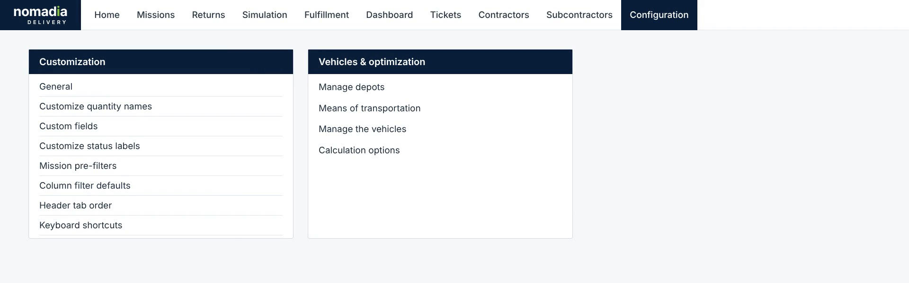
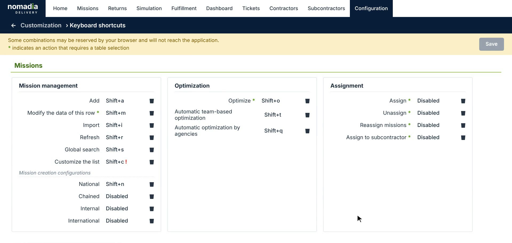
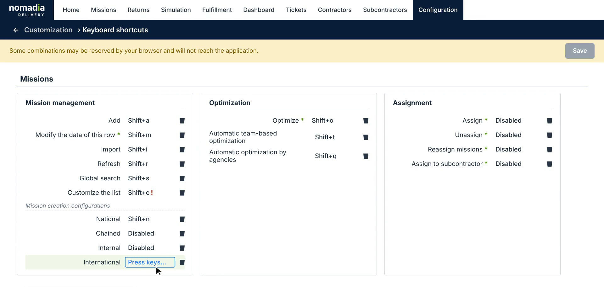
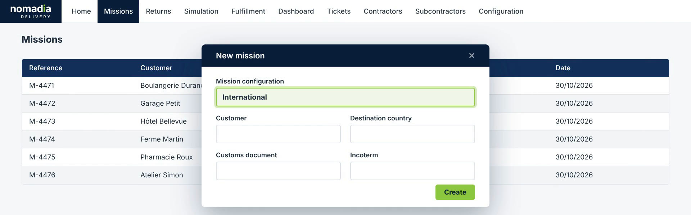
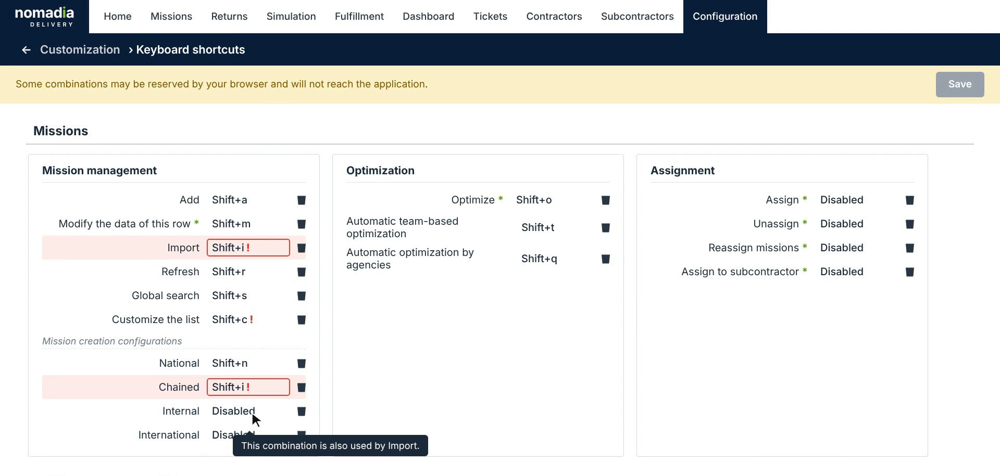
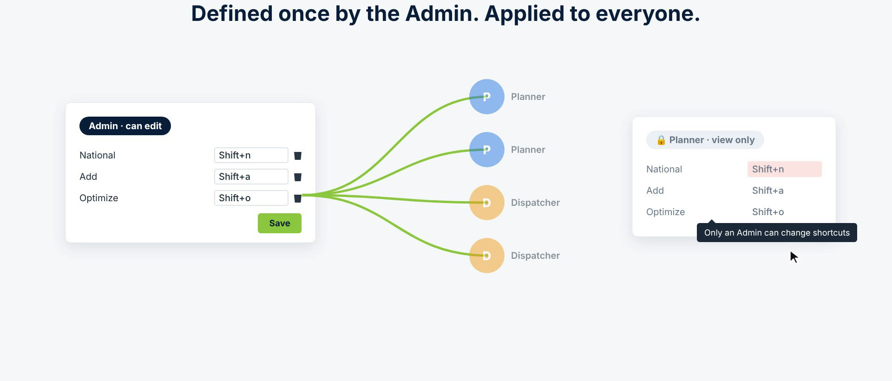

# Keyboard Shortcuts Configuration

The **Keyboard shortcuts** page brings every keyboard shortcut of Nomadia Delivery together in one place. An administrator defines one shortcut set for the whole account, and every planner and dispatcher uses the same shortcuts. You can assign a shortcut to the key actions of the **Missions**, **Route table**, **Documents** and **Fulfillment** pages, including a shortcut that opens the mission creation form with the right mission configuration already loaded. Conflicts and combinations reserved by the browser are flagged before you save.

## Before you begin

* Sign in to **Nomadia Delivery** as an administrator. Only an administrator can change the shortcuts. Other users can view them, but they can't edit them.

## Feature overview

* **Keyboard shortcuts page**: The page under **Configuration** > **Customization** that lists every action that can have a shortcut, grouped by page and by section, for example **Missions** > **Mission management**, **Optimization** and **Assignment**.
* **Account-wide shortcuts**: The shortcuts are defined once by the administrator and apply to every user of the account.
* **Mission creation configurations**: One shortcut per mission configuration, for example **National**, **Chained**, **Internal** or **International**. The shortcut opens the **New mission** form with that configuration selected.
* **Actions that need a selection**: An action marked with a green asterisk (**\***) requires you to select rows in the table first, for example **Optimize** or **Assign**.
* **Disabled**: The action has no shortcut. Click the trash icon next to a shortcut to remove it.
* **Conflict detection**: A combination that is already used by another action is highlighted in red. A combination reserved by the browser is flagged with a warning, because it will not reach the application.

## Open the Keyboard shortcuts page

1. Go to **Configuration**. In the **Customization** section, click **Keyboard shortcuts**.

2. Review the current shortcuts. Each page has its own sections. For example, under **Missions**, the **Mission management** section lists **Add** (**Shift+a**), **Import** (**Shift+i**), **Refresh** (**Shift+r**) and **Global search** (**Shift+s**).

3. Scroll down to see the shortcuts of the other pages, such as **Route table**, **Documents** and **Fulfillment**.

## Assign a shortcut

1. On the **Keyboard shortcuts** page, click the shortcut field of the action, for example **International** under **Mission creation configurations**. The field shows **Press keys...**.

2. Press the key combination you want to use, for example **Shift+x**.
3. Click **Save**.

### Result

The shortcut is saved for the whole account. Every user can now use it. For example, on the **Missions** page, pressing **Shift+x** opens the **New mission** form with the **International** mission configuration already selected.

## Fix conflicts before saving

1. If the combination you press is already used by another action, both fields are highlighted in red. Hover over the field to see which action already uses it, for example **This combination is also used by Import.**

2. If the combination is reserved by your browser, for example **Ctrl+t**, the field shows a warning: **Reserved by your browser: Ctrl+t will not reach the application.**

3. Press another combination, or click the trash icon to remove the shortcut, and then click **Save**.

## Who can change the shortcuts

Only an administrator can edit the shortcuts. Planners and dispatchers see the same shortcut set in view-only mode. If they try to change a shortcut, a message tells them that only an administrator can change shortcuts.

## Tips


**Prefer Shift combinations**: Many **Ctrl** and **Alt** combinations are reserved by the browser and never reach the application. Combinations with **Shift** are a safer choice.



**Select rows first**: For an action marked with an asterisk (**\***), such as **Optimize** or **Assign**, select the missions in the table before you press the shortcut.


## Related topics

* [Missions](8-6-missions/README.md)
* [Change the order of mission status shortcuts](8-6-missions/understanding-the-missions-page/change-the-order-of-mission-status-shortcuts.md)
* [Manage Users](7-5-manage-users/README.md)
