# Track Individual Containers by Unique ID

Container tracking lets you follow every container by its unique ID across its full journey. You register each container once, link it to the missions that carry it, and every scan, status change and condition change is recorded in the container's history. Supervisors get a live view of the whole fleet and can quickly find lost or damaged containers.

## Before you begin

* Sign in to **Nomadia Delivery** with a user profile that has access to **Configuration**.
* Have the unique code of each container available. This is the code printed on the container's barcode or QR label.
* Make sure the container types you need exist. See [Manage Container Types](README.md).

## Feature overview

* **Container list**: The list under **Configuration** that shows every registered container with its code, container type, cost, purchase date, condition, status, last known position, last seen date, active state and holding vehicle.
* **Code**: The unique code of the container, as printed on its barcode or QR label.
* **Recorded in history on save**: The **Condition** (for example **Good** or **Damaged**) and **Status** (for example **Received**, **To be collected** or **Lost**) of the container. They are written to the container's history as soon as you save.
* **Stay in vehicle**: When enabled, the status can only be changed manually (**Received** or **Lost**), and status changes triggered by missions are ignored.
* **Holding vehicle** and **Last known position**: Read-only fields that are updated from the field when drivers scan the container.
* **Tracked container**: The field in the mission form that links the mission to a registered container. The **Scannable container code** field above it is free text and is not checked against the registry.
* **History**: The section of a container that lists every event in its life, with what changed, who recorded it and when.

## Register a container

1. Under **Configuration**, open the **Container list**. It shows every registered container.

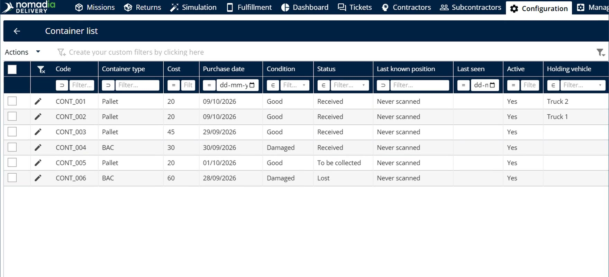

2. Click **Actions**, and then click **Add**.

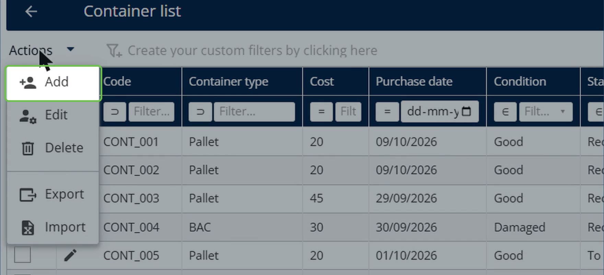

3. Enter the unique **Code** of the container, the one printed on its barcode or QR label, and then choose the **Container type**.

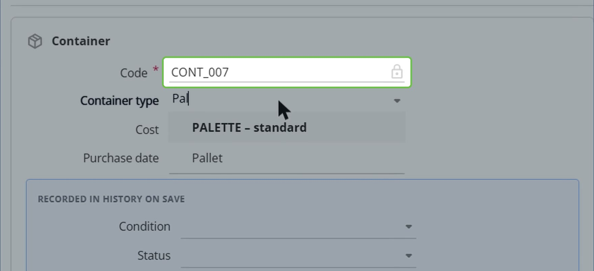

4. Enter the **Cost** and **Purchase date**, and then choose the **Condition** and **Status** under **Recorded in history on save**.

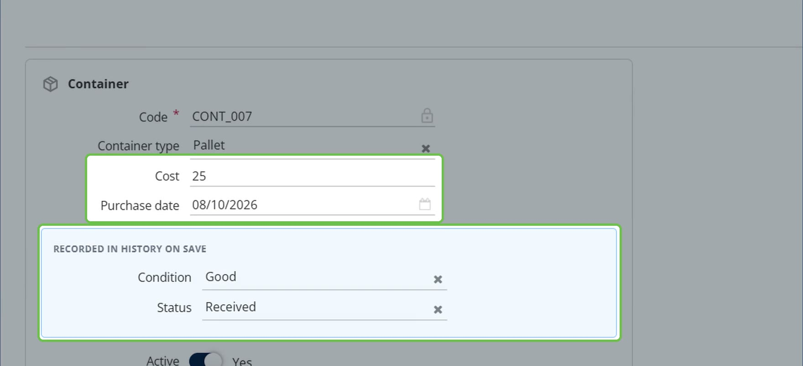

5. Click **Save**.

### Result

A notification confirms that the container was added. The container appears in the **Container list**, ready to be tracked, and its condition and status are written to its history.

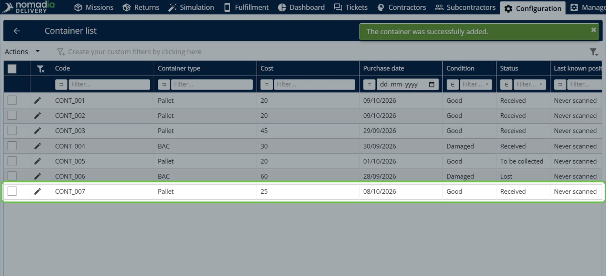

## Assign a container to a mission

1. Open the mission form and find the **Tracked container** field.

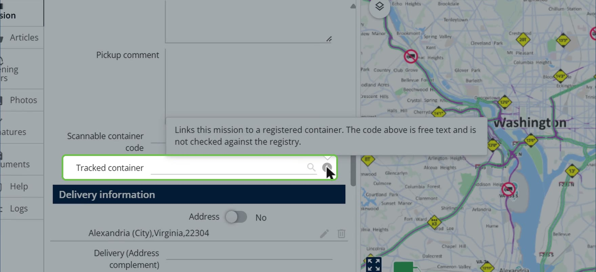

2. Scan or type the container code. Matching containers appear with their type and condition, so a damaged container is easy to spot.

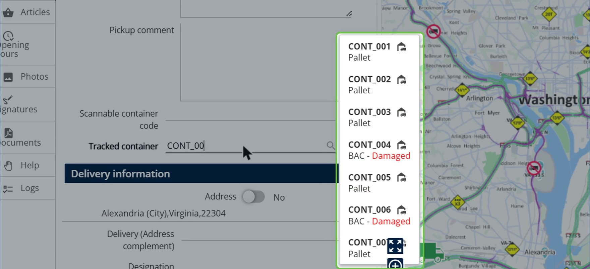

3. Select the container, and then save the mission.

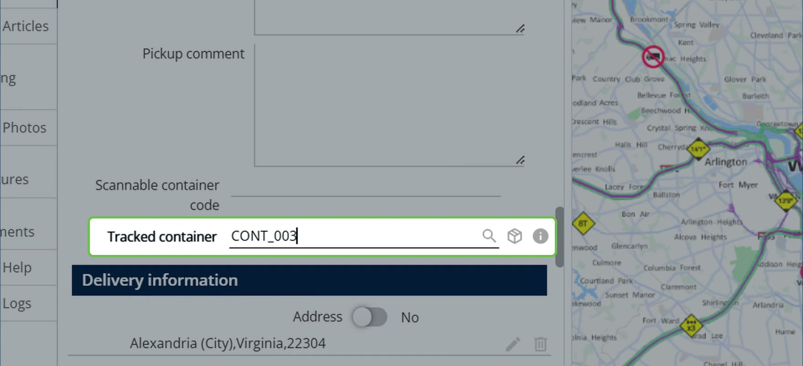

### Result

The link is recorded straight away. The container's **History** shows the mission, who made the change and when.

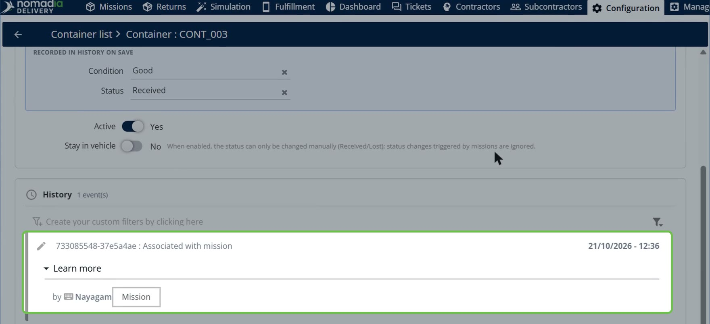

## View the history of a container

1. In the **Container list**, click the **pencil icon** next to a container to open it.

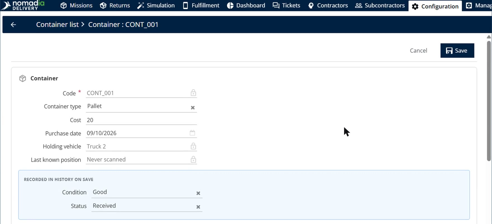

2. Check the **Holding vehicle** and **Last known position** fields to see where the container is right now. They are updated from the field.
3. Scroll down to the **History** section. It lists every event in the container's life. Each driver scan, at reception, at delivery and at pickup, is added automatically.

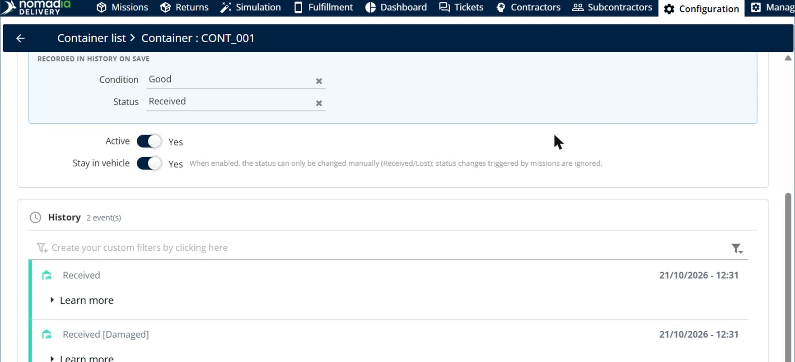

4. Click **Learn more** on an event to see exactly what changed, the user who recorded it and the timestamp.

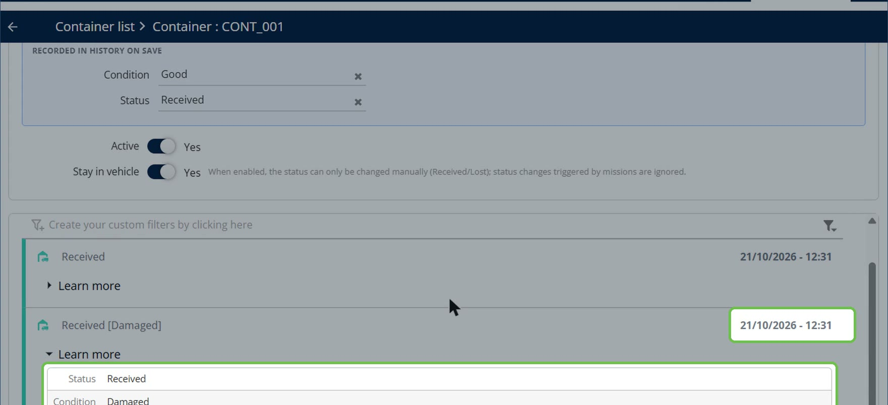

## Monitor the container fleet

1. In the **Container list**, review the **Status**, **Last known position**, **Last seen** and **Holding vehicle** columns. They give you a live view of the whole fleet.

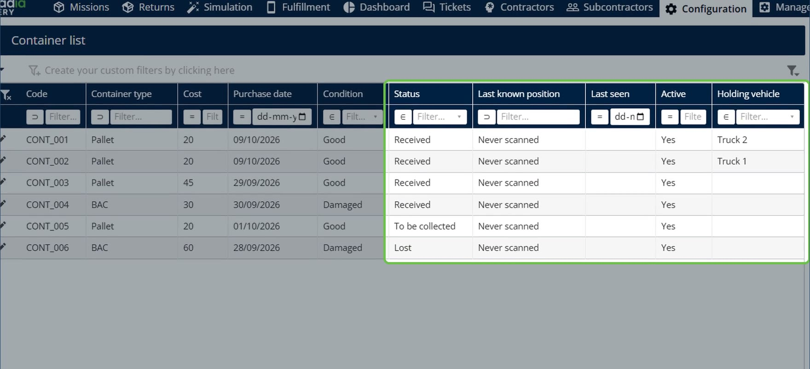

2. To find a missing container, open the filter of the **Status** column and choose **Lost**.

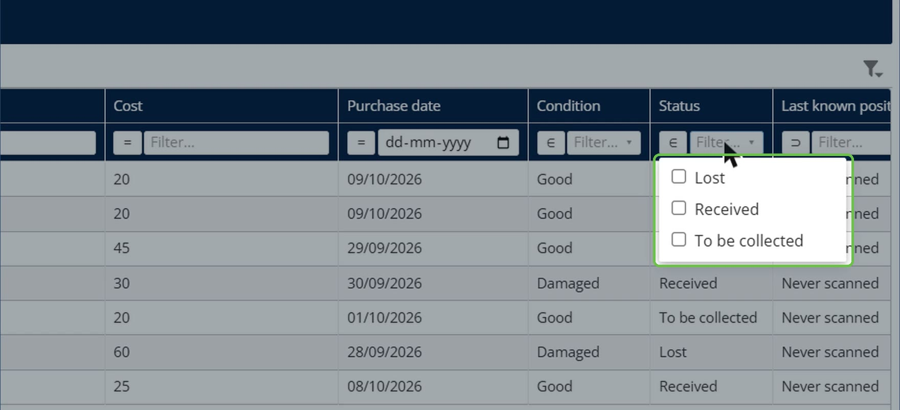

The list shows only the lost containers, with their full history one click away.

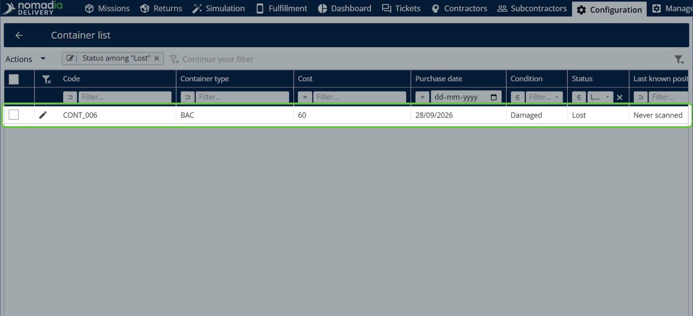

3. To list every damaged container that needs attention, filter the **Condition** column on **Damaged**.

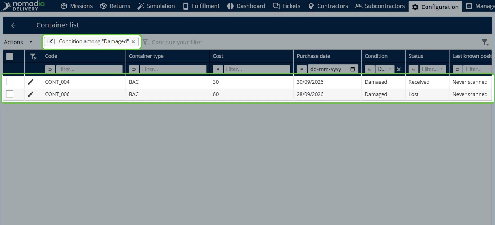

## Tips


**Use the Tracked container field**: Only the **Tracked container** field links a mission to a registered container. The **Scannable container code** field is free text and is not checked against the registry.


## Related topics

* [Manage Container Types](README.md)
* [Adding a Mission](../8-6-missions/adding-a-mission-beta/README.md)
* [Container child missions](container-child-missions.md)
