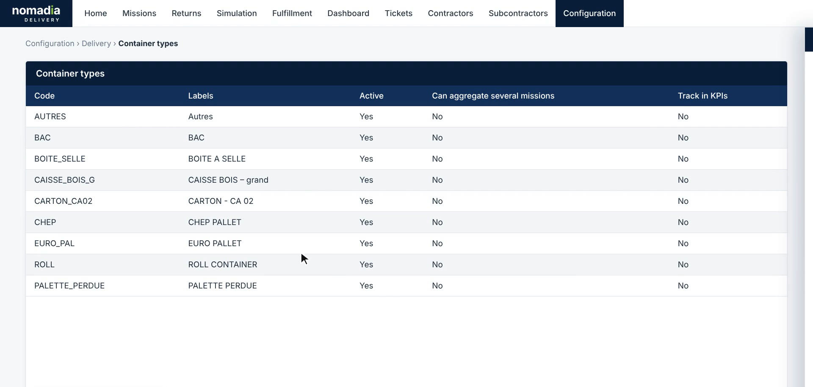
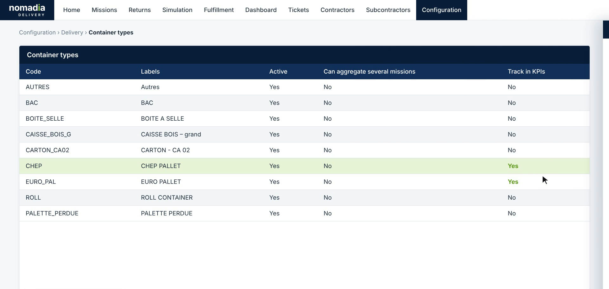
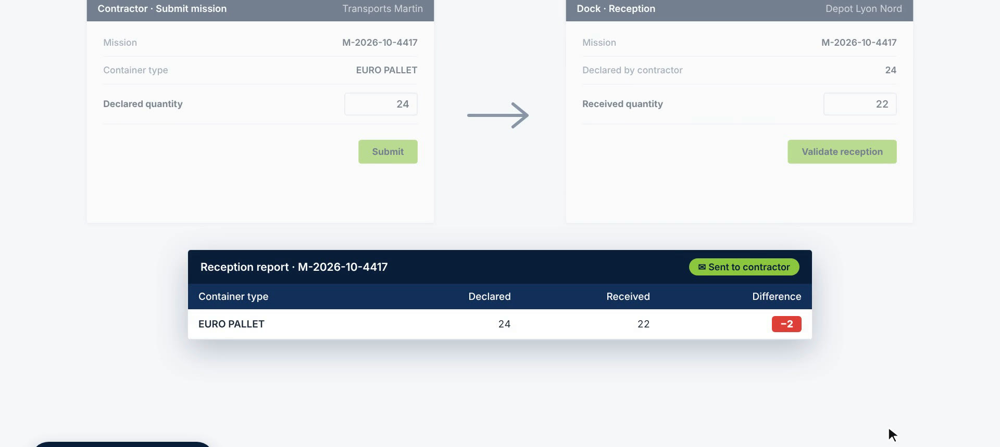
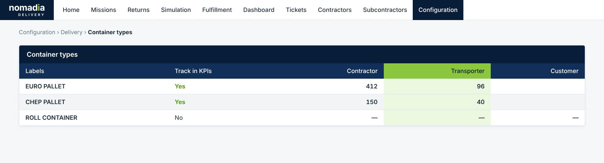
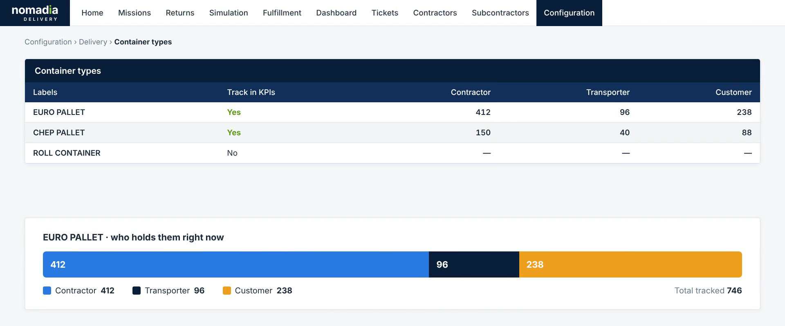

# Track Pallet Counts Across the Delivery Cycle

Pallet tracking lets you follow the number of pallets of a container type through the whole delivery cycle. The contractor declares a quantity, the dock records what it receives, the driver records the pallets delivered to and picked up from each customer, and the customer holds the pallets in between. Nomadia Delivery compares the counts at each step, so you spot losses early and always know which party holds your containers.

## Before you begin

* Sign in to **Nomadia Delivery** with a user profile that has access to **Configuration** and **Dashboard**.
* Make sure the container types you want to follow exist, for example **EURO PALLET** or **CHEP PALLET**. See [Manage Container Types](README.md).

## Feature overview

* **Track in KPIs**: An option of the container type. When it is enabled, the pallet count for this container type is followed through the delivery cycle and shown in a dedicated KPI on the dashboard.
* **Dedicated pallet KPI**: A tile on the **Dashboard** that shows the number of pallets in circulation for a tracked container type, with its trend.
* **Declared vs. received**: The contractor declares the quantity sent with the mission. The dock enters the quantity actually received. Any difference appears in the **Reception report**, which is sent to the contractor.
* **Driver recording**: In the mobile app, the driver records at each stop the number of pallets **Delivered** to the customer and **Picked up** (returns).
* **Owner fields**: The **Contractor**, **Transporter** and **Customer** columns of the container types list. They show how many pallets of each tracked type each party holds right now.

## Enable pallet tracking for a container type

1. Go to **Configuration** > **Delivery** > **Container types**. The list shows every container type with its **Track in KPIs** column.

2. Click the container type you want to track, for example **EURO PALLET**. The **Edit container type** panel opens.

3. Turn on **Track in KPIs**. A message explains that the pallet count for this container type is shown in a dedicated KPI on the dashboard.

4. Click **Save**.

### Result

The **Track in KPIs** column shows **Yes** for the container type. Repeat the steps for every container type you want to follow, for example **CHEP PALLET**.

## Follow the pallet KPI on the dashboard

1. Open the **Dashboard**.
2. Below the **Missions stats**, find the dedicated KPI of each tracked container type. It shows the number of **pallets in circulation** and a trend line.

## Compare declared and received quantities

1. When the contractor submits a mission, they enter the **Declared quantity** of the tracked container type, and then click **Submit**.

2. At reception, the dock sees the quantity **Declared by contractor**. The dock enters the **Received quantity**, and then clicks **Validate reception**.

### Result

A **Reception report** is created for the mission and sent to the contractor. It shows the **Declared**, **Received** and **Difference** values for each container type. A difference is highlighted in red, so a loss is caught at the dock instead of weeks later.

## Record pallets at each stop in the mobile app

1. At a stop, the driver opens the **Containers** section of the tracked container type.
2. The driver uses the **+** and **–** buttons to set the number of pallets **Delivered** to the customer and **Picked up** from the customer.
3. The driver taps **Validate stop**.

### Result

The delivered and picked-up counts update who holds the pallets: delivered pallets move to the customer, and picked-up pallets move back to the transporter.

## See who holds your pallets

1. Go to **Configuration** > **Delivery** > **Container types**.
2. Review the **Contractor**, **Transporter** and **Customer** columns. For each tracked container type, they show how many pallets each party holds right now. Container types that are not tracked show a dash.

3. Check the breakdown bar below the list. It shows, for a tracked container type, who holds the pallets right now and the **Total tracked**.

## Tips


**Track only what you need**: Turn on **Track in KPIs** only for the container types you want to follow, such as returnable pallets. The other types keep working as before and show a dash in the owner fields.



**Act on differences quickly**: The reception report is sent to the contractor as soon as the dock validates the reception, so you can settle a missing pallet with the contractor while the mission is still recent.


## Related topics

* [Manage Container Types](README.md)
* [Edit a Container Type](edit-a-container-type.md)
* [Track Individual Containers by Unique ID](track-individual-containers-by-unique-id.md)
