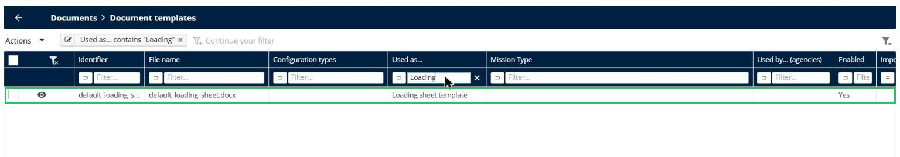
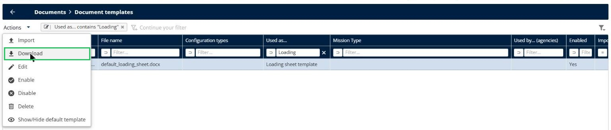

# Article Aggregation in Loading Sheets

**Article aggregation in loading sheets** lets route loading sheets show the planned quantity of each article for each mission, together with its total for the whole route. Deliverers no longer check the missions one by one and add up the quantities by hand, which takes time and causes loading errors. They load the vehicle correctly in a single pass.

## Before you begin

* Sign in to **Nomadia Delivery** with a user profile that has access to the **Configuration** tab.
* Know how to download, edit, and import a Word template. For more information, see [Customizing Word Templates](customizing-word-templates.md).
* Know the codes of the articles that you want to show on the loading sheet. For more information, see [Manage Articles](../manage-articles/README.md).

## Feature overview

* **Mission article field**: A field that you add to a loading sheet template with an article code. For each mission of the route, it returns the planned quantity of that article.
* **Route article total**: A field that adds up the planned quantities of an article across the missions of the route, and prints one total per article for the route.
* **Several articles per mission**: When a mission carries several articles, each article has its own planned quantity, and each quantity counts toward its own route total.
* **Missions counted**: Delivery and drop shipping missions are counted. Pickup missions and crossing points stay on the sheet, but they are left out of the totals.
* **Article not carried**: If no mission on the sheet carries the article code, the field returns **0** at mission level and at route level, without an error.
* **Several routes**: When you print the loading sheets of several routes at once, each sheet shows only the totals of its own route. Nothing carries over from one route to another.
* **No change to existing sheets**: The default loading sheet, and any custom template that doesn't use the new fields, render exactly as before.

Find the exact names of the new fields in the **FieldsMaster\_DocumentTemplate** document, which lists all the fields you can use in a template.

## Add article quantities to a loading sheet template

1. Go to the **Configuration** tab. Under **Documents**, click **Document templates**.
2. Select your loading sheet template. To start from the built-in template, click **Actions** > **Show/Hide default template**, and then filter **Used as...** on **Loading sheet template**.

3. Click **Actions** > **Download**.

4. Open the downloaded template in Microsoft Word.
5. In the table of missions, insert the **mission article field** with the article code, for example **WAT-06**, in the column where the quantity of the article must be printed. Add one column for each article.
6. In the total row of the table, insert the **route article total** field with the same article code.

   For how to insert a merge field, see [Convert plain text into a merge field](customizing-word-templates.md#convert-plain-text-into-a-merge-field).
7. Save the template, and then import it in **Document templates** with **Actions** > **Import**.
8. Check that **Used as...** is **Loading sheet template**, and then click **Save**.
9. Enable the template with **Actions** > **Enable**.

### Result

The next loading sheets generated from this template show the planned quantity of each article for each mission, and the total of each article for the route. For example, if three missions carry 12, 8 and 20 units of **WAT-06**, the route total is **40**.

## Print the loading sheet

1. Select one or more routes.
2. Click **Loading sheet** to generate the document. For more information, see [Route Editor](../routeeditor.md).

### Result

Each loading sheet shows the article quantities and totals of its own route. The deliverer loads the vehicle in a single pass.

## Tips


**One column per article**: Add a column for each article that your deliverers load most often, so that the whole load is visible on one sheet.



**Check the totals once**: After you import the template, print the loading sheet of a route that you know and compare the totals with the missions.



**Insert merge fields, not plain text**: A field typed as plain text is not replaced when the PDF is generated. Insert it as a merge field.


## Related topics

* [Manage Document Templates](README.md)
* [Customizing Word Templates](customizing-word-templates.md)
* [Add Articles to Mission](../manage-articles/add-articles-to-mission.md)
* [Route Editor](../routeeditor.md)
