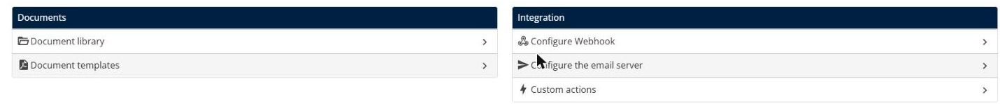
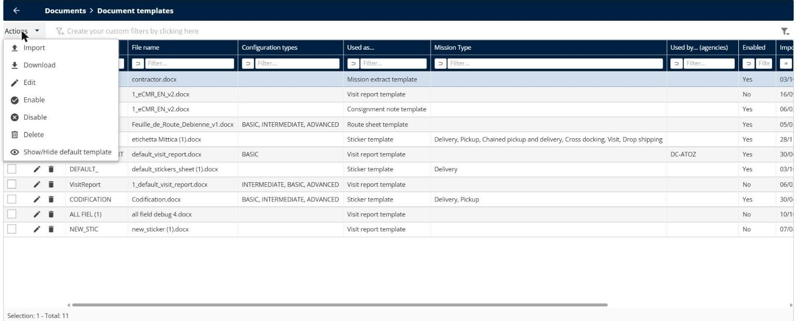
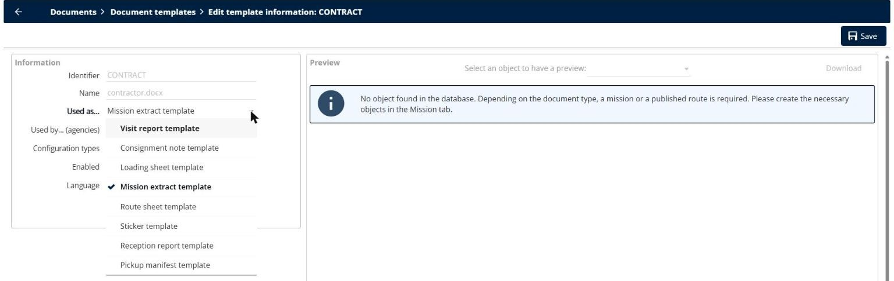

# QR Codes on Mission Extracts

**QR codes on mission extracts** let you print QR codes on the documents that Nomadia Delivery generates from your templates. On compact mission labels, a narrow barcode is easy to miss: the PDA fails to read it, the driver scans again, and every stop gets slower. A QR code encodes the same mission or parcel identifier as the existing barcode, so the same data is read on the first try, even on the smallest label.

## Before you begin

* Sign in to **Nomadia Delivery** with a user profile that has access to the **Configuration** tab.
* Know how to download, edit, and import a Word template. For more information, see [Customizing Word Templates](customizing-word-templates.md).

## Feature overview

* **QR code fields**: Two dedicated fields that you insert in a Word template, like the other fields of the template:
  * **Mission identifier QR code**: Encodes the mission identifier.
  * **Sender parcel number QR code**: Encodes the sender parcel number.

  Each field encodes its own identifier independently. Find their exact names in the **FieldsMaster\_DocumentTemplate** document, which lists all the fields you can use in a template.
* **Display mode**: You choose, template by template, which codes are printed, by placing the fields in the template:
  * **Barcode only**: Keep the existing barcode field.
  * **QR code only**: Replace the barcode field with a QR code field.
  * **Both**: Place the barcode and the QR code side by side.
* **Template types**: The QR code fields work in the six template types: **Mission extract template**, **Sticker template**, **Reception report template**, **Pickup manifest template**, **Route sheet template**, and **Loading sheet template**.
* **One QR code per mission**: Each child mission in a mission extract prints its own QR code, and so does every mission listed on a route sheet or a loading sheet.
* **Available to every client**: The feature is built into the core template engine. No specific configuration is needed.

## Add a QR code to a template

1. Go to the **Configuration** tab. Under **Documents**, click **Document templates**.

2. Select the template that you want to change, for example a **Mission extract template**, and then click **Actions** > **Download**.

3. Open the downloaded template in Microsoft Word.
4. Insert the QR code field where the code must be printed, as a merge field:
   * To print the mission identifier as a QR code, insert the **mission identifier QR code** field.
   * To print the sender parcel number as a QR code, insert the **sender parcel number QR code** field.
   * To print **Both**, keep the existing barcode field and place the QR code field next to it. To print the **QR code only**, remove the barcode field.

   For how to insert a merge field, see [Convert plain text into a merge field](customizing-word-templates.md#convert-plain-text-into-a-merge-field).
5. Save the template, and then import it in **Document templates** with **Actions** > **Import**.
6. Check that **Used as...** matches the document type, for example **Mission extract template**, and then click **Save**.

7. Enable the template with **Actions** > **Enable**.

### Result

The next documents generated from this template print the QR codes that you placed. In a mission extract, each child mission has its own QR code. On a route sheet or a loading sheet, each listed mission has its own QR code.

## Scan the QR code in the field

1. Print the documents as usual, for example the mission labels.
2. Scan the QR code with the PDA.

### Result

The PDA reads the QR code on the first try, even on a compact label. Fewer scans fail, and collection and delivery are faster.

## Tips


**Start with Both**: Print the barcode and the QR code side by side during the transition, so that every scanner keeps working while your teams switch to QR codes.



**Use the QR code on small labels**: The QR code is most useful on compact labels, where a narrow barcode is the hardest to read.



**Insert merge fields, not plain text**: A QR code field typed as plain text is not replaced when the PDF is generated. Insert it as a merge field.


## Related topics

* [Manage Document Templates](README.md)
* [Customizing Word Templates](customizing-word-templates.md)
* [Accessing eCMR](accessing-ecmr.md)
