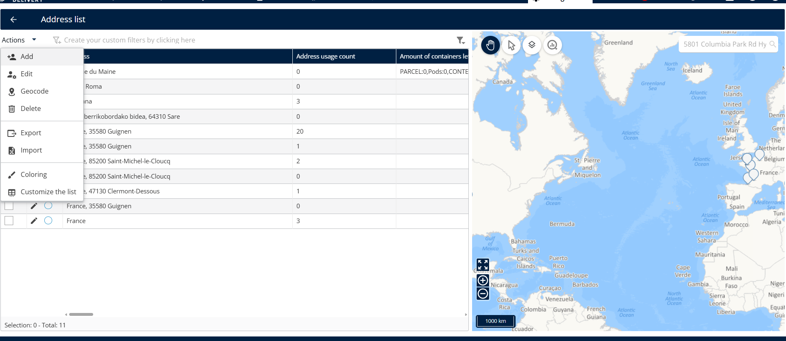
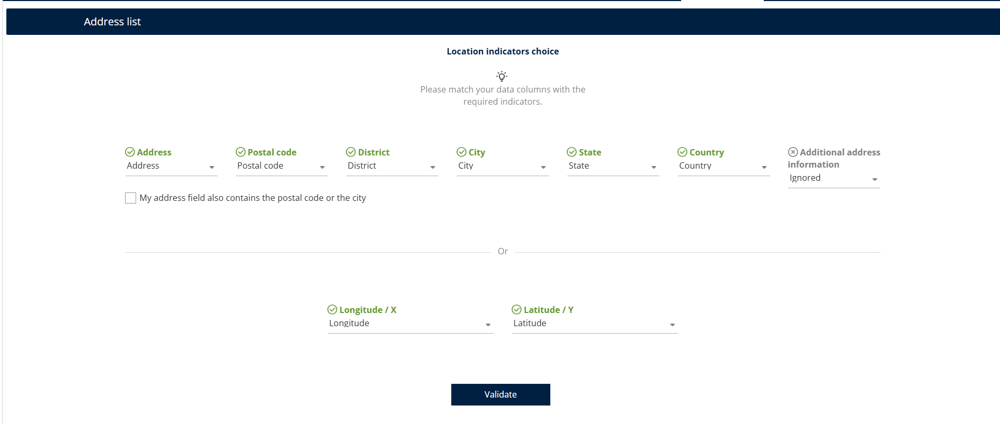
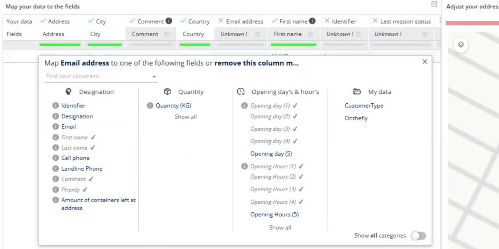
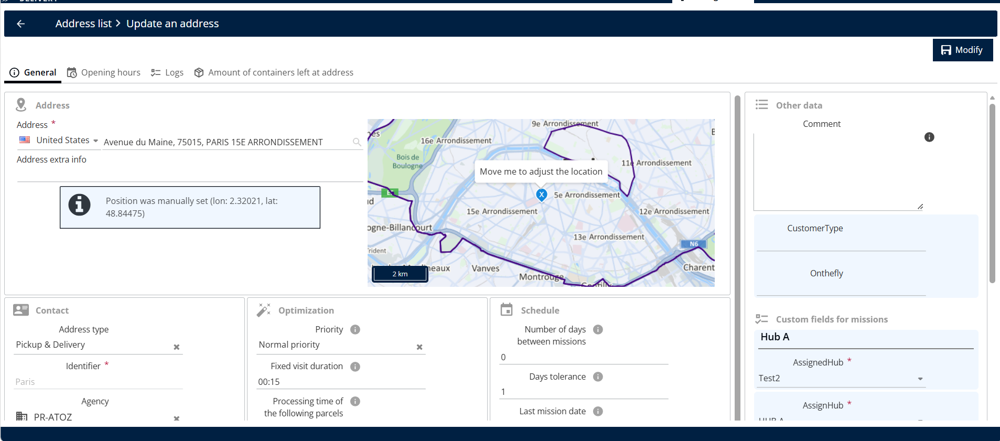
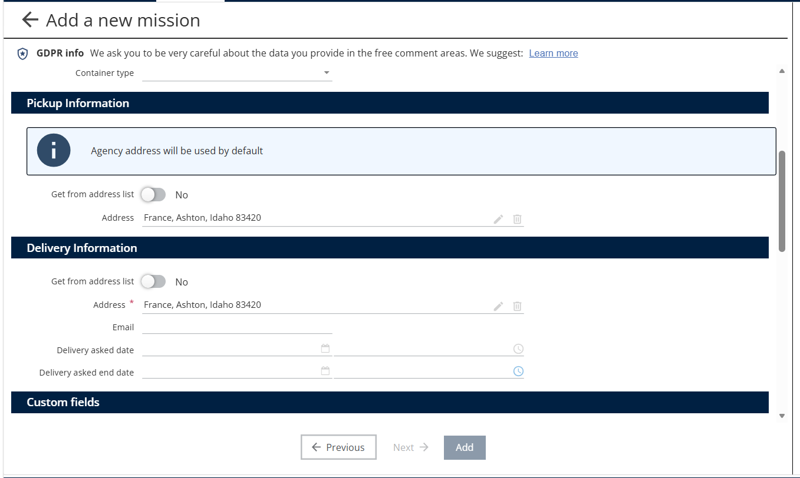

# Manage Global Address List

Nomadia Delivery allows you to manage an address list that serves as a master record of customer information. This helps improve both the speed and accuracy of mission creation. To create a global address list, follow these steps:

## Before you begin

* Access to the **Configuration** menu in **Nomadia Delivery**.
* For an import, an Excel file containing the addresses.

## Steps

1. Log in to the Nomadia Delivery application and go to **Configuration**.
2. Click **Address list**.

<figure><figcaption></figcaption></figure>

3. To create a new address list, click the **Actions** button and then select **Add**.
4. Alternatively, you can import an address list from an Excel file by clicking the **Import** button and selecting the desired file.

<figure><figcaption></figcaption></figure>

5. When importing, make sure you map the address fields or the X and Y coordinates.
6. Click **Validate** to map the remaining data into the address list.

<figure><figcaption></figcaption></figure>

7. A preview of all locations to be imported will be displayed during the import process.

8. Map the additional data fields in the address list, such as First Name, Last Name, Designation, Email, etc.

<figure><figcaption></figcaption></figure>

9. After mapping all the required fields, click **Import** to upload the address list to Nomadia Delivery.

<figure><figcaption></figcaption></figure>

### Result

The address list shows all customers on a map according to their geographical location.

## Setting the address type

1. Go to **Configuration**.
2. Click **Address list**.
3. Click the **pencil icon** next to the address you want to edit.
4. Under **Contact**, select the **Address type**.

<figure><figcaption></figcaption></figure>

**Note:** If you select **Pick up and delivery**, the address appears in both the pickup and delivery address lists. If you select only **Pick up** or only **Delivery**, the address appears only in the matching list when you enter an address.

<figure><figcaption></figcaption></figure>

## Related topics

* [Manage Address List](9-7-contractors/manage-address-list.md)
* [Customize the Address Visibility](customizetheaddresslistvisibility/customizetheaddresslistvisibility.md)
* [Map the addresses fields from the global address list](8-6-missions/map-the-addresses-fields-from-the-global-address-list.md)
