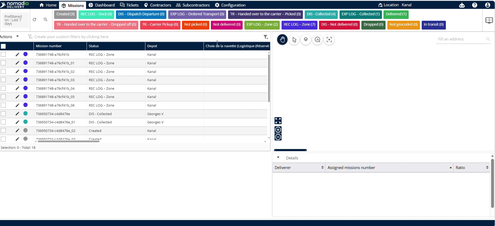
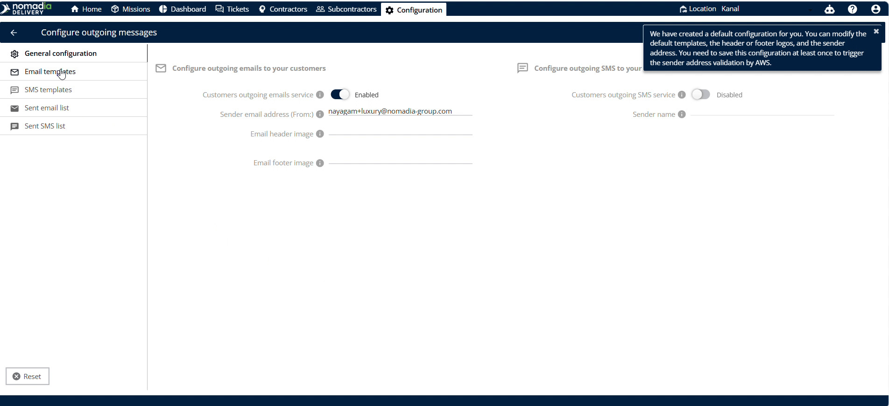
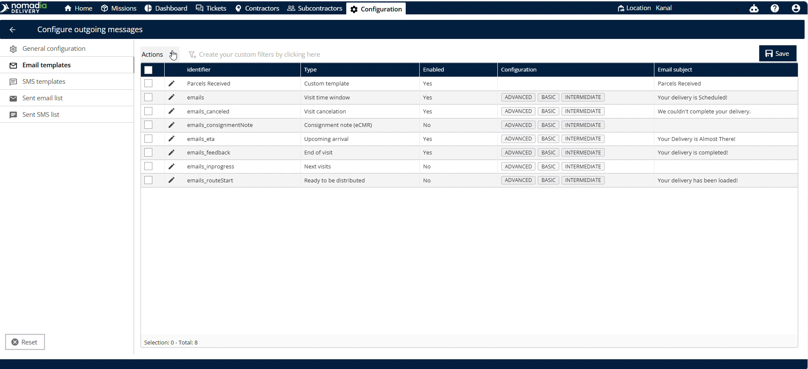
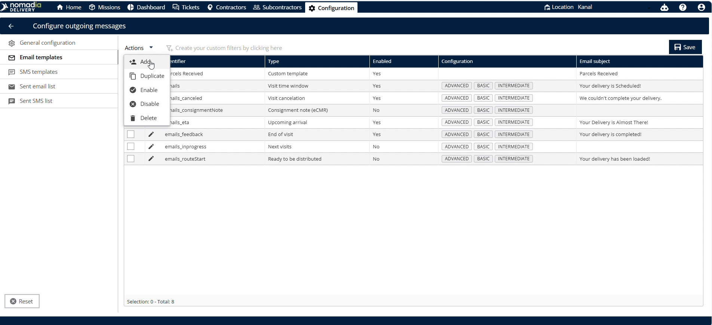
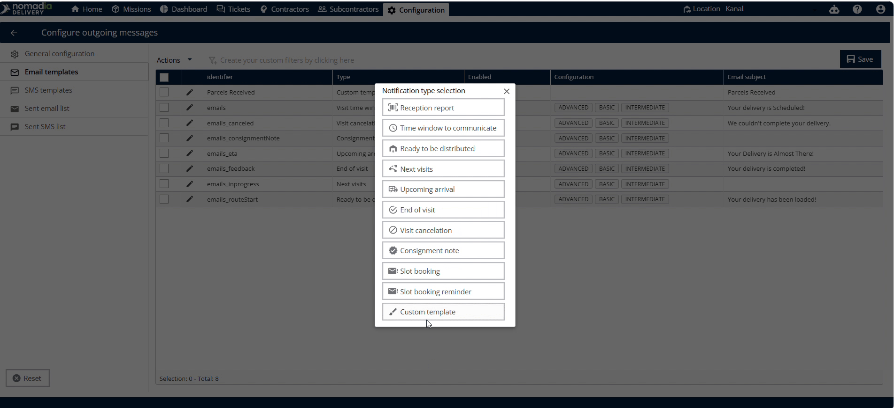
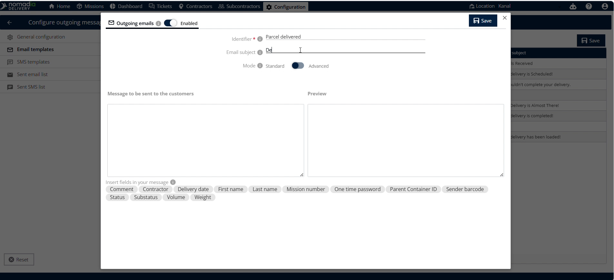
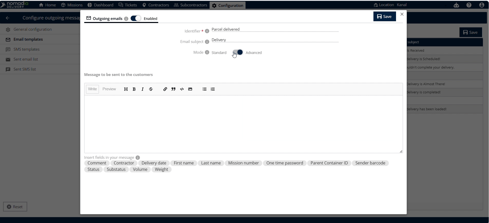

# Custom Templates

**Custom Templates** is a feature in **Nomadia Delivery** that lets you customize customer notification emails. Custom templates provide clear, branded updates directly to your clients. This improves customer communication and streamlines your delivery operations.

## Before you begin

Prerequisites & System Requirements:

* Active dispatcher or planner account in **Nomadia Delivery**.
* Web browser with an active internet connection.

Initial Setup Steps:

1. Open the **Configuration** page.
2. Scroll down and click **Configure outgoing messages**.

3. Click **Email templates** on the left side of the screen.

## Feature overview

* **Email templates**: Left-side menu where all your configured templates are listed.
* **Actions**: Dropdown button that opens commands to manage your email templates.
* **Add**: Menu option to start creating a new email template.
* **Custom template**: Selection box used to choose the template type.
* **Identifier**: Text input field where you define a unique template name.
* **Email subject**: Text field where you enter the subject line for the email.
* **Standard mode to advanced**: Switch that toggles the editor interface between standard and advanced editing.
* **Message**: Text editor where you type the email body content.

## Configure a custom customer email template

1. Open the **Configuration** page.
2. Scroll down and click **Configure outgoing messages**.

3. Click **Email templates** on the left side of the screen.

4. Click **Actions**.

5. Click **Add**.

6. Click **Custom template** to select your custom template.

7. Enter a unique template name in the **Identifier** field.

8. Enter your subject line in the **Email subject** field.
9. Toggle the mode switch from **Standard mode** to **Advanced mode** if desired.

10. Type your template text in the **Message** field.

Use the **$** keyword to add the appropriate fields.

11. Click **Save** in the top right corner to save your changes.

## Tips


**Mode Toggle**: Toggle **Standard mode** to **Advanced mode** if you want to use advanced editing options.


## Related topics

* [Email](../email.md)
* [SMS](../sms.md)
* [Group notifications for container missions](../../groupnotificationsforthecontainermissions/groupnotificationsforthecontainermissions.md)
