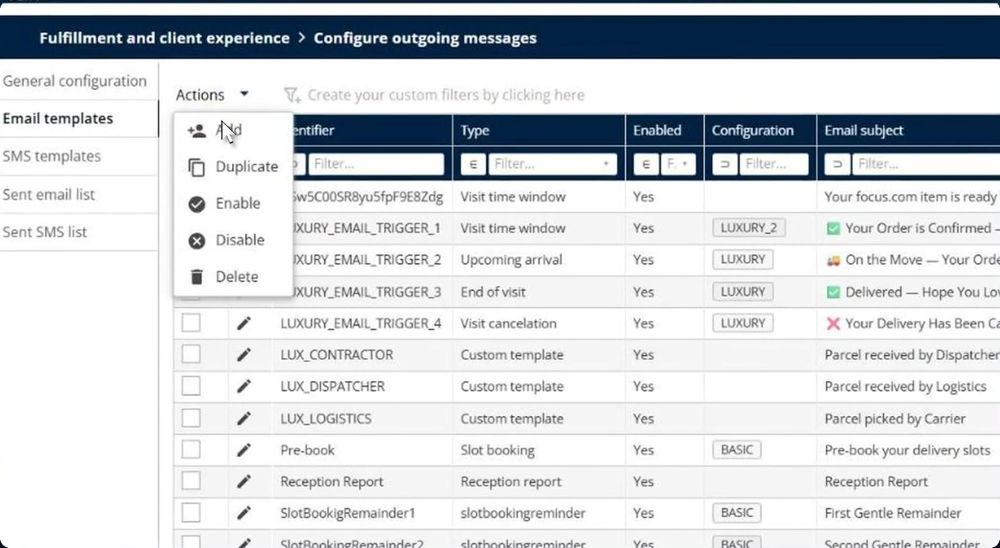
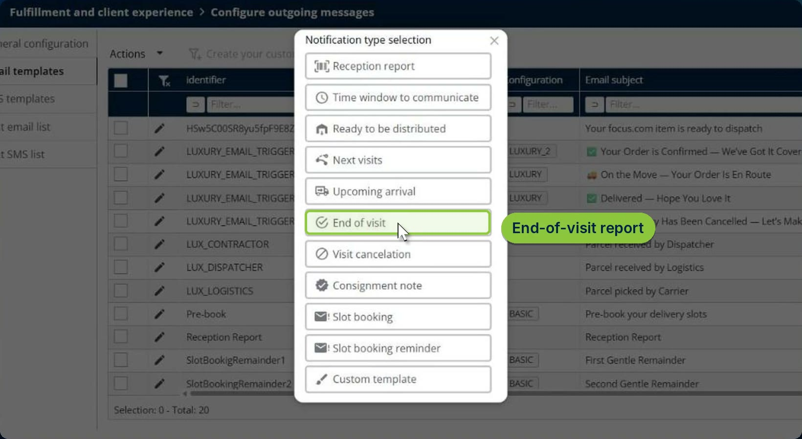
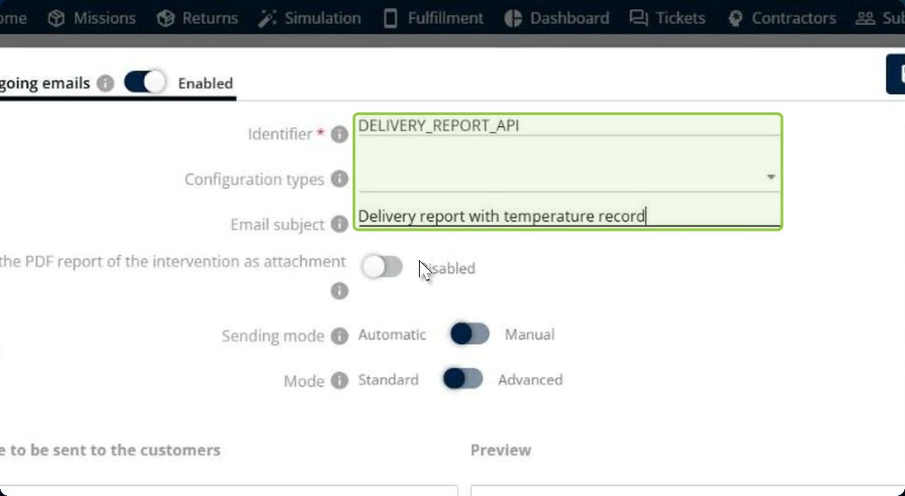
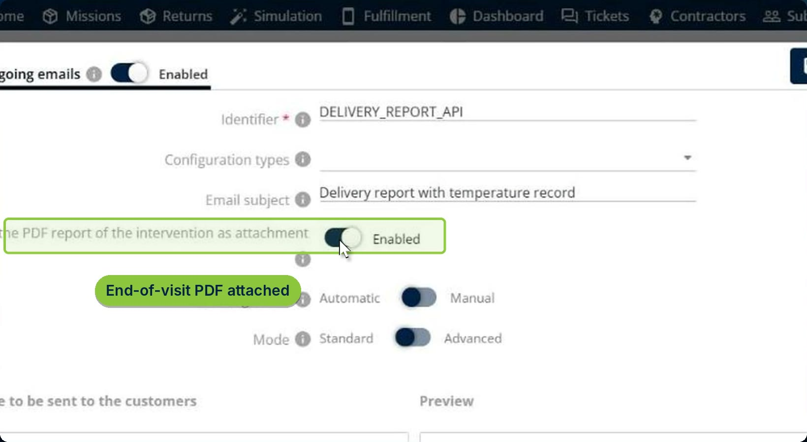
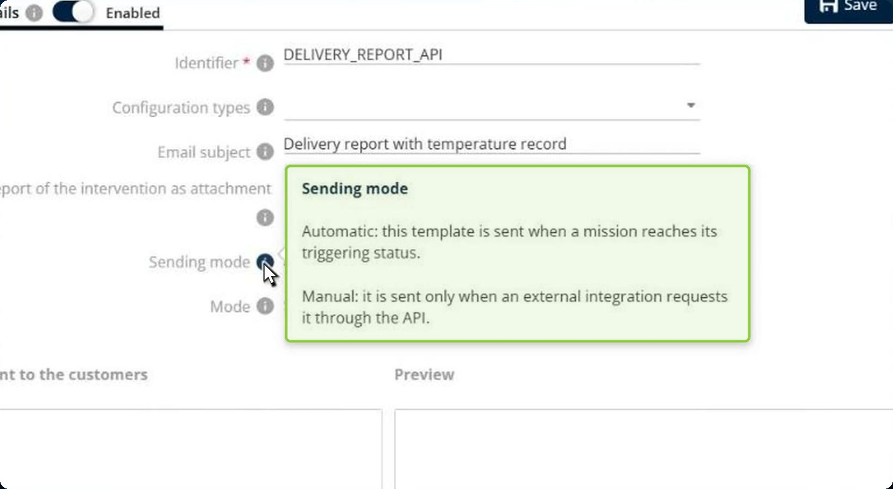
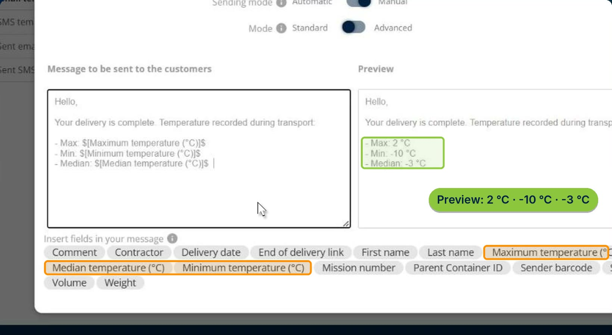
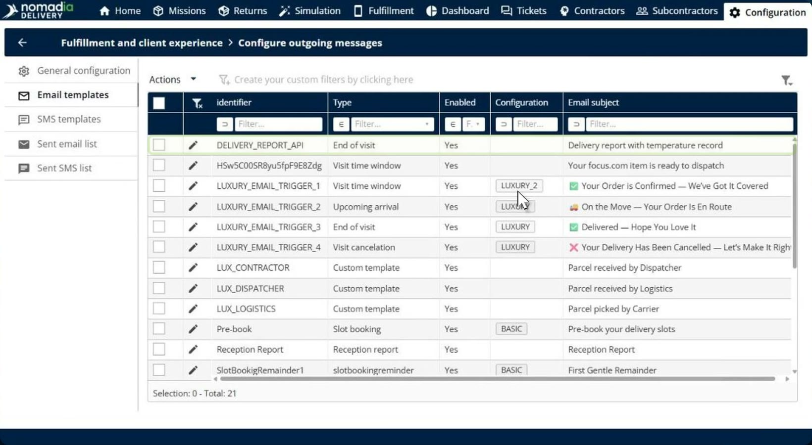
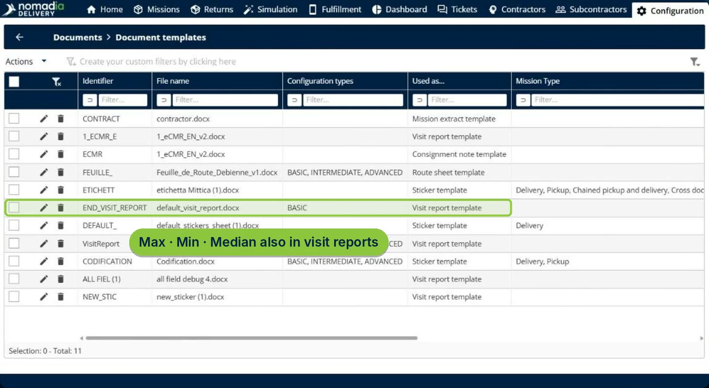
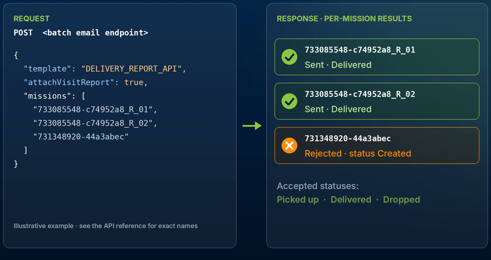
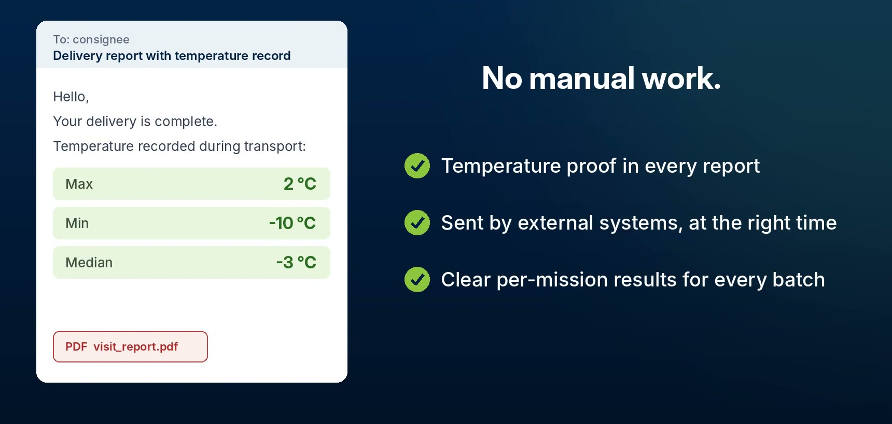

# Send Email Reports via API

**Send Email Reports via API** lets an external system, such as an ERP, a WMS or a TMS, send delivery report emails to consignees through the Nomadia API. You prepare an email template in **Manual** sending mode, add the temperature recorded during transport, and attach the end-of-visit PDF report. The external system then calls the batch email endpoint for a list of completed missions, and the API returns a result for each mission.

## Before you begin

* Sign in to **Nomadia Delivery** with access to **Configuration**.
* Make sure the external system that will call the API has a valid API key. For more information, see [Secure API Key Management](../../secure-api-key-management.md).
* Make sure your missions record temperature data during transport.

## Feature overview

* **Manual sending mode**: A template in **Manual** mode is never sent automatically when a mission changes status. It is sent only when an external integration requests it through the API.
* **Temperature variables**: The **Maximum temperature (°C)**, **Minimum temperature (°C)** and **Median temperature (°C)** fields insert the temperature recorded during transport into the email.
* **End-of-visit PDF**: The **Insert the PDF report of the intervention as attachment** switch attaches the visit report to the email.
* **Batch email endpoint**: The API endpoint the external system calls with the template identifier and a list of missions.
* **Per-mission results**: The API response tells you, for each mission, whether the email was sent or rejected.
* **Accepted statuses**: An email is sent only for missions in the **Picked up**, **Delivered** or **Dropped** status.

## Add an email template

1. Go to **Configuration** > **Fulfillment and client experience** > **Configure outgoing messages**, and then click **Email templates**.
2. Click **Actions**, and then click **Add**.

3. In the **Notification type selection** window, click **End of visit**.

## Name the template and attach the end-of-visit PDF

1. In the **Identifier** field, enter a unique name for the template, for example **DELIVERY\_REPORT\_API**. The external system uses this identifier to call the template.
2. In the **Email subject** field, enter the subject of the email, for example **Delivery report with temperature record**.

3. Switch on **Insert the PDF report of the intervention as attachment**.

## Set the sending mode to Manual

1. Set **Sending mode** to **Manual**.


**Automatic**: The template is sent when a mission reaches its triggering status.\
**Manual**: The template is sent only when an external integration requests it through the API.


## Insert the temperature variables

1. In the **Message to be sent to the customers** field, type your message.
2. Under **Insert fields in your message**, click **Maximum temperature (°C)**, **Minimum temperature (°C)** and **Median temperature (°C)** to add the temperature recorded during transport.

The **Preview** shows the message with example values, such as **2 °C**, **-10 °C** and **-3 °C**.

3. Click **Save**.

### Result

The template appears in the **Email templates** list with the **End of visit** type.

The same temperature variables are also available in document templates, so you can add the maximum, minimum and median temperatures to your visit reports. For more information, see [Manage Document Templates](../../manage-document-templates/README.md).

## Send the email reports from an external system

The external system calls the batch email endpoint with:

* the identifier of the template, for example **DELIVERY\_REPORT\_API**;
* whether to attach the visit report;
* the list of missions to report on.

The API returns a result for each mission. Missions in the **Picked up**, **Delivered** or **Dropped** status are sent. Other missions, for example a mission still in the **Created** status, are rejected.


The request above is an illustrative example. See the API reference for the exact endpoint and field names.


### Result

Each consignee receives the delivery report email with the maximum, minimum and median temperatures recorded during transport, and the end-of-visit PDF report attached.

## Tips


**Check the per-mission results**: Read the API response after each batch to find the missions that were rejected, and send them again once they reach an accepted status.



**Keep the identifier stable**: The external system calls the template by its identifier. If you rename the template, update the integration too.


## Related topics

* [Custom Templates](customtemplates.md)
* [Email](../email.md)
* [Manage Document Templates](../../manage-document-templates/README.md)
* [Secure API Key Management](../../secure-api-key-management.md)
