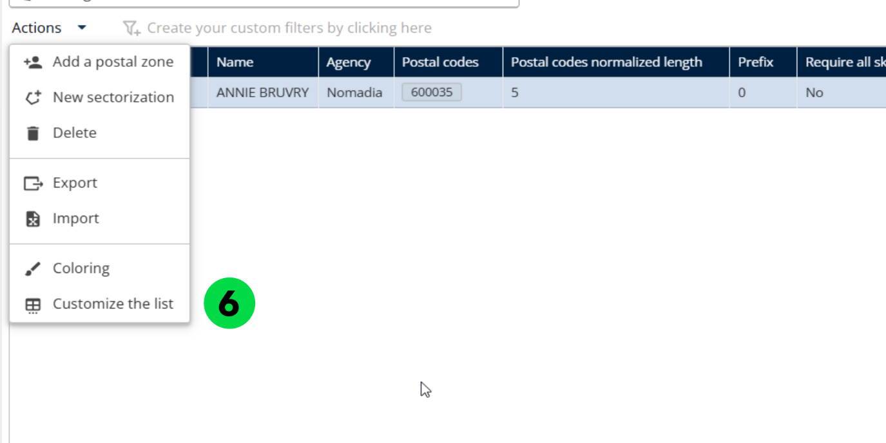
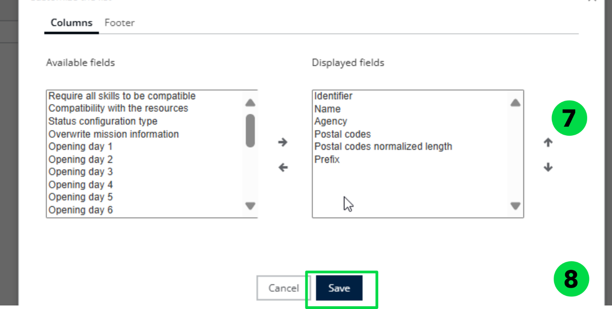

# Customize Zones Table

Customize the zones table to choose which fields are displayed for a mission's zones.

## Before you begin

* Sign in to **Nomadia Delivery** with a user profile that has access to the **Configuration** tab.
* Have missions available under **Manage studies and zones**, because you select a mission to customize its zones table.

## Feature overview

* **Actions** dropdown menu: Contains the **Customize Limit** option for the selected mission.
* **Customize Limit**: Lets you choose which fields are displayed on the zones table.
* **Save**: Applies your field selection to the table.

## Customize the zones table

1. Click the **Configuration** tab.
2. Click **Manage studies and zones**.
3. Review the available missions, which are displayed in a list.
4. Select a mission.
5. Click the **Actions** dropdown menu.
6. Click **Customize Limit**.

7. Choose which fields you want to display on the table.
8. Click **Save**.

### Result

The selected fields are displayed on the table.

## Tips


**Field selection**: Avoid selecting too many fields at once, as it may become difficult to read or navigate.


## Related topics

* [Manage Studies & Zones:](README.md)
* [Manage Postal Zones](manage-postal-zones.md)
* [Create Postal Zones by Territory Management (Sectorization)](create-postal-zones-by-territory-management-sectorization.md)
