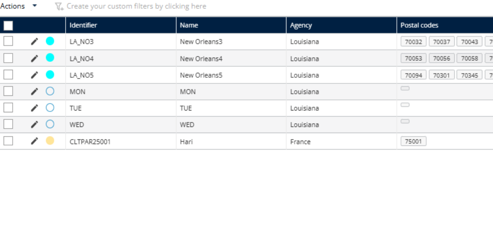

# Manage Postal Zones

The Manage Postal Zones feature allows administrators and logistics managers to define and manage geographical delivery zones based on postal codes. These zones are essential for organizing deliveries, assigning resources, and optimizing routes within specific areas.

## Import postal zones

1. Click the **Configuration** tab.

2. Under **Delivery**, click **Manage studies and zones**.

<figure><figcaption></figcaption></figure>

3. Click the **Pencil** icon next to the study to open the zone table.
4. Open the **Actions** menu dropdown.
5. Click **Import**.

.png>)

6. Click **Browse File** to upload the file that contains the zone data.

.png>)

7. Select a valid zone file from your local system.

.png>)

### Result

Postal zones are imported successfully.

.png>)

## Add a postal zone

1. Click the **Configuration** tab.
2. Under **Delivery**, click **Manage studies and zones**.
3. Click the **Pencil** icon next to the study to open the zone table.
4. Click the **Actions** dropdown menu.
5. Click **Add a Postal Zone**.

.png>)

6. Fill in the required fields: **Code**, **Name**, and **Prefix**.

.png>)

7. Click **Save**.

.png>)

### Result

The postal zone is added successfully.

.png>)

## Delete a postal zone

1. Click the **Configuration** tab.
2. Under **Delivery**, click **Manage studies and zones**.
3. Click the **Pencil** icon next to the study to open the zone table.
4. Select a zone.

.png>)

5. Click the **Actions** dropdown menu.
6. Click **Delete**.

.png>)

7. Review the confirmation pop-up message: "Are you sure you want to delete this zone?"
8. Click **Yes**.

.png>)

### Result

The postal zone is deleted successfully.

.png>)

## Export a postal zone

1. Click the **Configuration** tab.
2. Under **Delivery**, click **Manage studies and zones**.
3. Select a zone.
4. Click the **Actions** dropdown menu.
5. Click **Export**.

<figure><figcaption></figcaption></figure>

### Result

The postal zone is exported successfully.

## Color a postal zone

Apply conditions based on zone attributes such as type of mission (Delivery, Pickup), zone priority, assigned deliverer, postal code prefix, etc.

1. Click the **Configuration** tab.
2. Under **Delivery**, click **Manage studies and zones**.
3. Select a zone.
4. Click the **Actions** dropdown menu.
5. Click **Coloring**.

<figure><figcaption></figcaption></figure>

6. Choose a color.
7. Click **Save**.

<figure><figcaption></figcaption></figure>

### Result

The selected color is applied successfully.

## Tips


**Prefix**: The Prefix is used to standardize postal codes to a fixed length of 6 digits. In regions where postal codes are shorter (e.g., 5 digits in some areas of France), the system automatically adds the defined prefix to reach the required length.


## Related topics

* [Manage Studies & Zones:](README.md)
* [Create Postal Zones by Territory Management (Sectorization)](create-postal-zones-by-territory-management-sectorization.md)
* [Customize Zones Table](customize-zones-table.md)
