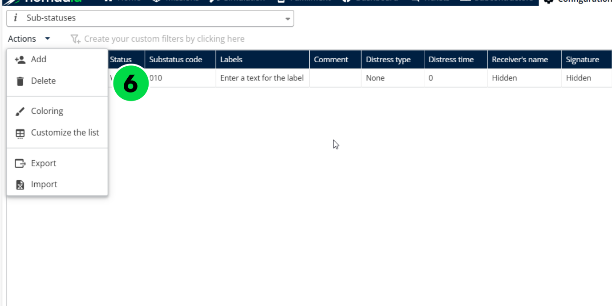
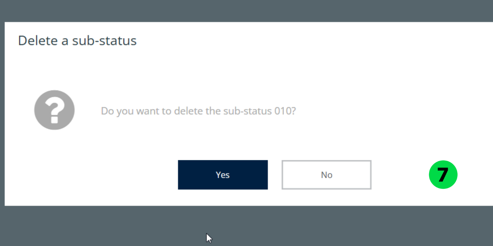
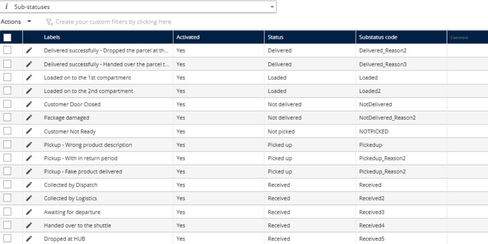
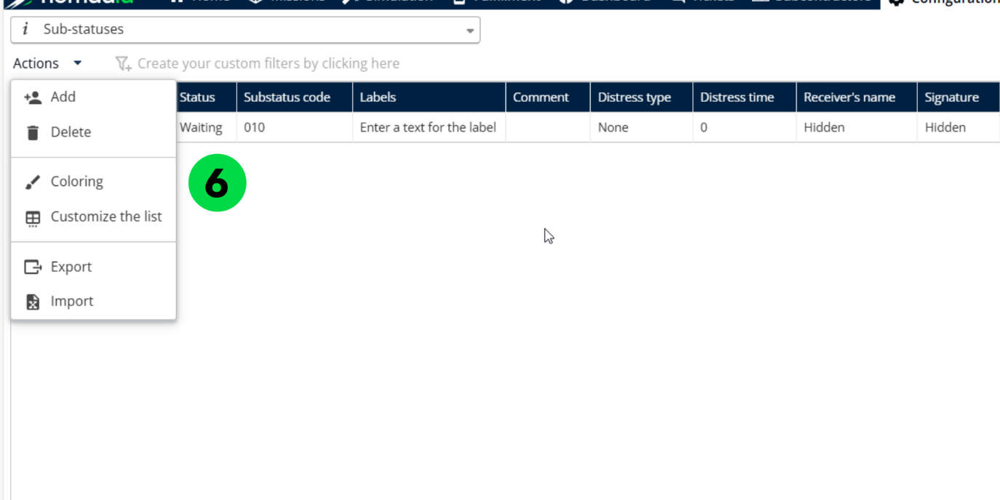

# Manage Substatus

The Manage Sub Statuses feature allows administrators to create, edit, and assign detailed status labels that reflect the real-time progress or condition of a delivery task. These sub statuses provide a more granular tracking mechanism within the broader status categories such as "Pickup", "Waiting", or "Delivered".

## Before you begin

* Sign in to **Nomadia Delivery** with a user profile that has access to the **Configuration** page.
* Open **Configuration**, click the **Configuration** menu, and under **My Data**, click **Sub statuses**.
* Have at least one sub status available to delete or color.

## Feature overview

* **Sub status**: A detailed status label that reflects the real-time progress or condition of a delivery task within broader status categories such as "Pickup", "Waiting", or "Delivered".
* **Delete**: Removes the selected sub status after you confirm.
* **Coloring**: Applies a color to the selected sub status.
* **Actions** dropdown menu: Contains the **Delete** and **Coloring** options.

## Delete a sub status

1. Go to **Configuration**.
2. Click the **Configuration** menu.
3. Under **My Data**, click **Sub statuses**.
4. Select a sub status.
5. Click the **Actions** dropdown menu.
6. Click **Delete**.

7. Review the confirmation pop-up message: "Do you want to delete the sub-status?"
8. Click **Yes**.

### Result

The sub status is deleted successfully.

## Coloring a sub status

Apply conditions based on zone attributes such as type of mission (Delivery, Pickup), zone priority, assigned deliverer, postal code prefix, etc.

1. Go to **Configuration**.
2. Click the **Configuration** menu.
3. Under **My Data**, click **Sub statuses**.
4. Select a sub status.
5. Click the **Actions** dropdown menu.
6. Click **Coloring**.

7. Choose a **Color**.
8. Click **Save**.

### Result

The selected color is applied successfully.

## Tips


**Granular tracking**: Sub statuses provide a more granular tracking mechanism within the broader status categories, so use them to reflect the real-time progress of a delivery task.



**Confirm before deleting**: A confirmation pop-up asks "Do you want to delete the sub-status?" before the sub status is deleted, so review your selection before you click **Yes**.


## Related topics

* [Creating a Substatus](creating-a-substatus.md)
* [Customizing Substatus](customizing-substatus.md)
* [Manage Substatus Configuration](manage-substatus-configuration.md)
* [Trigger Notifications for Sub Status Changes](trigger-notifications-for-sub-status-changes.md)
