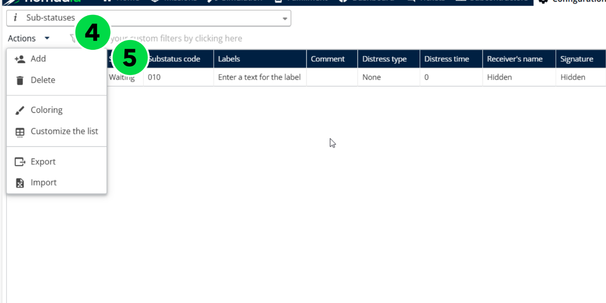
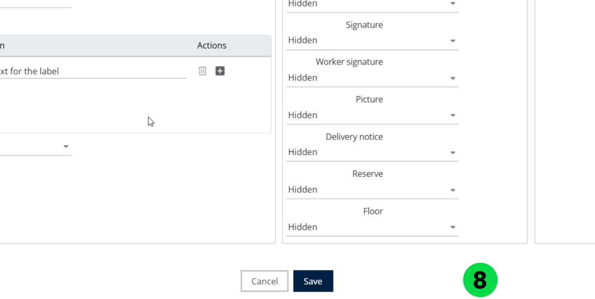
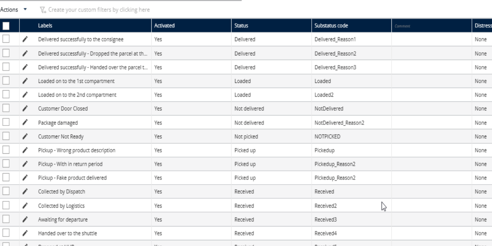

# Creating a Substatus

Create a sub status with a code and a status configuration type so that you can track the progress of a delivery task in more detail.

## Before you begin

* Sign in to **Nomadia Delivery** with a user profile that has access to the **Configuration** page.
* Have the sub status code ready, and know which **Status configuration** type to select.

## Feature overview

* **Sub status**: The code that identifies the sub status.
* **Status configuration**: The type that you select for the sub status.
* **Actions** > **Add**: Opens the form to create a sub status.

## Create a sub status

1. Go to **Configuration**.
2. Click the **Configuration** menu.
3. Under **My Data**, click **Sub statuses**.

4. Click the **Actions** dropdown menu.
5. Click **Add**.

6. Enter the **Sub status** code.
7. Select the **Status configuration** type.

8. Click **Save**.

### Result

The sub status is created successfully.

## Tips


**Code and configuration type**: Create each sub status with a code and a status configuration type so that you can track the progress of a delivery task in more detail.


## Related topics

* [Manage Substatus](README.md)
* [Customizing Substatus](customizing-substatus.md)
* [Manage Substatus Configuration](manage-substatus-configuration.md)
* [Trigger Notifications for Sub Status Changes](trigger-notifications-for-sub-status-changes.md)
