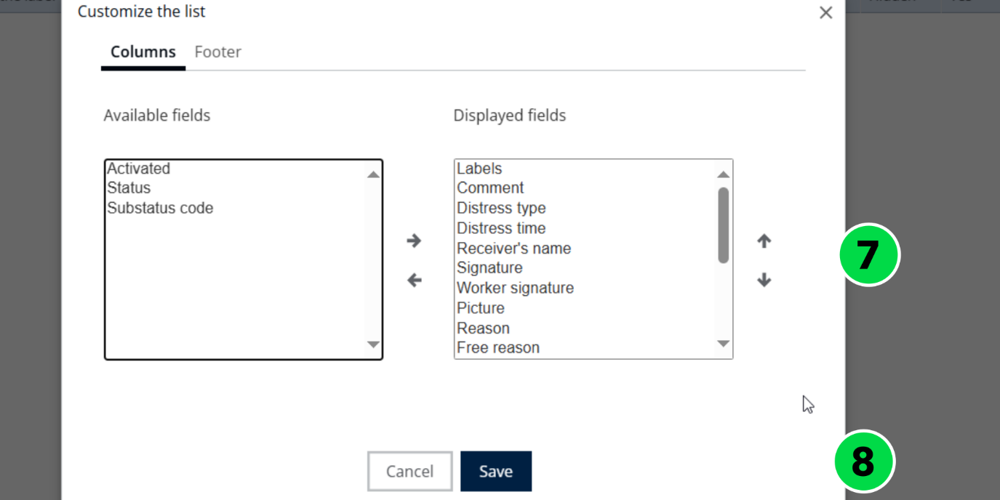
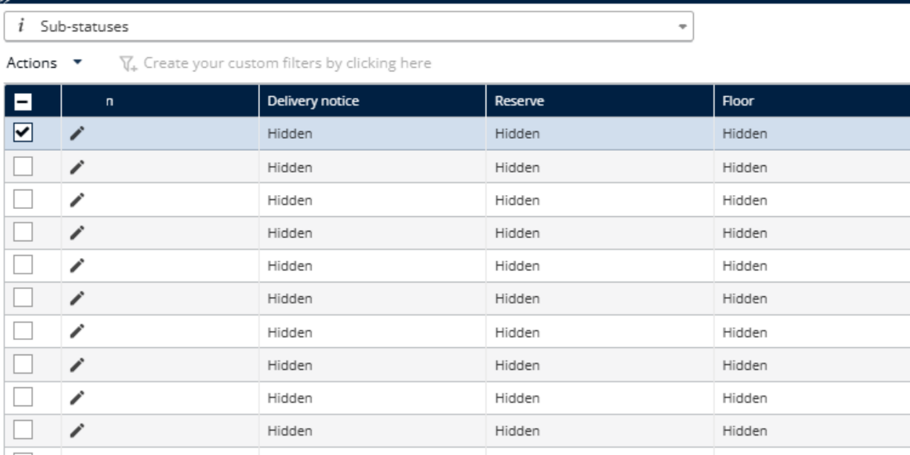

# Customizing Substatus

Customize the sub status table to choose which fields are displayed.

## Customize sub status

1. Go to **Configuration**.
2. Click the **Configuration** menu.
3. Under **My Data**, click **Sub statuses**.
4. Select a sub status.
5. Click the **Actions** dropdown menu.
6. Click **Customize the Limit**.

7. Choose which fields you want to display on the table.
8. Click **Save**.

### Result

The selected fields are displayed on the table successfully.

## Tips


**Field selection**: Avoid selecting too many fields at once, as it may become difficult to read or navigate.


## Related topics

* [Manage Substatus](README.md)
* [Creating a Substatus](creating-a-substatus.md)
* [Manage Substatus Configuration](manage-substatus-configuration.md)
