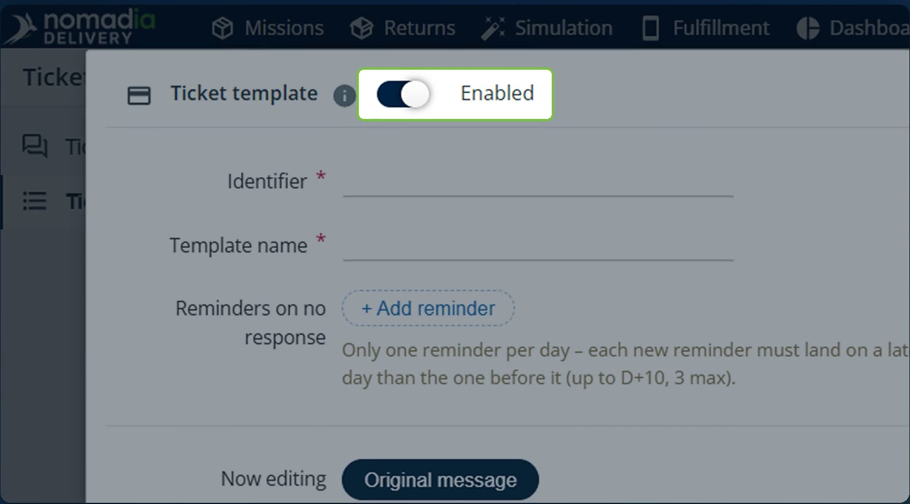
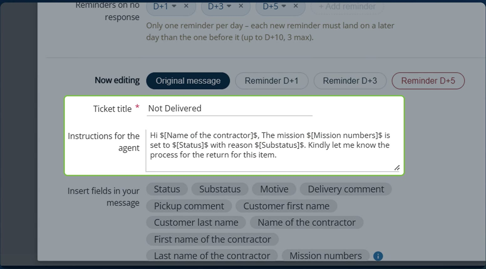
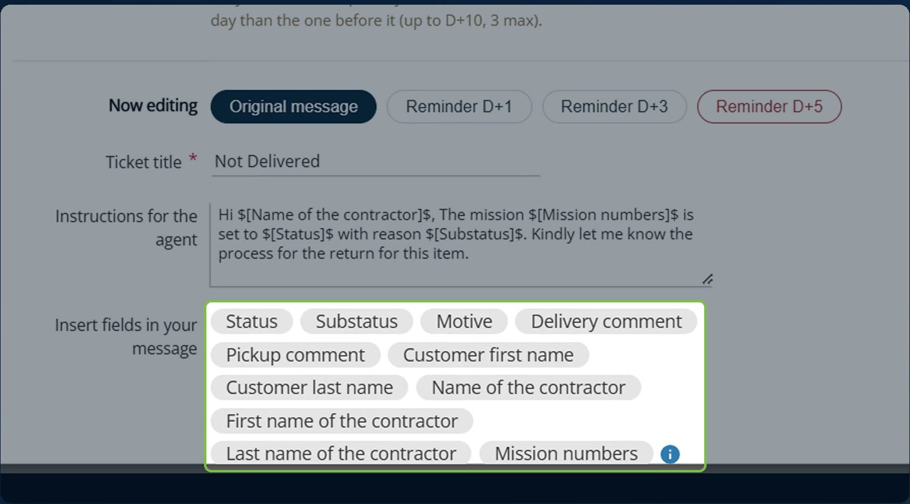
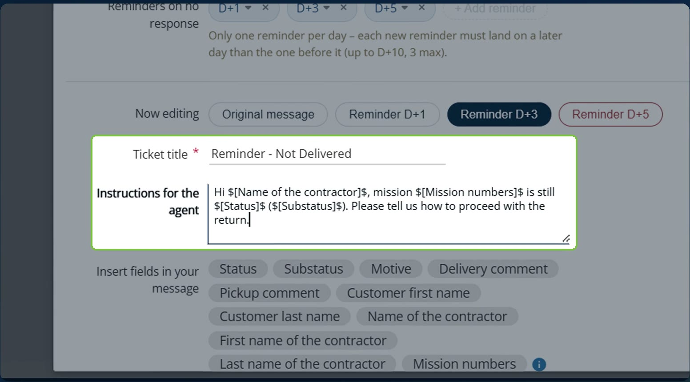
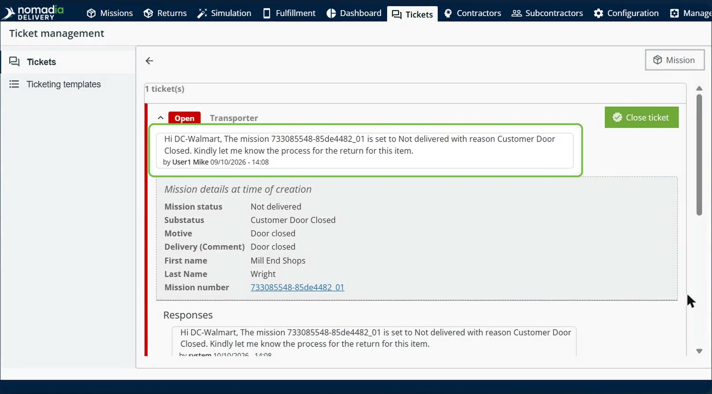
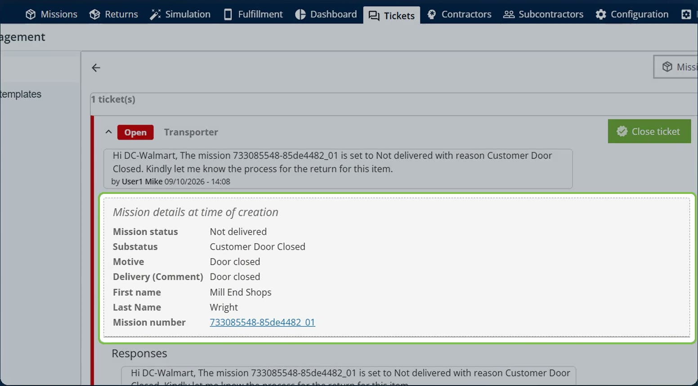
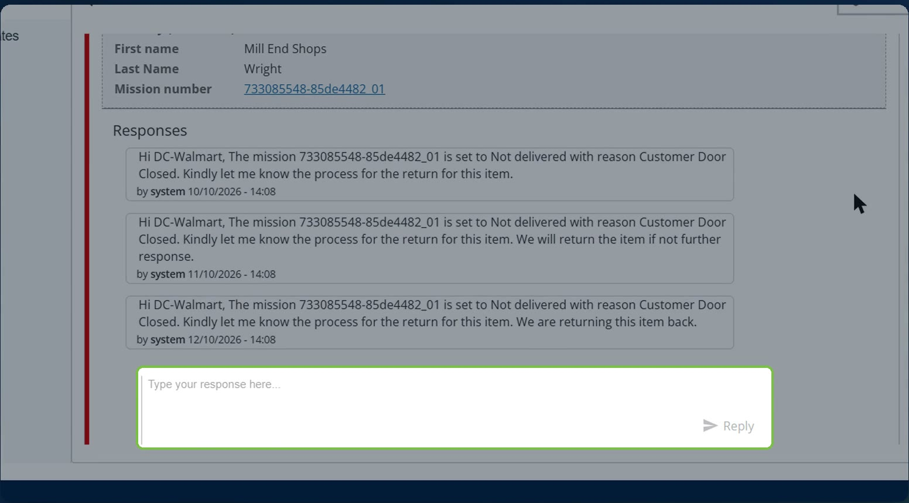

# Automated Contractor Tickets and Reminders

Automated contractor tickets and reminders create a ticket for the contractor as soon as a driver records a specific sub-status in the mobile app, such as **Customer Door Closed**. If the contractor does not reply, reminders are posted on a schedule and an email notification is sent. The reminders stop as soon as the contractor replies or the ticket is closed, and every step is logged in the ticket history.

## Before you begin

* Sign in to **Nomadia Delivery** with a user profile that has access to the **Tickets** module and to **Configuration**. See [Activating the Ticket Module](activating-the-ticket-module.md).
* Make sure the sub-status that should trigger the ticket exists. See [Manage Substatus](../manage-substatus/README.md).

## Feature overview

* **Ticketing templates**: The page under **Tickets** where you create the templates used for automatic tickets.
* **Ticket template**: A template with an **Identifier**, a **Template name**, an **Enabled** switch, the original message and up to three reminders.
* **Reminders on no response**: Reminders posted when the contractor has not replied. You can add up to three reminders, only one per day, and each new reminder must land on a later day than the one before it, up to D+10.
* **Now editing**: The selector that switches between the **Original message** and each reminder, so that each one has its own ticket title and message.
* **Insert fields in your message**: Dynamic fields, such as **Status**, **Substatus**, **Motive**, **Delivery comment**, **Pickup comment**, **Customer first name**, **Customer last name**, **Name of the contractor** and **Mission numbers**, that are replaced with the mission's values in the ticket.
* **Create ticket**: The completion action of a sub-status that automatically creates a ticket when a mobile user executes this sub-status.

## Create a ticket template

1. Go to **Tickets** > **Ticketing templates**.

2. Click **Actions**, and then click **New template**.

3. Enter an **Identifier** and a **Template name**.

4. Make sure the **Enabled** switch is on.

5. With **Original message** selected in **Now editing**, enter the **Ticket title** and the message in **Instructions for the agent**.

6. To add mission data to the message, click the fields under **Insert fields in your message**. For example, `$[Name of the contractor]$` is replaced with the contractor's name in the ticket.

7. Under **Reminders on no response**, click **+ Add reminder** and choose the day of each reminder, for example **D+1**, **D+3** and **D+5**.

8. In **Now editing**, select each reminder in turn and enter its own **Ticket title** and message.

9. Save the template.

### Result

The template appears in the **Ticketing templates** list, with its number of reminders and its enabled state.

## Link the template to a sub-status

1. Go to **Configuration** > **Sub-statuses**.

2. Click the **pencil icon** next to the sub-status that should trigger the ticket, for example **Customer Door Closed**.

3. Under the completion actions, turn on **Create ticket**, and then choose the **Ticket template**. The **Ticket title** is filled in from the template.

4. Save the sub-status.

### Result

From now on, when a driver records this sub-status in the mobile app:

1. A ticket is created from your template.
2. If the contractor does not reply, the reminders are posted on schedule, for example at D+1, D+3 and D+5, and an email notification is sent.
3. The reminders stop as soon as the contractor replies or the ticket is closed.

## Follow up on an automatic ticket

1. Go to **Tickets** and open the ticket. It shows the original message.

2. Check **Mission details at time of creation**. It shows a snapshot of the mission when the ticket was created, such as the mission status, sub-status, motive, comment, customer name and mission number.

3. Check **Responses**. The reminders are posted there on schedule.

4. To reply, type your response in the response box and click **Reply**.

5. To end the follow-up, click **Close ticket**.

### Result

When the contractor replies or the ticket is closed, the remaining reminders stop. Every step is logged in the ticket history.

## Tips


**Reminder schedule**: You can add up to three reminders, only one per day. Each new reminder must land on a later day than the one before it, up to D+10.


## Related topics

* [Manage Tickets](README.md)
* [Creating a Ticket](creating-a-ticket.md)
* [Manage Substatus](../manage-substatus/README.md)
