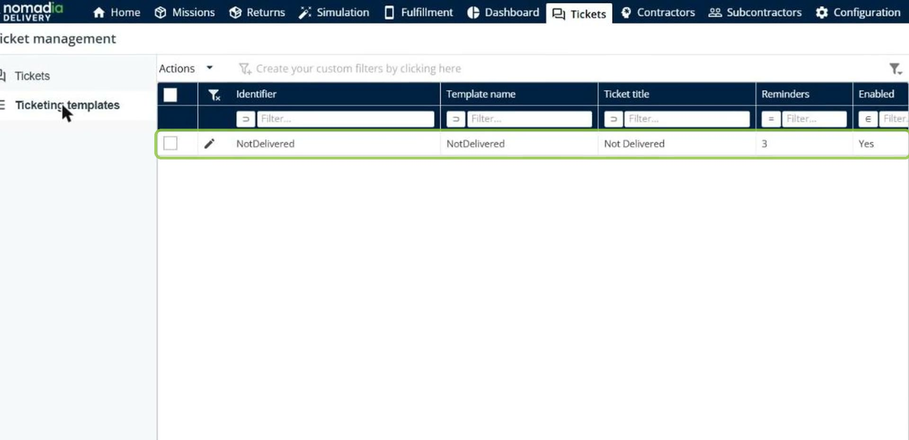
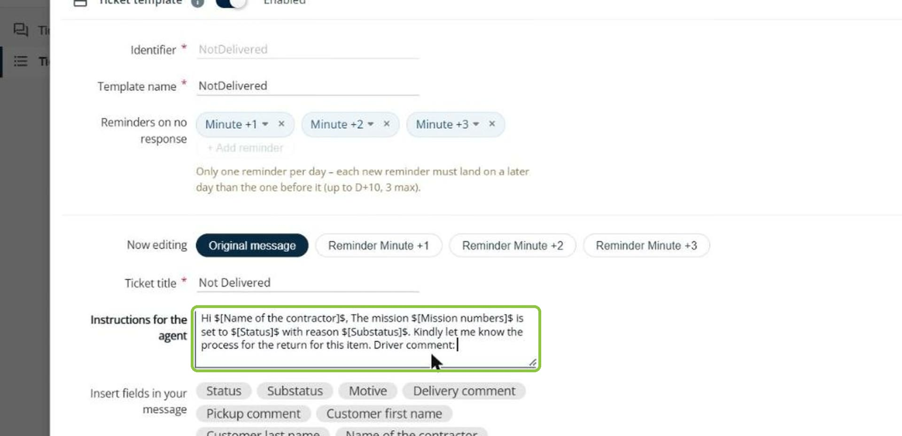
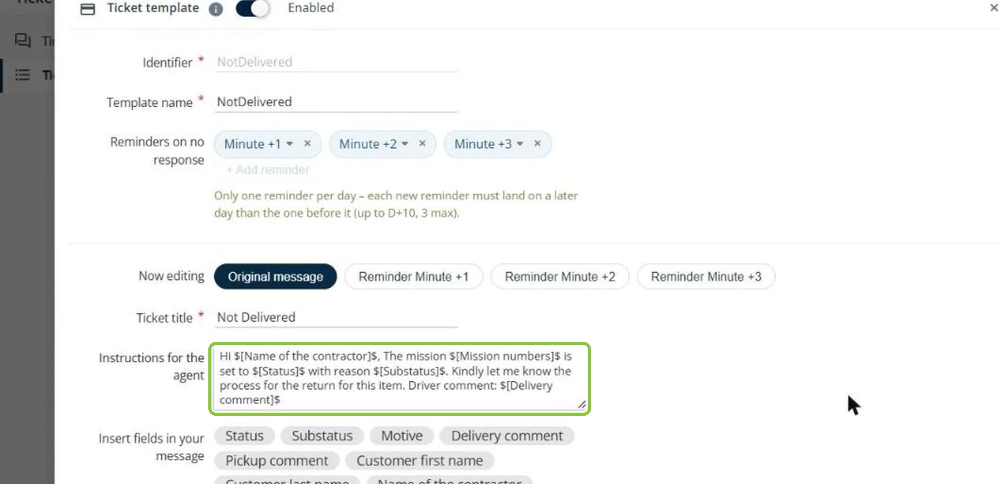
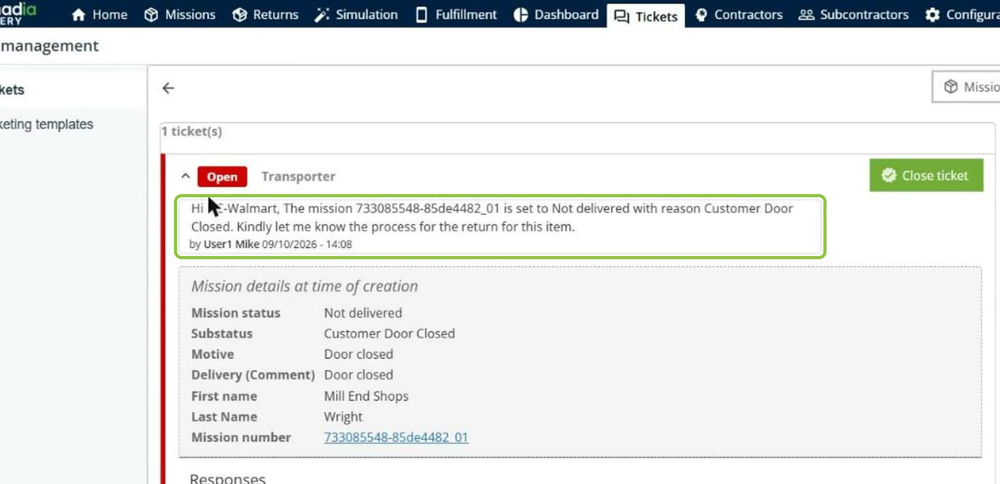
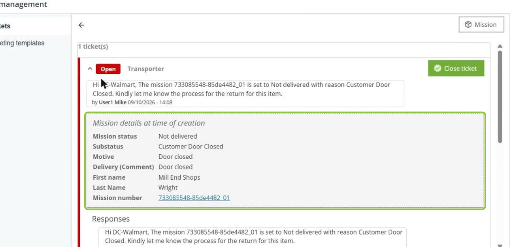
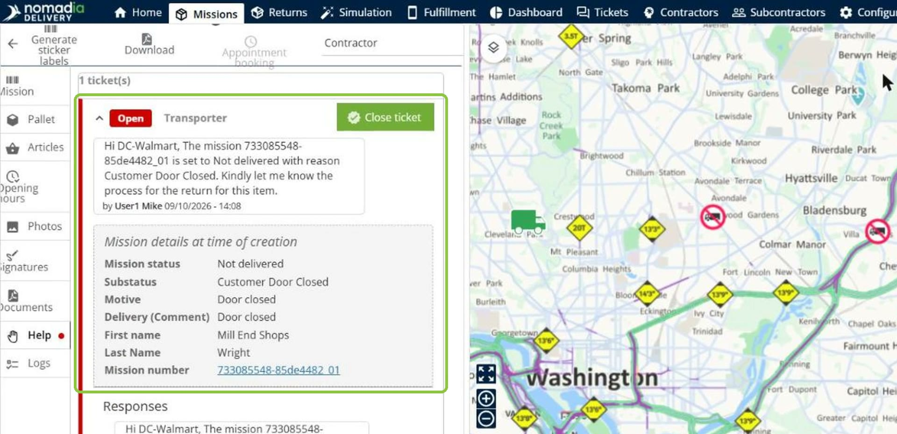
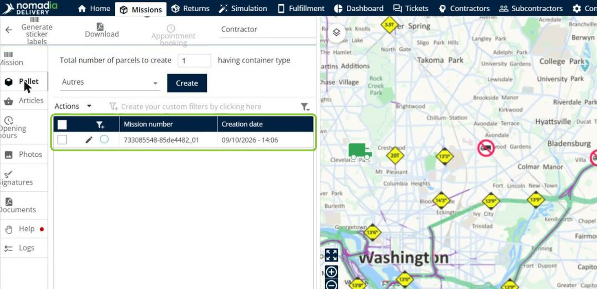
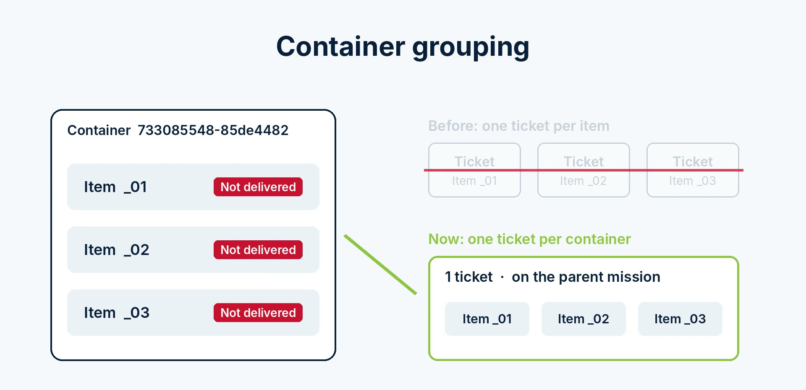

# Mission Details in Tickets

Mission details in tickets give contractors and your team the full mission context right inside every ticket. You insert mission fields in the ticket template message, and their values are filled in automatically when the ticket is created. Each ticket also keeps a snapshot of the mission details at the time of creation, the ticket is visible on the mission, and for container missions a single ticket is created on the parent mission instead of one ticket per item.

## Before you begin

* Sign in to **Nomadia Delivery** with a user profile that has access to the **Tickets** module. See [Activating the Ticket Module](activating-the-ticket-module.md).
* Make sure a ticket template exists. See [Automated Contractor Tickets and Reminders](automated-contractor-tickets-and-reminders.md).

## Feature overview

* **Insert fields in your message**: The section of the ticket template that lists the mission fields you can add to the message, such as **Status**, **Substatus**, **Motive**, **Delivery comment**, **Pickup comment**, **Customer first name**, **Customer last name** and **Name of the contractor**.
* **Dynamic field**: A field inserted in the message, for example `$[Delivery comment]$`. It is replaced with the mission's value when the ticket is created.
* **Mission details at time of creation**: The section of the ticket that shows the mission status, sub-status, motive, comment, customer name and mission number as they were when the ticket was created.
* **Help tab**: The tab of the mission editor where the mission's tickets are also visible.
* **One ticket per container**: For a container mission, one ticket is created on the parent mission for all its items, instead of one ticket per item.

## Add mission fields to a ticket template

1. Go to **Tickets** > **Ticketing templates**, and then click the **pencil icon** next to the template.

2. With **Original message** selected in **Now editing**, place the cursor in **Instructions for the agent** where you want to add a mission value.

3. Under **Insert fields in your message**, click the field to add, for example **Delivery comment**. The field is added to the message as `$[Delivery comment]$`.

4. Save the template.

### Result

In new tickets created from this template, the inserted fields are replaced with the mission's values.

## View the mission details in a ticket

1. Go to **Tickets** and open the ticket. The message shows the mission's values in place of the inserted fields.

2. Check **Mission details at time of creation**. It shows the mission status, sub-status, motive, comment, customer name and mission number as they were captured when the ticket was created.

## View the ticket on the mission

1. Open the mission in the mission editor, and then click the **Help** tab. The ticket is also visible there, with its message and mission details.

2. For a container mission, open the parent mission. The ticket is created on the parent mission, which lists its child missions.

### Result

When several items of a container have the same issue, one ticket is created on the parent mission for the whole container, instead of one ticket per item.

## Tips


**Captured at creation**: The mission details in a ticket are captured when the ticket is created. Later changes to the mission do not change them, so the ticket always shows the situation the contractor was asked about.


## Related topics

* [Manage Tickets](README.md)
* [Automated Contractor Tickets and Reminders](automated-contractor-tickets-and-reminders.md)
* [Container child missions](../manage-container-types/container-child-missions.md)
