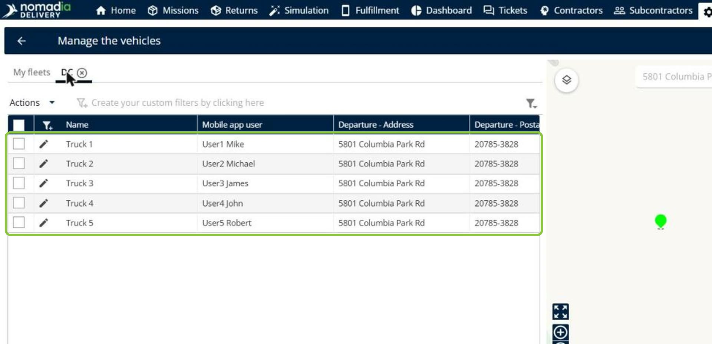
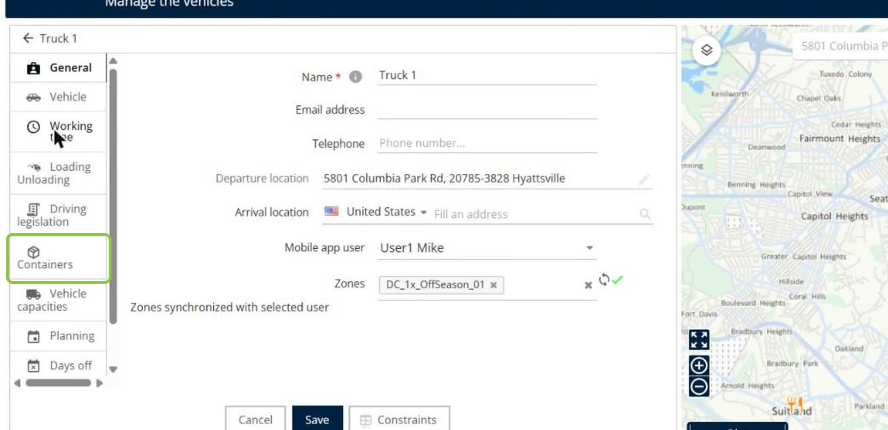
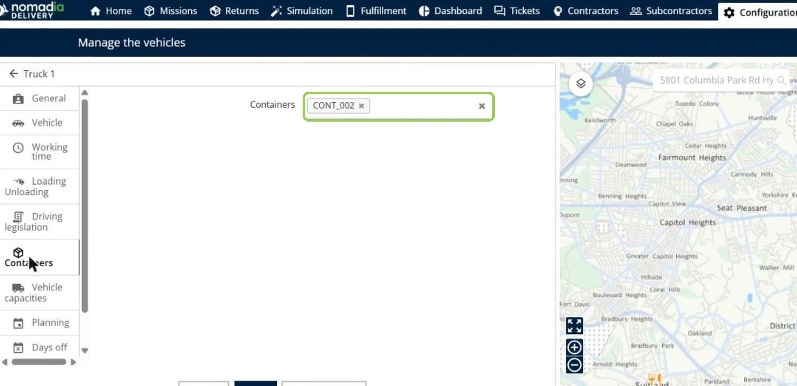
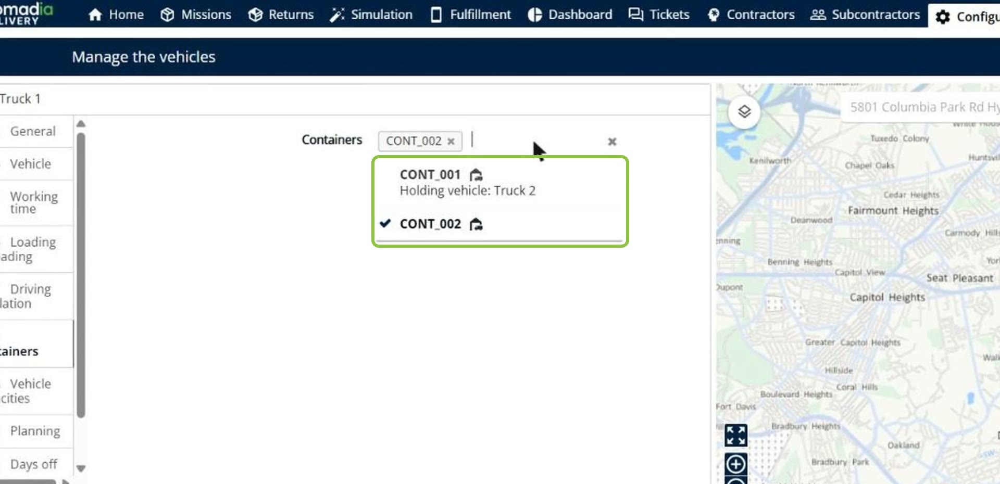
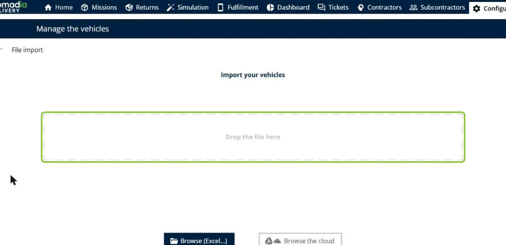
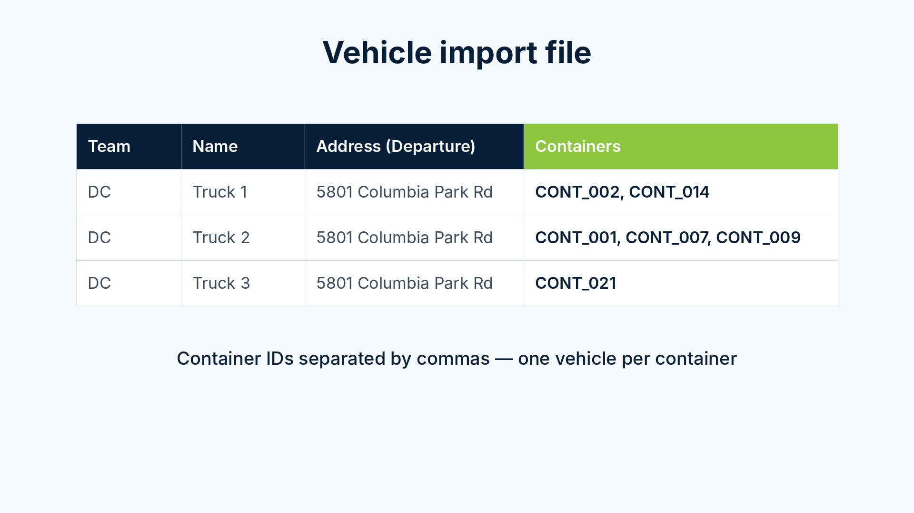
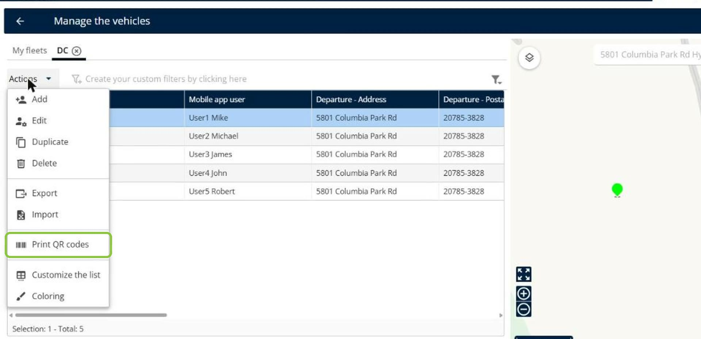
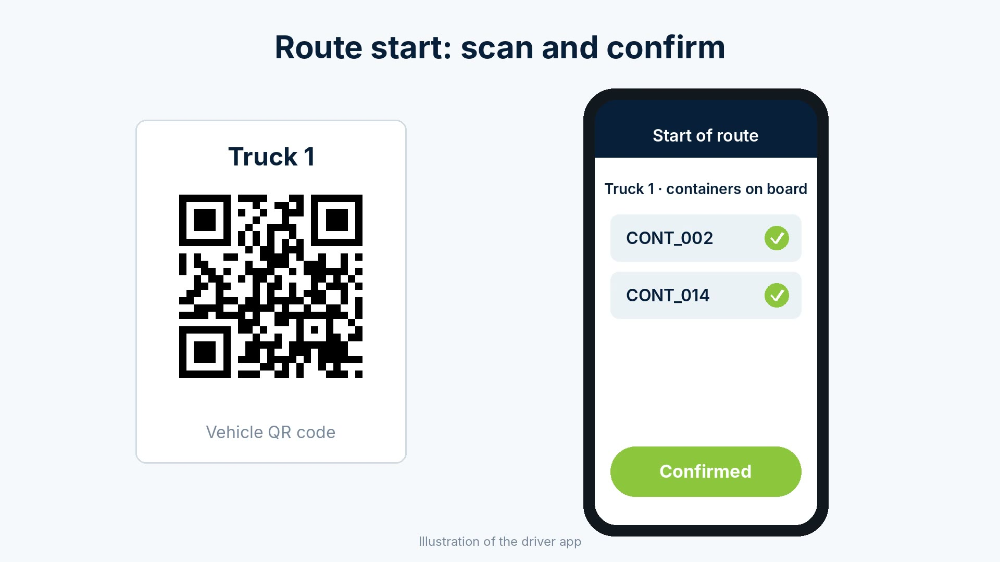

# Associate Containers with Vehicles

Associating containers with vehicles lets you define which containers are on board each vehicle. Drivers see their containers at the start of the route and confirm them in one scan of the vehicle QR code, which reduces drop errors and speeds up route departures. You can associate containers one vehicle at a time or in bulk with a vehicle import file.

## Before you begin

* Sign in to **Nomadia Delivery** with a user profile that has access to the **Configuration** page.
* Make sure the containers exist in the container list. See [Track Individual Containers by Unique ID](../manage-container-types/track-individual-containers-by-unique-id.md).

## Feature overview

* **Manage the vehicles**: The page under **Configuration** that lists the vehicles of each fleet.
* **Containers tab**: The tab of a vehicle where you choose the containers on board.
* **Holding vehicle**: The vehicle a container is already associated with. A container can be associated with only one vehicle at a time.
* **Containers column**: The column of the vehicle import file where you list the container IDs of each vehicle, separated by commas.
* **Print QR codes**: The action that prints the QR code of the selected vehicles, which drivers scan at the start of the route.

## Associate containers with a vehicle

1. Go to **Configuration** > **Manage the vehicles**, and then click the fleet tab, for example **DC**.

2. Click the **pencil icon** next to the vehicle, and then click the **Containers** tab.

3. In the **Containers** field, choose the containers on board the vehicle.

The list shows the **Holding vehicle** of containers that are already associated with another vehicle, because a container can be on board only one vehicle.

4. Click **Save**.

## Associate containers with vehicles in bulk

1. On the **Manage the vehicles** page, click **Actions**, and then click **Import**.

2. In your vehicle import file, add a **Containers** column. For each vehicle, enter the container IDs separated by commas. Each container can be listed for only one vehicle.

3. Drop the file on the import page, or click **Browse (Excel...)** to select it, and then complete the import.

### Result

The containers are associated with the vehicles listed in the file.

## Print the vehicle QR codes

1. On the **Manage the vehicles** page, select the check boxes of the vehicles.
2. Click **Actions**, and then click **Print QR codes**.

3. Place each QR code in its vehicle.

### Result

At the start of the route, the driver scans the vehicle QR code in the mobile app. The app lists the containers on board the vehicle, and the driver confirms them in one scan.

## Tips


**One vehicle per container**: A container can be on board only one vehicle at a time. Check the **Holding vehicle** shown in the list before you choose a container.


## Related topics

* [Manage Vehicles in a fleet](manage-vehicles-in-a-fleet.md)
* [Track Individual Containers by Unique ID](../manage-container-types/track-individual-containers-by-unique-id.md)
* [Manage Container Types](../manage-container-types/README.md)
