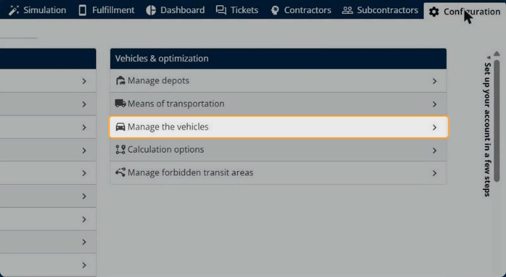
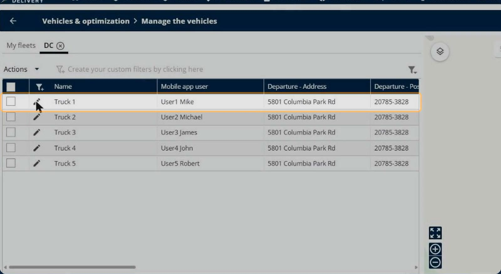
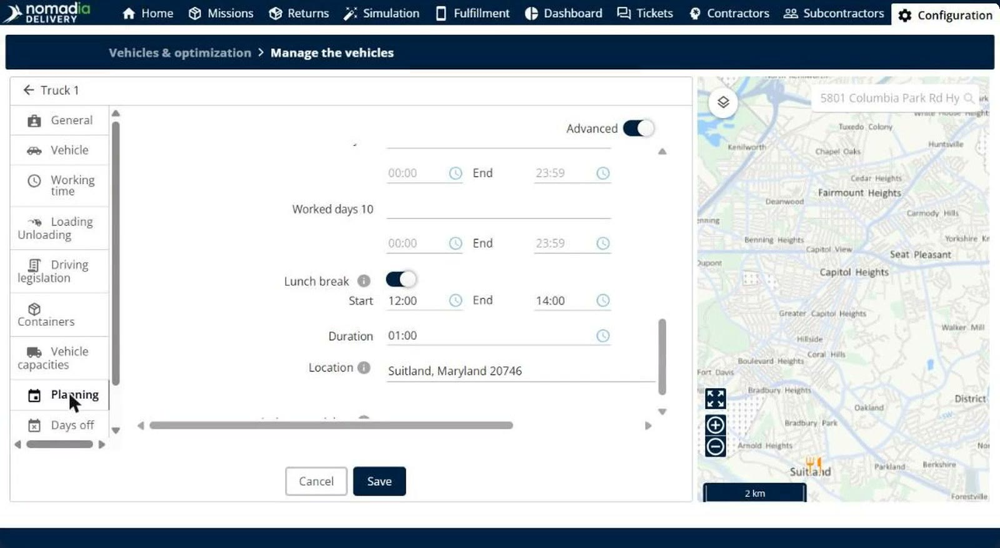
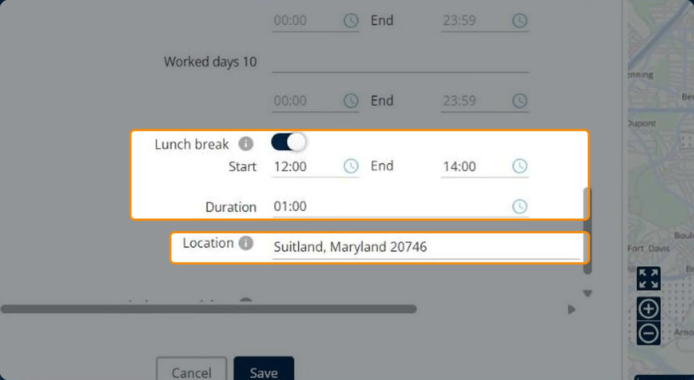
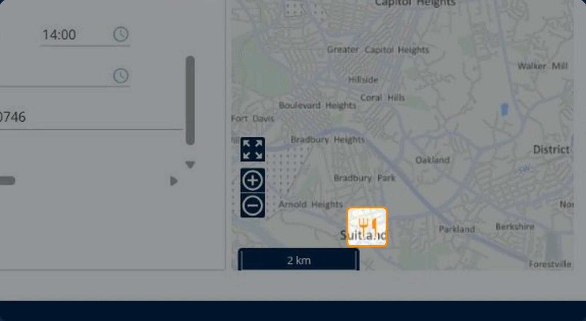
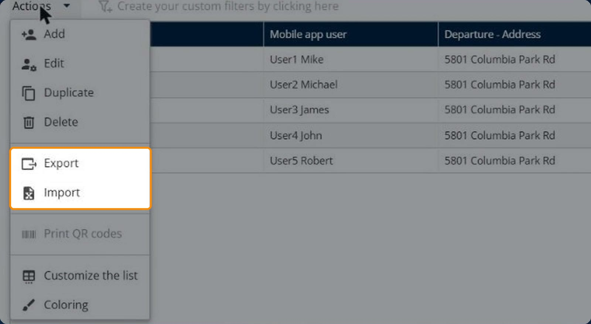
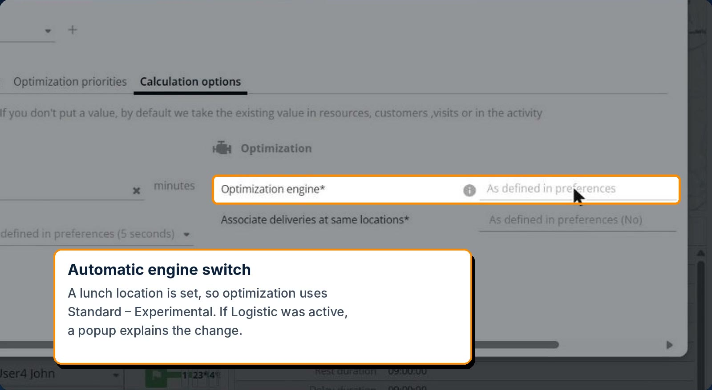
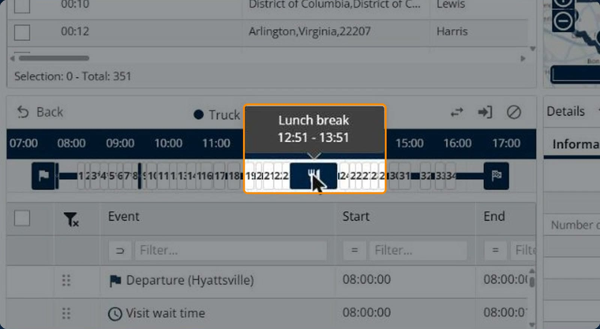
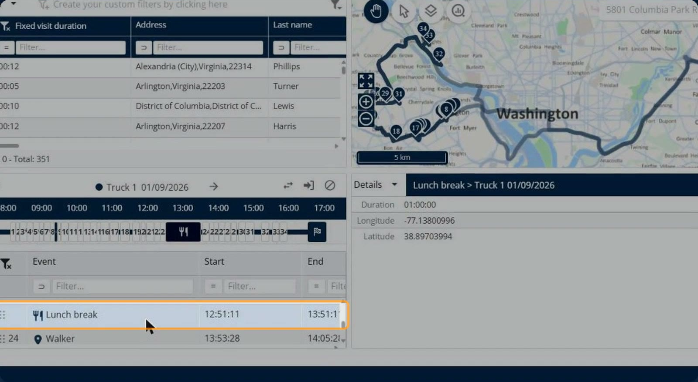
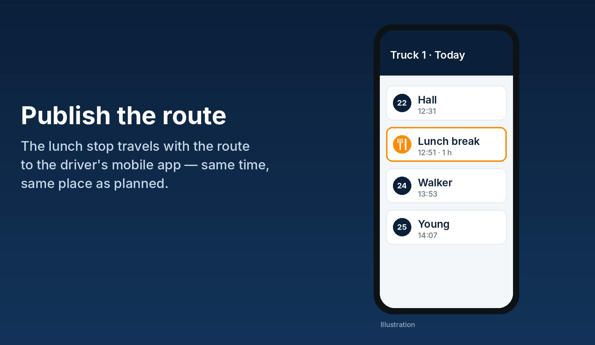

# Driver Lunch Location

**Driver Lunch Location** lets you plan the trip to lunch into every optimized route. On each vehicle, you set a lunch break window, its duration and the place where the driver has lunch. The optimization then builds the drive to and from that location into the route, so the plan reflects where and when the driver actually stops. The lunch stop is shown on the map, in the route details and in the driver's mobile app.

## Before you begin

* Sign in to **Nomadia Delivery** with access to **Configuration**.
* Make sure the driver's vehicle exists in a fleet. For more information, see [Manage Vehicles in a fleet](manage-vehicles-in-a-fleet.md).

## Feature overview

* **Lunch break**: The switch on the vehicle's **Planning** tab that turns on a lunch break for the driver.
* **Start** and **End**: The time window in which the lunch break can take place, for example from **12:00** to **14:00**.
* **Duration**: How long the lunch break lasts, for example **01:00**.
* **Location**: The address where the driver has lunch. The optimization includes the drive to and from this location in the route.
* **Map icon**: The lunch location is shown on the vehicle map with a knife-and-fork icon.
* **Import and export**: The lunch address is included when you export or import vehicles.
* **Automatic engine switch**: When a lunch location is set, optimization uses the **Standard – Experimental** engine.

## Set the lunch break and location

1. Go to **Configuration** > **Vehicles & optimization** > **Manage the vehicles**.

2. Open the fleet, and then click the edit icon of the driver's vehicle, for example **Truck 1**.

3. Click the **Planning** tab.

4. Switch on **Lunch break**.
5. In **Start** and **End**, enter the time window for the lunch break, for example **12:00** and **14:00**.
6. In **Duration**, enter how long the break lasts, for example **01:00**.
7. In **Location**, enter the address where the driver has lunch, for example **Suitland, Maryland 20746**.

8. Click **Save**.

### Result

The lunch location is shown on the map with a knife-and-fork icon.

## Import or export lunch addresses

To set the lunch address of many vehicles at once, use the vehicle import and export.

1. On the **Manage the vehicles** page, click **Actions**.
2. Click **Export** to download the vehicles with their lunch address, or **Import** to load a file of vehicles that includes the lunch address.

## Optimize the routes

1. Optimize your routes as usual.

When a lunch location is set, the optimization automatically uses the **Standard – Experimental** engine. If the **Logistic** engine was active, a popup explains the change.

### Result

The lunch stop is built into the optimized route. On the route timeline, the knife-and-fork icon shows when the lunch break takes place, for example from **12:51** to **13:51**.

## Check the lunch stop during validation

1. In the route events, click **Lunch break**.

The **Details** panel shows the duration of the break and the longitude and latitude of the lunch location.

## Publish the route

1. Publish the route as usual.

### Result

The lunch stop travels with the route to the driver's mobile app, at the same time and place as planned.

## Tips


**Give the break a realistic window**: A wider **Start** to **End** window lets the optimization place the lunch stop where it fits the route best.



**Set many vehicles at once**: Export your vehicles, add the lunch addresses to the file, and then import it again.


## Related topics

* [Manage Vehicles in a fleet](manage-vehicles-in-a-fleet.md)
* [Customize the Constraints](customize-the-constraints.md)
* [Track Individual Containers by Unique ID](../manage-container-types/track-individual-containers-by-unique-id.md)
