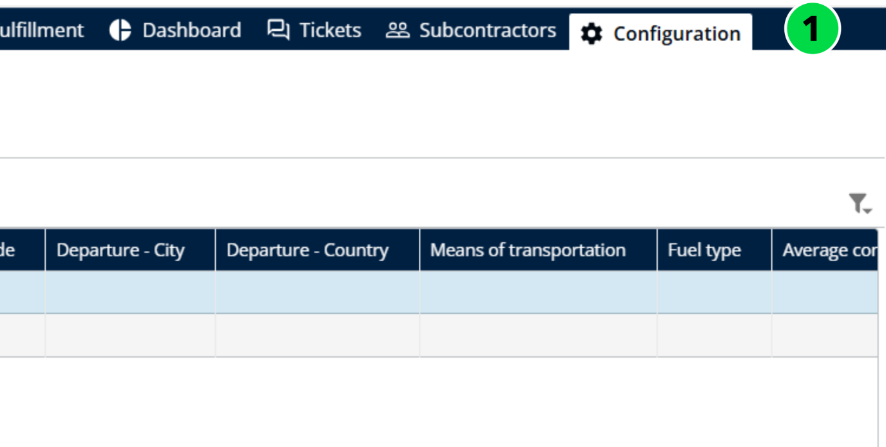
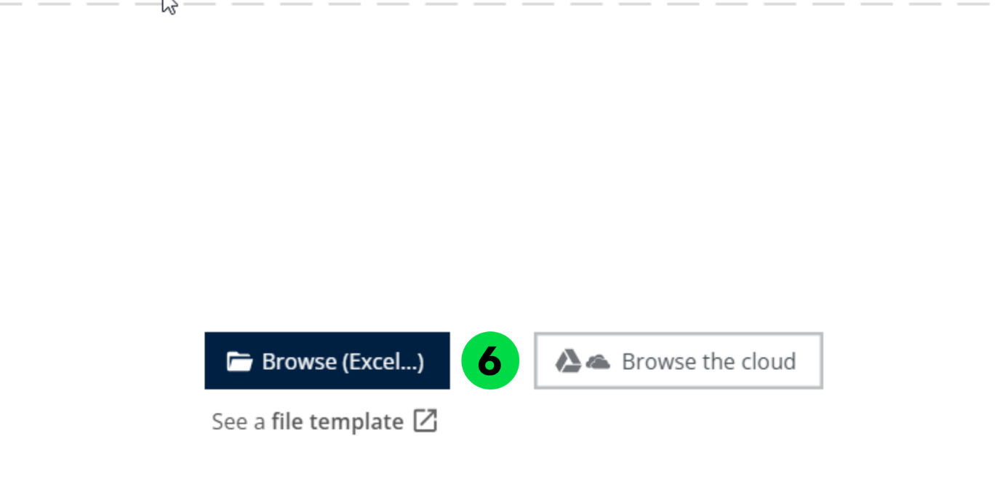
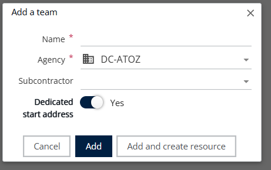
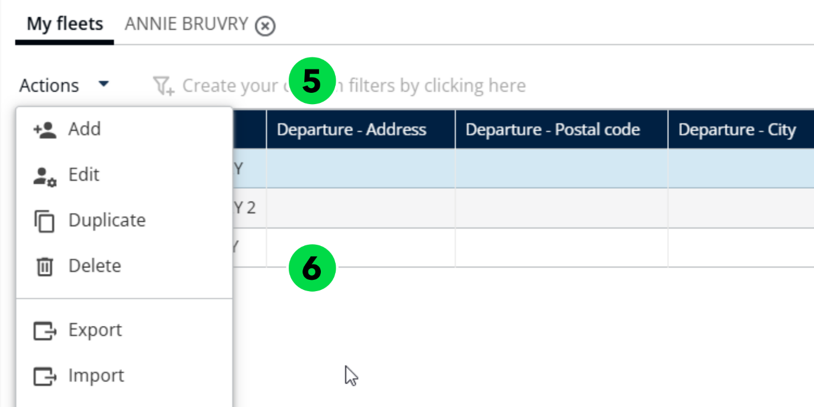

# Manage Vehicle Fleets

The **Manage Vehicle Fleets** feature in Nomadia Delivery allows administrators and planners to maintain an up-to-date registry of the vehicles used for delivery operations. This includes adding, editing, or deactivating vehicles, assigning specific characteristics, and ensuring that each vehicle is properly configured to meet logistical needs.

## Before you begin

* Access to the **Configuration** page.

## Import vehicle fleets

1. Open the **Configuration** page.

2. Under **My Data**, click on **Manage the Vehicles**.

3. Under **My Fleets**, click the **Actions** drop-down menu.
4. Click on **Import**.

5. Click on **Browse File** to upload the file.

6. Select a valid file from your local system.

### Result

The vehicle fleets have been imported successfully.

## Add a vehicle fleet

1. Open the **Configuration** page.
2. Under **My Data**, click on **Manage the Vehicles**.
3. Under **My Fleets**, click the **Actions** drop-down menu.
4. Click on **Add**.

5. Enter the **Name** and **Agency name**.

When adding a vehicle, enable the **Dedicated start address** toggle to edit the **Start address**.

6. Click on **Add**.

<figure><figcaption></figcaption></figure>

### Result

The address field is now enabled so you can edit it.

<figure><figcaption></figcaption></figure>

The vehicle fleets have been added successfully.

## Delete a vehicle fleet

1. Open the **Configuration** page.
2. Under **My Data**, click on **Manage the Vehicles**.
3. Select a **Team**.
4. Under **My Fleets**, click the **Actions** drop-down menu.
5. Click on **Delete**.

6. You will see a confirmation pop-up message stating: "Do you want to delete the Vehicle?"
7. Click on **Delete**.

### Result

The vehicle fleets have been deleted successfully.

## Related topics

* [Manage Vehicles in a fleet](manage-vehicles-in-a-fleet.md)
* [Customize the Constraints](customize-the-constraints.md)
