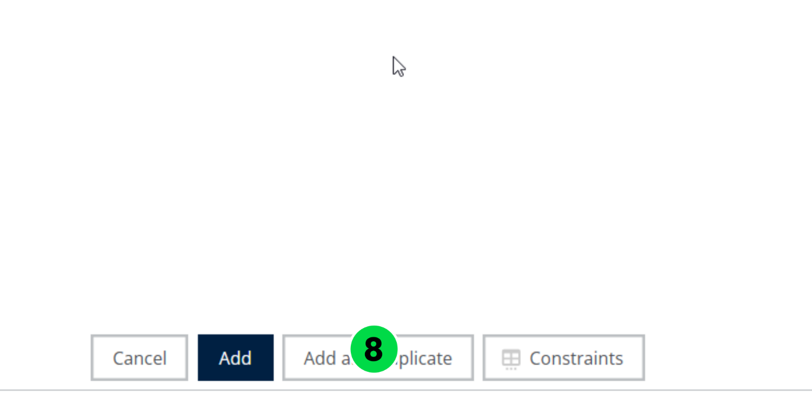
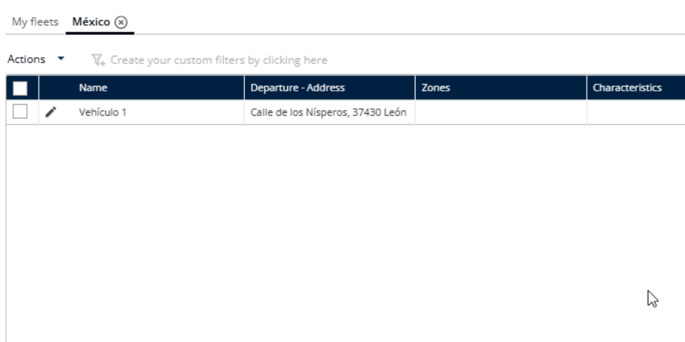
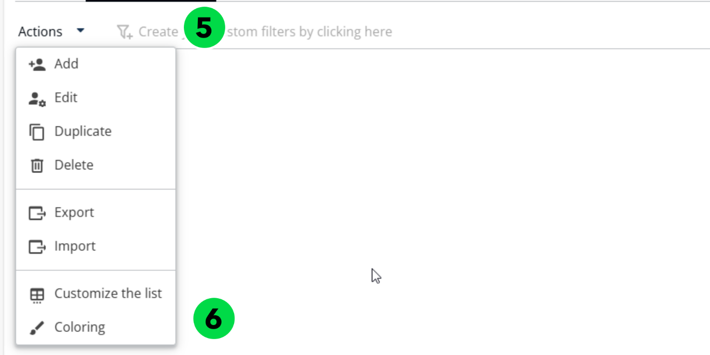
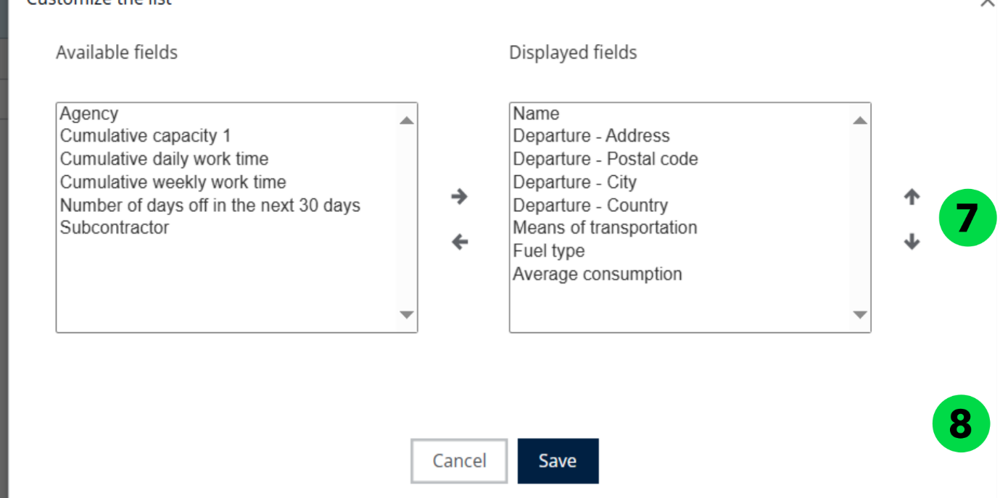

# Manage Vehicles in a fleet

Add, delete, export, color, and customize the display of the vehicles in a fleet.

## Before you begin

* Sign in to **Nomadia Delivery** with a user profile that has access to the **Configuration** page.
* Open **Manage the Vehicles** under **My Data** and select the fleet name you want to work with.

## Feature overview

* **Add**: Adds a vehicle with a **Name**.
* **Delete**: Deletes a vehicle after you confirm the pop-up message.
* **Export**: Exports the vehicles.
* **Coloring**: Applies a color to a vehicle.
* **Customize the list**: Lets you choose which fields to display on the vehicles table or on the vehicles fleets table.

## Add a vehicle

1. Go to **Configuration**.
2. Click the **Configuration** menu.
3. Under My Data, click **Manage the Vehicles**.
4. Click the desired name.
5. Click **Actions**.
6. Click **Add** from the dropdown menu.

7. Enter the **Name**.

8. Click **Add**.

## Delete a vehicle

1. Go to **Configuration**.
2. Click the **Configuration** menu.
3. Under My Data, click **Manage the Vehicles**.
4. Click the desired name.
5. Click **Actions**.
6. Click **Delete** from the dropdown menu.

7. Review the confirmation pop-up message that states: "Do you want to delete the Vehicle?"
8. Click **Delete**.

### Result

The vehicles are deleted successfully.

## Export a vehicle

1. Go to **Configuration**.
2. Click the **Configuration** menu.
3. Under My Data, click **Manage the Vehicles**.
4. Click the desired name.
5. Click **Actions**.
6. Click **Export** from the dropdown menu.

### Result

The vehicles are exported successfully.

## Color a vehicle

1. Go to **Configuration**.
2. Click the **Configuration** menu.
3. Under My Data, click **Manage the Vehicles**.
4. Click the desired name.
5. Click **Actions**.
6. Click **Coloring** from the dropdown menu.

7. Choose a color.
8. Click **Save**.

### Result

The color is applied successfully.

## Customize vehicles table

1. Go to **Configuration**.
2. Click the **Configuration** menu.
3. Under My Data, click **Manage the Vehicles**.
4. Click the desired name.
5. Click **Actions**.
6. Click **Customize the list** from the dropdown menu.

7. Choose which fields you want to display on the table.
8. Click **Save**.

### Result

The selected fields are displayed on the table successfully.

## Customize vehicles fleets table

1. Go to **Configuration**.
2. Click the **Configuration** menu.
3. Under My Data, click **Manage the Vehicles**.
4. Select a team.
5. Under My Fleets, click the **Actions** dropdown menu.
6. Click **Customize the list**.

7. Choose which fields you want to display on the table.
8. Click **Save**.

### Result

The selected fields are displayed on the table successfully.

## Tips


**Field selection**: Avoid selecting too many fields at once, as it may become difficult to read or navigate.


## Related topics

* [Manage Vehicle Fleets](README.md)
* [Customize the Constraints](customize-the-constraints.md)
