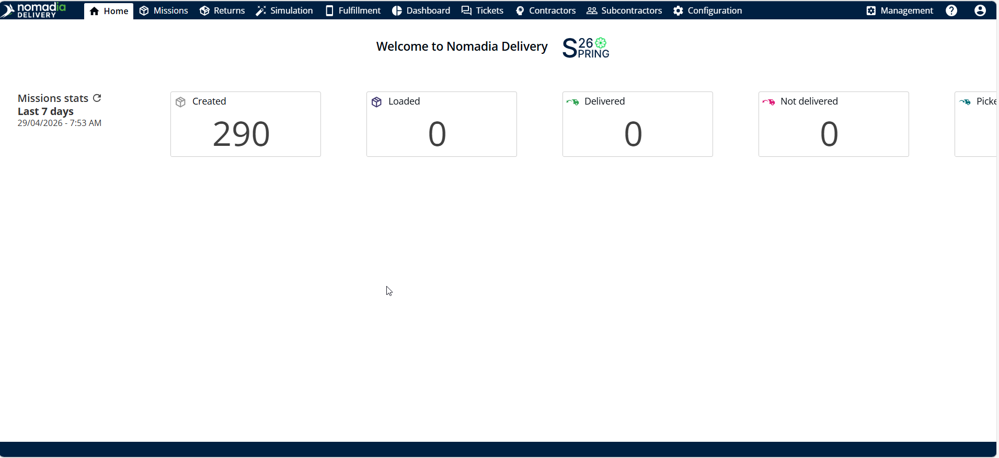

# Configure the Display of my KPI

You can personalize your Home Screen by selecting which KPIs are most relevant to your operations. Nomadia Delivery allows you to display the configured home page dashboard, along with a configurable calculation period ranging from the last day to the last seven days. This helps you stay focused on the metrics that matter most.

## Before you begin

* Sign in to **Nomadia Delivery** and open the **Home page**.
* Make sure a home page custom dashboard is available to choose from.

## Feature overview

* **Account icon**: Located in the upper-right corner of the screen; opens the dropdown menu.
* **My Preferences**: The option where you choose the dashboard and period.
* **Dashboard**: The Home page custom dashboard displayed on your home page.
* **Period**: The calculation period, ranging from Last Day to Last Seven Days.

## Configure the display of my KPI

1. From the **Home page,** click the **Account icon** located in the upper-right corner of the screen.
2. Select **My Preferences** from the dropdown menu.

<figure><figcaption></figcaption></figure>

3. Choose the **Dashboard** from the Home page custom dashboard.

<figure><figcaption></figcaption></figure>

4. Select a period ranging from Last Day to Last Seven Days based on your preference.
5. Click **Save**.

<figure><figcaption></figcaption></figure>

### Result

Your homepage displays the chosen dashboard.

<figure><figcaption></figcaption></figure>

## Tips


**Focus on key metrics**: Select the KPIs that are most relevant to your operations to stay focused on the metrics that matter most.


## Related topics

* [Home Page](README.md)
* [Understanding the Home Screen](understanding-the-home-screen.md)
* [Configure the display of mission’s statuses](configure-the-display-of-missions-statuses.md)
* [Refresh KPI date and Mission statuses](refresh-kpi-date-and-mission-statuses.md)
