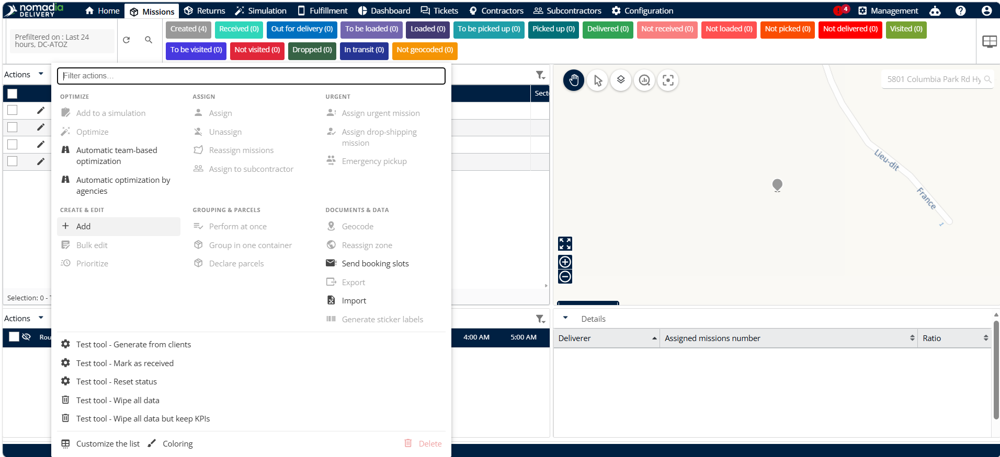
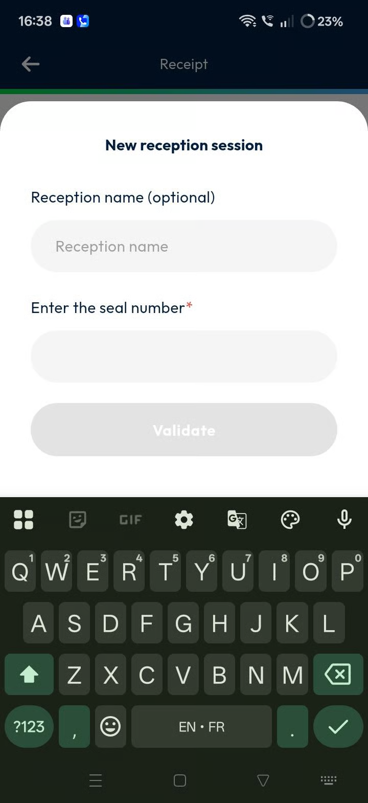
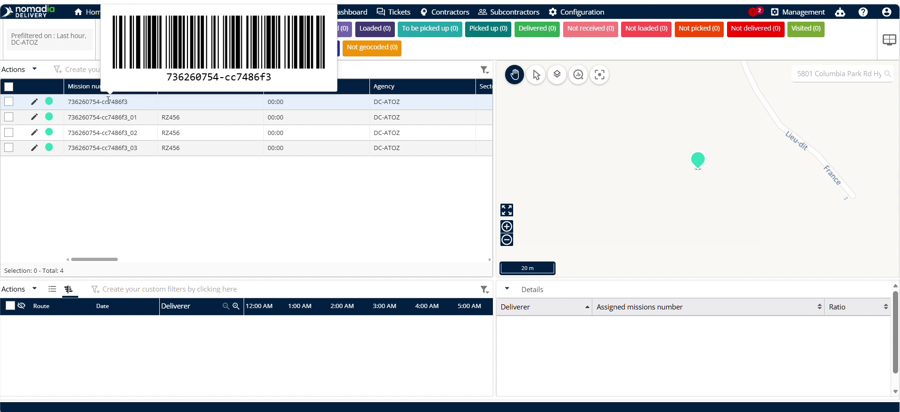
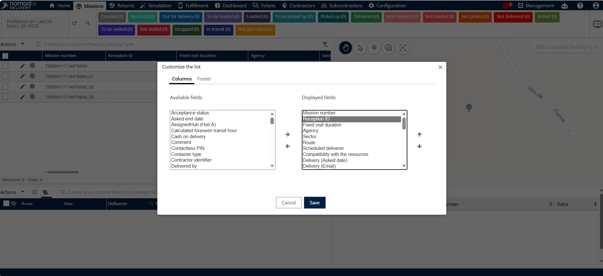

# Reception Management

The **reception management** feature allows dispatchers to manage, verify, and track container deliveries from the field. When a driver receives a container on the mobile application, the scans are logged against a reception, so you can monitor progress in real time and keep an accurate record of what was received.

It is used by dispatchers and back-office administrators, who configure the feature and follow receptions in the portal, and by field drivers, who scan and receive containers on the mobile application. Once enabled, complete reports are sent automatically to your contractors, which keeps inventory accurate and communication clear.

## Before you begin

Ensure you have the following system requirements and configurations set up:

* Access to the **Nomadia Delivery** back-office portal.
* A registered contractor email address to receive automatic reports.
* The mobile application installed on field devices.

Then complete the setup in this order:

1. Configure the mobile app for reception.
2. Configure a sub-status for scanning all items in the container.
3. Configure the reception report.

## Feature overview

The following UI elements control your reception tracking workflow:

* **Configure the mobile app**: Opens the mobile settings panel to customize field worker workflows.
* **Ask for reception ID**: Prompts drivers for a reception identifier to ensure all received shipments are uniquely tracked.
* **Scan all the items in the container**: Forces drivers to scan every package to prevent missed or incorrect deliveries.
* **Customize the list**: Adjusts columns in the back-office view to select displayed columns.

## How To: Configure the Mobile App for Reception

1. Navigate to the **Configuration** menu in the portal.
2. Click **Configure the mobile app**.

3. Enable the **Ask for reception ID** and **Send reception report** toggles under the **Reception** column.
4. Click **Save** to apply the configuration.

<figure><figcaption></figcaption></figure>

### Result

The next time drivers open the mobile application, the reception option is available and they are asked for a reception ID.

## How To: Configure a Sub-Status for Scanning All Items in the Container

1. Navigate to the **Sub Status** menu in the portal.
2. Locate the **Received** sub-status in the list.
3. Click the **pencil icon** next to the **Received** sub-status.
4. Enable the **Scan all the items in the container** toggle.
5. Click **Save** to update the sub-status rules.

### Result

Drivers must now scan every item in the container before the **Received** sub-status can be applied.

## How To: Associate a Contractor with a Mission

1. Navigate to the **Missions** menu.
2. Click **Add** or edit an existing mission.

<figure><figcaption></figcaption></figure>

3. Select the associated **Contractor** for the mission.

<figure><figcaption></figcaption></figure>

4. Click **Add** to save the mission.

<figure><figcaption></figcaption></figure>

## How To: Configure the Reception Report

1. Go to **Configure Outgoing Messages**.
2. Create an email template for the reception report.
3. As soon as the mobile user ends the reception, the email is automatically sent to the contractor's email address.

## How To: Scan and Receive Containers in the Mobile Application

1. Open the mobile application on your field device.
2. Click the **+** icon at the bottom
3. Enter the **Reception name** and **Reception ID** when prompted and click **validate**

<figure><figcaption></figcaption></figure>

4. Scan the **Parent container form**.

5. Tap the Tick mark at the bottom.&#x20;
6. You will get a pop up stating "Are you sure you want to finish receiving scanned messages"
7. Click **confirm**

<figure><figcaption></figcaption></figure>

## How To: Display Reception IDs in the Back-Office List

1. Navigate to the main list view in the portal.
2. Click **Customize the list**.
3. Locate the **Reception ID** field and ensure it is selected for display.
4. Click **Save** to update the list columns.

<figure><figcaption></figcaption></figure>

5. Verify the entered **Reception ID** is visible in the list.

## Tips


**\[Forced Verification]**: Enable **Scan all the items in the container** under **Received** sub-status to prevent drivers from skipping verification.

