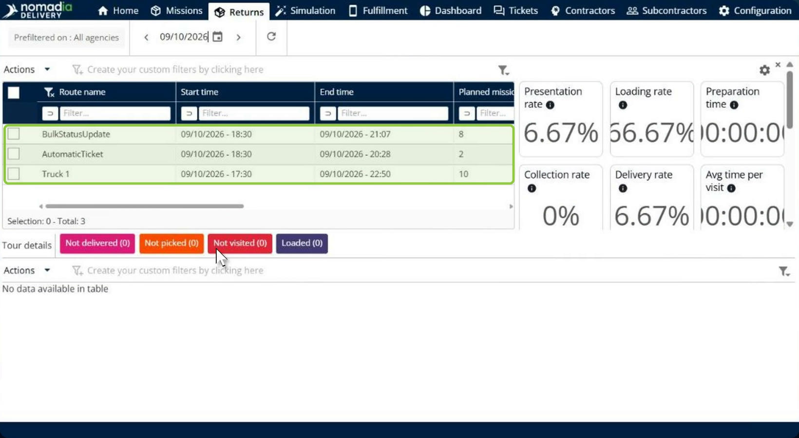
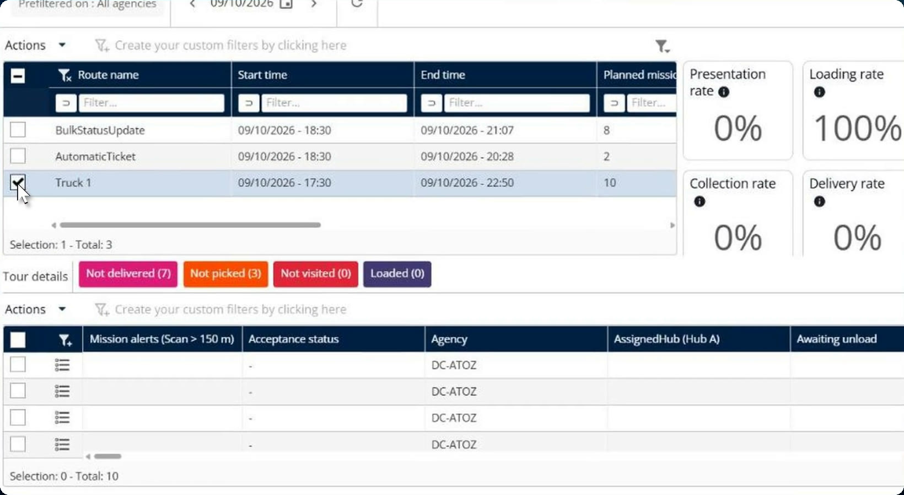
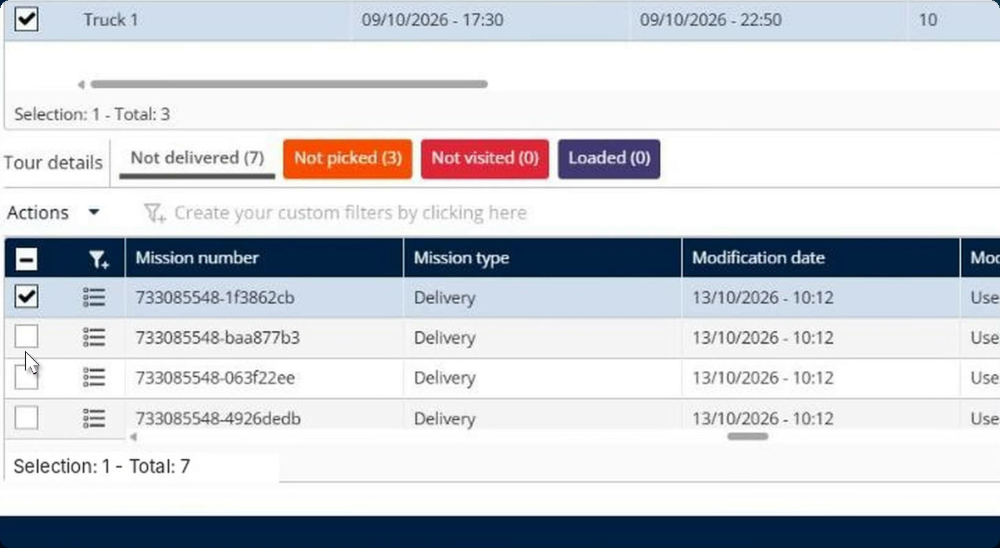
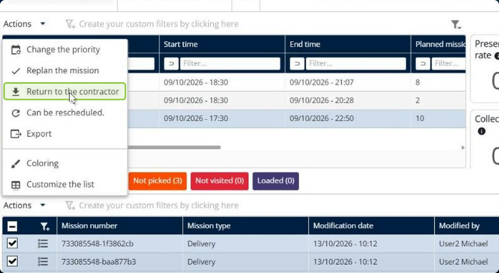
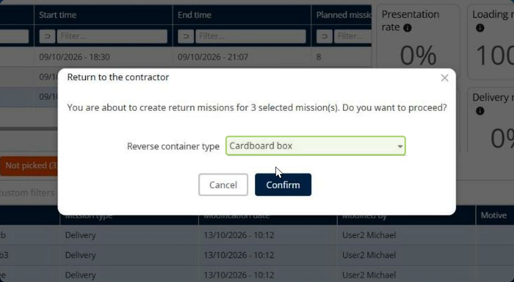
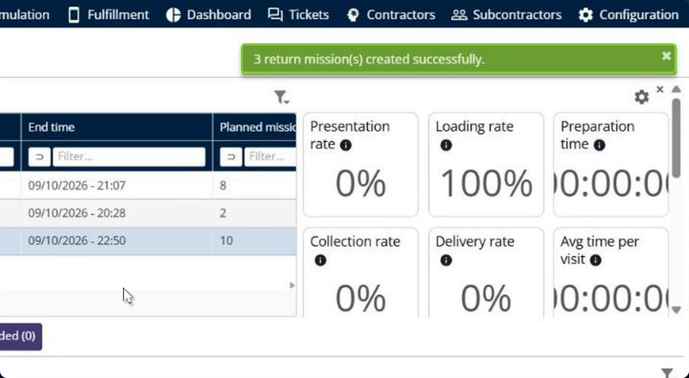
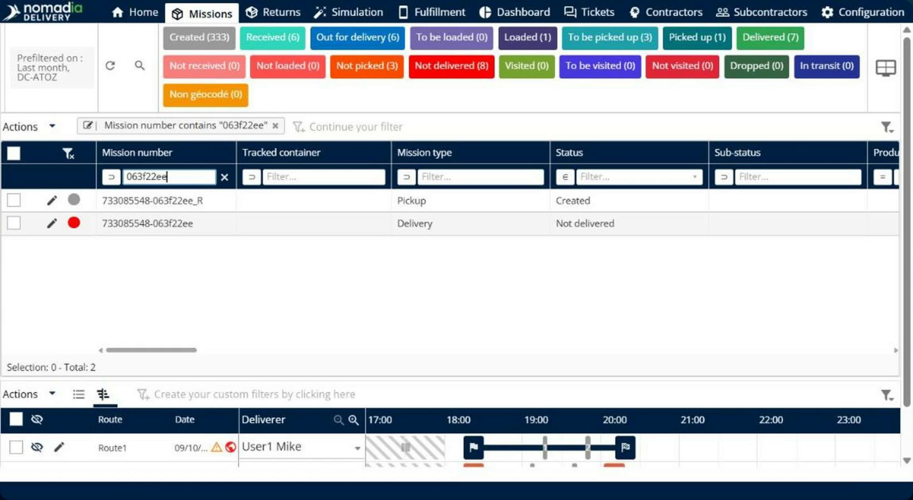
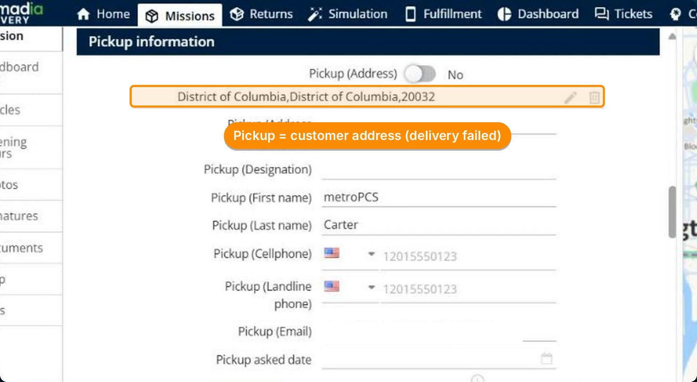
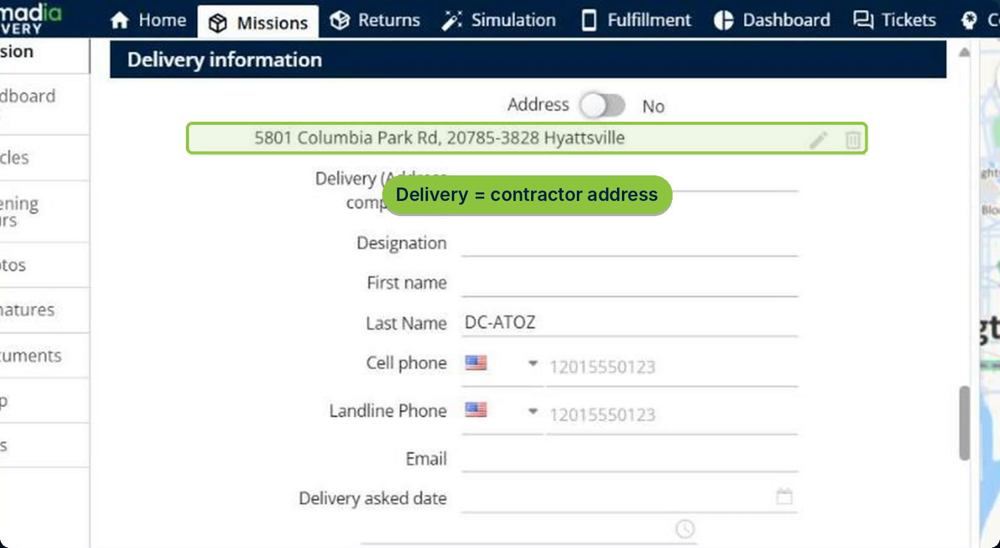

# Return to Contractor

Return to contractor creates the return missions for parcels that could not be delivered, in a single action. From the **Returns** page, you select the not-delivered or dropped items of a route and send them back to the contractor. Nomadia Delivery creates one return mission per item, with the pickup and delivery addresses reversed, and shows a summary of the returns that succeeded and any that failed.

## Before you begin

* Sign in to **Nomadia Delivery** with a user profile that has access to the **Returns** page.
* Make sure the route has missions in the **Not delivered** or **Dropped** status.

## Feature overview

* **Returns page**: The page of the main header that lists the routes of the selected day, with their delivery indicators and, under **Tour details**, the missions grouped by result: **Not delivered**, **Not picked**, **Not visited** and **Loaded**.
* **Return to the contractor**: The action, in the **Actions** menu of the mission list, that creates the return missions for the selected items. It applies to missions that are **Not delivered** or **Dropped**, and works for containers or individual items.
* **Reverse container type**: The container type used for the return missions, for example **Cardboard box**. You choose it in the confirmation window.
* **Return mission**: The new mission created for each item. Its number is the number of the original mission followed by **\_R**, its mission type is **Pickup**, and its status is **Created**.
* **Reversed addresses**: In the return mission, the pickup address is the customer address where the delivery failed, and the delivery address is the contractor address.

## Create return missions

1. From the main header, click **Returns**, and then select the route that has undelivered items, for example **Truck 1**.

2. Under **Tour details**, click **Not delivered** to list the missions that were not delivered on this route.

3. Select the missions you want to return. You can select individual items, or click the checkbox in the table header to select them all. The selection counter below the table shows how many missions are selected.

4. Click **Actions**, and then click **Return to the contractor**.

5. In the **Return to the contractor** window, read the message, which tells you how many return missions will be created. Choose the **Reverse container type**, and then click **Confirm**.

### Result

A notification confirms how many return missions were created, for example **3 return mission(s) created successfully.** If a return can't be created, it is listed with the reason, so you can follow up straight away.

## Check a return mission

1. On the **Missions** page, filter the **Mission number** column on the number of the original mission. The return mission appears next to it, with the same number followed by **\_R**, the **Pickup** mission type and the **Created** status.

2. Open the return mission. In **Pickup information**, the pickup address is the customer address where the delivery failed.

3. In **Delivery information**, the delivery address is the contractor address.

## Tips


**Return several items at once**: You can select all the not-delivered missions of a route and create every return mission in one action, instead of creating them one by one.



**Find return missions quickly**: Every return mission ends with **\_R**. Filter the **Mission number** column on **\_R** to list all the returns.


## Related topics

* [Missions](8-6-missions/README.md)
* [Contractors](9-7-contractors/README.md)
* [Bulk Update Mission Status](8-6-missions/bulk-update-mission-status.md)
